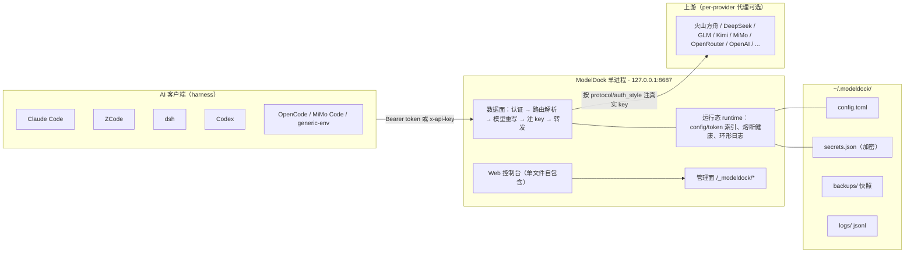
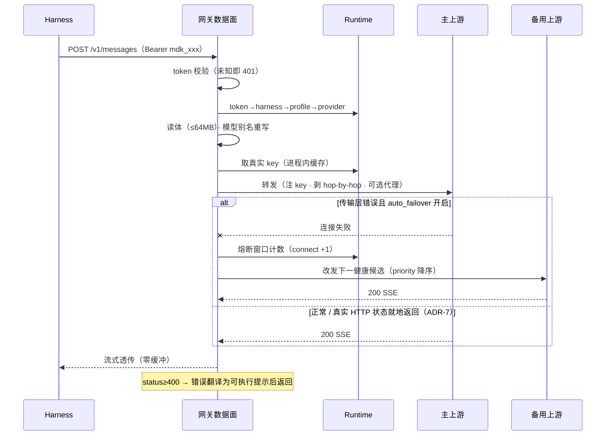
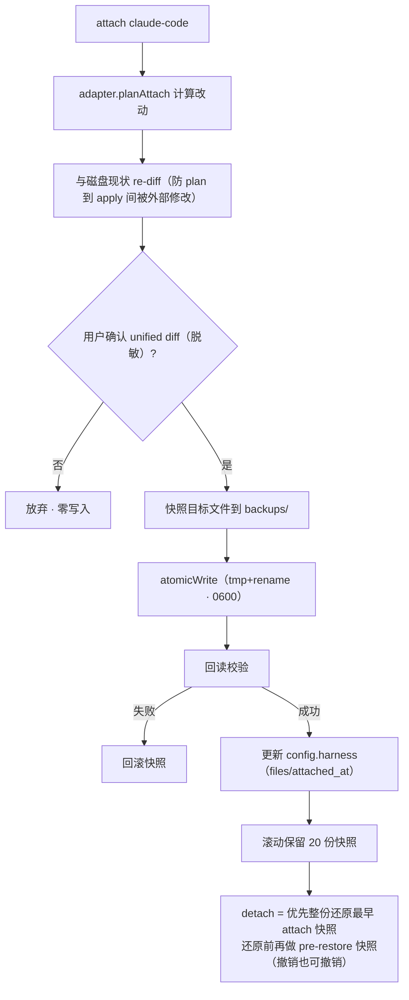
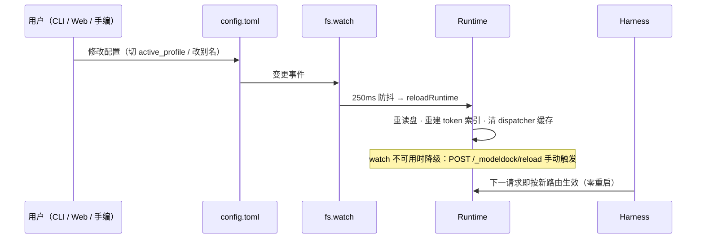

# ModelDock 概要设计说明书

| 文档属性 | 内容 |
|---|---|
| 当前版本 | **v1.0 · 发布基线** |
| 对齐实现 | 公开仓库 v1.0.0（git tag，2026-10-11 发布）；develop 分支 |
| 作者 | ObsidianTrine |
| 日期 | 2026-10-11 |

**版本历史**

| 版本 | 日期 | 说明 |
|---|---|---|
| v1.0 | 2026-10-11 | 初版（随公开仓库 v1.0.0 发布）：以实现为准（as-built）的概要设计——术语表、ADR 决策（网关为主/配置即 TOML/密钥分层/纯 JS 依赖/SEA 检测/failover 语义/别名透传/定时切换实时求值）、双槽位路由选路语义、子系统设计、接口设计、关键流程、威胁模型、非功能指标、测试映射（642 例 / 46 条命令 / 20 预设基线）、风险处置与规划项现状 |

**评审记录**（评审后填写）

| 评审人 | 日期 | 结论 | 意见摘要 |
|---|---|---|---|
| | | | |

## 目录

1. [引言](#1-引言)
2. [背景与目标](#2-背景与目标)
3. [总体架构](#3-总体架构)
4. [关键设计决策（ADR）](#4-关键设计决策adr)
5. [子系统设计](#5-子系统设计)
6. [接口设计](#6-接口设计)
7. [关键流程](#7-关键流程)
8. [数据与目录布局](#8-数据与目录布局)
9. [安全设计](#9-安全设计)
10. [非功能设计](#10-非功能设计)
11. [测试与验收](#11-测试与验收)
12. [里程碑与实施现状](#12-里程碑与实施现状)
13. [风险与开放问题（v1.0 处置结论）](#13-风险与开放问题v10-处置结论)
14. [附录：评审关注点](#14-附录评审关注点)

---

## 1. 引言

### 1.1 目的与读者

本文是 ModelDock 的概要设计说明书，用于技术评审与后续详细设计/维护的基准。读者为具备工程背景的评审人与贡献者。文中所有"已实现"描述均以 v1.0.0 源码为准并标注关键源码位置；未实现的能力一律显式标注「规划中」，避免设计与实现的口径漂移。

### 1.2 范围

**覆盖**：单机形态下的配置托管、API 网关、客户端接入（attach）、备份还原、导入、诊断、Web 控制台、跨平台打包（SEA）。
**不覆盖**（单机核心之外的子系统已独立详设并实施，细节见各自文档）：多机配置同步与云端控制面（[design-cloud-sync.md](./design-cloud-sync.md)——M1–M3c 已随 v1.0.0 发布，剩 M4 与 VPS 真机验收）、自动更新（[design-auto-update.md](./design-auto-update.md)——M1/M2 已发布、M3 暂缓待 VPS）。网关数据面仍仅监听 `127.0.0.1` 单用户；远程能力（LAN 手机控制台 `/m`、云端控制面）经上述两份详设承载。

### 1.3 术语表

| 术语 | 定义 |
|---|---|
| harness | AI 编码客户端（Claude Code、ZCode、dsh、Codex、OpenCode、MiMo Code 等），经适配器接入 ModelDock |
| provider | 上游模型服务：`base_url` + 协议 + 认证方式 + key 引用（存于安全后端） |
| profile | 路由档案：provider + 默认模型 + 别名映射 + 可选 fallback 链 |
| alias | 模型别名映射（支持 `*` 通配），如 `claude-sonnet-* → deepseek-v4-flash` |
| attach / detach | 接管 / 还原某个 harness 的配置（先预览 diff、自动快照） |
| adapter | harness 适配器，三层体系：L1 内置 / L2 声明式 pack / L3 外部插件（规划中） |
| token | 网关为每个 harness 颁发的本地凭据（`mdk_` 前缀），替代真实上游 key |
| admin token | 管理面凭据（`mdkadm_` 前缀），记录在运行态文件 `gateway.json` |
| secret store | 上游 key 的安全存储后端（macOS Keychain / Windows DPAPI / Linux Secret Service / 加密或 0600 文件） |
| snapshot | 任何写盘前对目标文件的自动快照（manifest + sha256 校验） |
| active_profile | 全局默认路由；`route=default` 的 harness 跟随它 |
| 熔断（meltdown） | 60s 滑动窗口错误计数触发的临时摘除，避免持续打故障上游 |
| 定时切换（schedule） | 按时段把流量优先走 / 避开指定服务的窗口配置；每次请求实时求值（ADR-9），生效日支持星期几与日类型（工作日 / 周末 / 法定节假日） |
| SEA | Node.js Single Executable Application，单文件可执行打包 |

### 1.4 参考资料

`AGENTS.md`（工程约定）、`docs/usage.md`（使用指南）、`CHANGELOG.md`（版本记录）。

---

## 2. 背景与目标

### 2.1 问题陈述

每个 AI 编码客户端各自维护 `base_url` + API Key：切换供应商要逐个改配置、部分还要重启；key 以明文散落在各处配置文件中；模型分层映射（sonnet/opus/haiku → 不同上游模型）要在每个客户端里重复配置。

### 2.2 设计目标与非目标

**目标**

1. **一次接入、零成本切换**：harness 指向网关后，供应商/模型切换只在 ModelDock 侧完成并即时生效，harness 配置零改动。
2. **key 集中保管**：真实上游 key 只存于 ModelDock 安全后端，harness 配置中只出现本地 token。
3. **非侵入**：未 `attach` 前对现有 harness 零写入；所有写入先 diff 预览、自动快照、可还原。
4. **开箱即用**：内置预设库 + 模型目录自动获取 + 首启向导，安装到跑通 ≤5 分钟。
5. **可诊断**：`test` / `doctor` / `status` / `logs` 回答"通不通、慢不慢、哪里坏了"。
6. **可分发**：跨平台单文件可执行（SEA），无 Node 环境依赖。

**非目标**

- 远程访问、多用户、多机高可用（本机单用户工具，设计如此）。
- prompt 内容审计、代理缓存（日志不落请求体）。
- 上游协议全量模拟：按 anthropic / openai / responses 三协议端点直连透传，协议互相转换规划于 M3。
- 云同步与多机能力（Phase 2 另行详设，**已实施**，见 §1.2 范围注记）。

### 2.3 设计依据：本机现状盘点

| harness | 配置位置 | 协议 | 现状 |
|---|---|---|---|
| Claude Code | `~/.claude/settings.json` | anthropic | 经 cc-switch 代理 → 火山 Coding Plan；`DEFAULT_*_MODEL` env 做模型分层映射 |
| ZCode | `~/.zcode/v2/config.json` | anthropic | bigmodel/zai 多 provider 注册表 |
| dsh | `~/.dsh/settings.yaml` + `.credentials.yaml` | anthropic-messages / openai-completions | providers 带 `apiKeyEnv` 间接层 |
| Codex | 未安装 | openai/responses | 列入适配目标 |
| cc-switch | `~/.cc-switch/cc-switch.db` | — | 现任切换器，含火山/DeepSeek/小米 MiMo 档案 |

关键结论（设计输入）：① 本地代理模式已被 cc-switch 验证可行；② 各上游均提供 Anthropic 兼容端点，协议同质化高，透传式网关成立；③ 模型分层映射是重度真实需求，须为一等能力（别名系统）；④ 本机存在 clash 代理，部分国外上游需 per-provider 代理配置。

---

## 3. 总体架构

### 3.1 架构图



### 3.2 模块划分

| 模块（`src/`） | 职责 |
|---|---|
| `cli.ts` | 入口三路分发：`--sea-gateway` 起守护；SEA 无参双击起 GUI；其余走 commander（勿破坏） |
| `cli/` | 46 条 CLI 命令（§6.1） |
| `config/` | config.toml 读写（`store.ts`）、类型定义（`types.ts`）、key 安全后端（`secrets.ts`） |
| `gateway/` | HTTP 网关（`server.ts` 数据面+管理面）、转发与重写（`relay.ts`）、运行态与健康（`state.ts`）、上游代理（`proxy.ts`）、Web 控制台（`ui.ts`，单文件内联 HTML/JS） |
| `adapters/` | 适配器契约（`types.ts`）、L1 内置 8 个、L2 pack 引擎（`packs.ts`）、落盘引擎（`engine.ts`） |
| `backup/` | 快照、sha256 校验还原、滚动保留 |
| `import/` | 存量配置只读扫描与收编：cc-switch（含 v3 Codex/Gemini 行）/ Claude Code / Codex / dsh / ZCode / OpenCode / MiMo Code / WorkBuddy / claude-code-router / Crush / Gemini CLI + one-api/new-api 渠道拉取（管理 API） |
| `presets/` | 内置 20 个 provider 预设（含模型元数据与多协议端点；另有 `presets.json` 用户扩展） |
| `providers/` | 模型目录拉取（`fetch.ts`）、已知模型元数据表（`known.ts`）、dsh catalog（`dshcatalog.ts`） |
| `sync/` + `cloud/` | 多机配置同步（syncdoc 数据模型、同步代理、WebDAV/localdir 目标）与云端控制面（独立进程，详设见 design-cloud-sync.md） |
| `update/` | 自更新：检查 → 下载（镜像回退链）→ SHA256 校验 → 替换 → 重启网关；Web 控制台/托盘入口（详设见 design-auto-update.md） |
| `install/` + `cliinstall.ts` | 客户端自动安装元数据与执行（含托管 Node bootstrap、EBADENGINE 钉版健康检查） |
| `autostart.ts` / `ops.ts` | 开机自启服务文件生成（三平台）与重置/卸载运维 |
| `util/i18n.ts` | 双语文案：`t(中文, English)`，语言链 `--lang` > `MODELRDOCK_LANG` > config.toml > zh |
| `gateway/lan.ts` + `cookies.ts` | LAN 手机控制台（第二监听器 `/m` + 二维码 + PWA）与会话 cookie |
| `gateway/daytype.ts` + `holidays.ts` | 定时切换生效日判定（holiday-cn 缓存日历：工作日/周末/法定节假日） |
| `util/` | 路径（`paths.ts`）、原子写（`fsx.ts`）、diff/脱敏、JSONPath、glob |

### 3.3 运行形态

| 形态 | 入口 | 说明 |
|---|---|---|
| 开发 | `npm run dev -- <cmd>` | tsx 直跑源码 |
| 分发 | Releases 安装包 / 源码构建（`bin.modeldock → dist/cli.js`） | commander CLI |
| SEA 单文件 | 可执行文件名以 `modeldock` 开头 | 双击 → 后台 spawn `--sea-gateway` → 打开浏览器控制台；带参则等价 CLI |

SEA 检测以 `process.execPath` 文件名判断（ADR-6）。守护进程单实例：读 `gateway.json`，pid 存活且 `/_modeldock/health` 可达则拒绝二次启动。

### 3.4 技术选型与约束

- **TypeScript（ESM，NodeNext）+ Node ≥22**；运行依赖仅 5 个纯 JS 包：`commander`、`undici`（含 ProxyAgent 流式转发）、`smol-toml`、`yaml`（Document API 保注释）、`@inquirer/prompts`。
- **硬约束：全部纯 JS、无 native addon**——SEA 单文件打包的前提（ADR-5）。
- 密钥后端调用平台原生子进程（macOS `security` CLI / Windows PowerShell DPAPI / Linux `secret-tool`）；SQLite 读取（cc-switch）优先内置 `node:sqlite`。

---

## 4. 关键设计决策（ADR）

| # | 决策 | 备选方案 | 理由 |
|---|---|---|---|
| ADR-1 | **网关为主、配置写入为辅** | 纯写入器（cc-switch 模式） | 见下表对比：切换零成本、key 零暴露、可叠加别名/日志/failover。写入器保留为 bootstrap 与 `attach --mode file` 降级路径 |
| ADR-2 | **配置即 TOML 文本**（`config.toml` 用户可直编 + fs.watch 热加载） | JSON / SQLite | 可 diff、可手编、可纳入 dotfiles；SQLite 不透明且违背"配置即文本" |
| ADR-3 | **密钥分层安全后端 + 绝不回退明文** | 统一明文 0600 / 强制 OS keychain | 跨平台可用性与安全强度平衡；解不开宁可控失败也不落明文（§9.3） |
| ADR-4 | **单进程同时承载数据面与管理面** | 数据面/管理面分离进程 | 本地单用户工具，运维面最小化；管理面有独立鉴权边界（§9.2） |
| ADR-5 | **纯 JS 依赖、禁 native addon** | 使用 native 加速包 | SEA 单文件打包前提，工程约束优先 |
| ADR-6 | **SEA 检测走 `process.execPath` 文件名** | `import.meta.url` / sea-config env | postject 注入下 `import.meta.url` 失效；esbuild CJS 输出下为空 |
| ADR-7 | **failover 只切传输层错误**（连接拒绝/重置/超时等），真实 HTTP 状态（含 429/5xx）就地返回 | 对 5xx/429 也切换 | 避免同一请求对多上游重复计费；429/5xx 可能是账号/模型配置问题，换服务大概率同样失败 |
| ADR-8 | **别名未命中透传原始模型名** | 未命中报错 | 上游新模型零配置即可用；`default_model` 仅在请求完全缺 model 字段时兜底 |
| ADR-9 | **定时切换每次请求实时求值**（选路时现算命中窗口，无后台定时器 / 无切换指针） | 后台定时器到点改写 active_profile / 维护运行态切换指针 | 无定时误差与重启补切问题；配置修改经热加载即时生效；并发选路无共享状态；窗口目标不可用时每次请求自然降级 |

**ADR-1 对比明细**

| | A. 本地网关（主） | B. 配置写入器（辅） |
|---|---|---|
| 原理 | harness 指向 `127.0.0.1:8687`，网关转发并注入真实 key | CLI 把 url/key 直接写进 harness 原生配置 |
| 切换成本 | 0（改路由即热生效） | 重写文件，部分 harness 需重启 |
| key 暴露面 | 只在 ModelDock | 散落各配置文件 |
| 依赖 | 需常驻守护进程 | 无 |
| 附加能力 | 别名重写 / 用量日志 / failover | 无 |

---

## 5. 子系统设计

### 5.1 网关数据面

**请求生命周期**（`src/gateway/server.ts` / `relay.ts`）：

1. 监听 `127.0.0.1:8687`；`EADDRINUSE` 时端口 +1 重试最多 10 次，实际端口回写 `gateway.json` 并提示（attach 以实际端口写入）。
2. URL 分流：`/_modeldock/*` → 管理面；无 token 的 `GET /` → 302 控制台；`/favicon.ico` → 204；**其余所有路径不设白名单**，认证后整体透传上游。
3. 认证（双轨）：`x-modeldock-admin` 头（CLI 用，可附 `x-modeldock-profile` 覆盖路由）→ 管理面；否则取 `Authorization: Bearer` 或 `x-api-key` → token→harness 索引；未知 token 401。
4. 路由解析：profile 覆盖 → harness 钉死的 `route`（非 `default` 时）→ `active_profile`；任一层缺失返回 503 + 可执行修复提示。
5. 读请求体上限 64MB（超出 413）。
6. **模型重写**：仅对 6 条路由路径生效（`/v1/messages`、`/v1/messages/count_tokens`、`/v1/chat/completions`、`/v1/completions`、`/v1/responses`、`/v1/embeddings`）；规则为精确 alias 优先于 `*` 通配，未命中透传，无 model 字段注入 `default_model`（ADR-8）；例外：Claude 内置模型名（`claude-*`）未命中别名时改写为 `default_model`（开箱即用），discovery 别名（`anthropic.` 前缀 ID）转发前还原真实 ID；其余路径纯透传。**`GET /v1/models` 本地合成**（不透传上游）：返回当前选路目标服务的模型目录（显示名 + ID，Anthropic 形状为主、兼容 OpenAI 字段），跟随钉定路由与手动切换——上游目录不等于用户筛选过的目录，上游也未必实现该接口。
7. **出站构造**：按入站 path 推断客户端协议，取 `provider.endpoints[protocol]`（缺端点 400 可操作错误）；剥离 hop-by-hop / host / content-length / 入站凭据头；按 `auth_style` 注入真实 key（anthropic 补 `anthropic-version: 2023-06-01` 缺省值）。
8. **上游代理**：`provider.proxy = direct | env | http://...`（undici ProxyAgent，兼容 clash），dispatcher 按 provider 缓存。
9. **转发**：`gateway.auto_failover` 开启时按候选链切换（候选链构成与定时切换见下两节），否则直发；传输层连接错误重试 1 次。
10. **响应**：过滤响应侧 hop-by-hop 与 content-length；status < 400 时 `pipeline` 流式透传（SSE 零缓冲）；≥ 400 时读全文、经错误翻译后以 JSON 返回。
11. **日志**：内存环形 500 条 + 按天 `gateway-*.jsonl` 与操作审计 `audit-*.jsonl`；不落请求体。

**超时与重试参数**

| 参数 | 默认 | 说明 |
|---|---|---|
| `gateway.port` | 8687 | 占用时 +1，最多 10 次 |
| `gateway.idle_timeout_ms` | 600000（10 min） | 流内空隙超时（undici bodyTimeout） |
| headersTimeout | 60 s | 上游响应头超时 |
| keepAliveTimeout | 75 s | 连接保活 |
| `gateway.retries` | 1 | 仅传输层连接错误类（ECONNREFUSED / ECONNRESET / ENOTFOUND / ETIMEDOUT / EPIPE / UND_ERR_CONNECT_TIMEOUT） |
| 请求体上限 | 64 MB | 超出 413 |
| 热加载防抖 | 250 ms | fs.watch 触发后合并 |

**自动路由候选链**（`gateway/state.ts` 的 `pickTarget` / `parseFallbackEntry`；恒启用——故障切换不依赖任何开关）

每次请求实时排出候选链，按序转发：

1. **主候选三级优先**：① `gateway.auto_route_provider` **人工钉定的主服务**（桌面/手机「当前」槽人工选择，人为修改优先于程序自动——含定时窗口；钉定持续到选回「自动」）→ ② 定时切换 prefer 窗口目标（可带 `服务ID:模型ID` 强制改写模型；**仅 `auto_failover` 开启时参与**——该开关语义为「程序自动选主」）→ ③ 默认路由主服务。高优先目标须通过可用性过滤（存在、`enabled !== false`、未熔断）才接管，否则顺延到下一级，不打死在坏服务上。
2. **fallback 链**：`gateway.route_next`（「下一个切换」槽人工钉定）存在时插到首位，其后为 `profile.fallback` 条目去重按 `priority` 降序、同 priority 按最近请求耗时升序（均无数据保持配置顺序）。
3. **链尾兜底**：钉定 / 窗口接管了主候选时，默认路由主服务排到整个候选链末尾（在用户显式 fallback 之后），保证高峰目标不可用时回落到默认服务而非直接报错。
4. 全部候选不可用 → 503（`reason=down_all`）。

**故障切换与熔断**（`gateway/state.ts` 的 `recordOutcome` / `isMeltdown`，`relay.ts` 的 `forwardWithFailover`）

**故障切换常开**：主候选不可达时按候选链自动改发，不与 `auto_failover` 绑定（该开关只控制定时窗口是否参与选主）；候选链只有主服务时行为与直连等价。按候选链逐个转发；仅**传输层错误**（连接拒绝 / 重置 / 超时等，请求未送达、可安全重放）改发下一候选（ADR-7）。例外：`gateway.failover_status_codes` 显式列出的状态码（如 429/503，上游未产出内容）在仍有剩余候选时切换，切换前排空响应体释放连接；未列出的已送达状态码一律就地返回，避免同一请求对多上游重复计费。

60s 滑动窗口错误计数：

| 错误类别 | 窗口内阈值 | 熔断时长 |
|---|---|---|
| 传输层连接错误 | 3 | 60 s |
| 429 | 5 | 120 s |
| 5xx | 10 | 60 s |
| 额度耗尽（402 / 429 带 quota 语义响应体） | 3 | 15 min（额度不会分钟级恢复，避免反复撞耗尽的服务） |
| 4xx（其余） | 不计数（中性：模型/key 配置类错误换服务大概率同样失败） | — |

熔断中的 provider 不作候选；解除条件为连续 3 次成功，另有 60s 周期探活清扫器在冷却期满后主动探活恢复。候选全部连接失败 → 502（`reason=down_all`）。

**定时切换**（`gateway/state.ts` 的 `hitScheduleWindows` / `activeScheduleWindow` / `activeAvoidTargets`）

- **求值模型**：`gateway.schedule.windows` 在每次选路时实时求值命中窗口（ADR-9），无定时器、无运行态——修改时段经热加载后下一请求立即生效。`start` 含、`end` 不含；`end < start` 视为跨午夜窗口，后半夜归属窗口起始日（星期几与日类型都按起始日判定）。
- **生效日**：窗口可配 `days`（星期几）与 `dayFilter`（日类型），同时配置取交集。日类型由 holiday-cn 缓存日历判定：`workday` = 周一至五与调休补班日（不含法定节假日）/ `weekend` / `holiday`；公告未覆盖的年份按星期几降级判定（宁可按普通周历走，不停用窗口）。
- **窗口模式**：`prefer`（缺省）= 时段内优先走 `target`（`服务ID:模型ID` 可强制改写模型）；`avoid` = 时段内从候选链剔除该服务（仅服务粒度，模型部分忽略）。
- **多窗口重叠消解**：多个 prefer 窗口同时命中时**按配置顺序取首个**，其余窗口不参与（即使首个目标不可用也不顺延到次一个 prefer 窗口，而是整个 schedule 层降级）；avoid 窗口彼此独立、命中即全部生效，且可与 prefer 叠加（prefer 目标恰被 avoid 时同样被剔除、顺延后续候选）。保存端点不检测重叠、无警告——顺序即语义。
- **降级与软约束**：prefer 目标不可用（下线 / 熔断）时该窗口不接管，按三级优先顺延（默认主服务）；主服务被人工钉定时窗口整体让位（钉定 > 窗口）；avoid 剔除后候选链为空时，从链外其余可用服务按 `priority` 降序补入；仍无可用则回退被避开的原链——宁可用被避开的服务也不断供。
- **保存校验**（`/_modeldock/auto-route/schedule`，整体替换 `{enabled, windows}`）：逐条校验 HH:mm 格式、起止不同、目标服务存在、`mode` / `dayFilter` 枚举；清空窗口即删除 schedule 配置。

**上游错误翻译**（可执行提示）：401/403 → 提示 `provider set-key`；404 + 模型名 → 提示 `model refresh` 或切 profile；400 + context 关键词 → 上下文超限建议；429 → 限流提示。JSON 原文注入 `modeldock: {hint, provider, model}` 字段后透出。

### 5.2 网关管理面与运行态

- **端点清单**见 §6.2；鉴权模型见 §9.2。
- **热加载**：fs.watch 监听 `~/.modeldock/`，`config.toml` / `secrets.json` 变更经 250ms 防抖后重建运行态（重读盘、重建 token 索引、清 dispatcher 缓存）；watch 不可用时降级为提示，可 `POST /_modeldock/reload` 手动触发。任何配置修改（CLI / Web 控制台 / 手编文件）都经此路径**零重启生效**。
- **运行态文件 `gateway.json`**（0600）：pid / port / admin_token / started_at；供单实例判定与 CLI 取 admin token。
- **开机自启（常驻，`gateway install/uninstall` + `POST /_modeldock/autostart`）**：注册为系统服务——macOS LaunchAgent（RunAtLoad + KeepAlive，崩溃自动拉起）、Linux systemd user unit（Restart=always）、Windows 启动文件夹 VBS（登录自启，无崩溃拉起）。daemon 命令按安装形态推导（SEA→自身 `--sea-gateway`；npm→`node <cli.js> --sea-gateway`；dev→tsx 直跑 cli.ts），argv 以 base64 注记随服务文件落盘，status 可检出 nvm 升级/二进制移动导致的路径失效（stale）。运行中安装只登记文件不 bootstrap（第二个实例会被单实例保护拒掉、KeepAlive 陷入重启循环），下次登录由服务接管；服务托管时 `gateway stop` 先 bootout 再停进程，避免与游离进程清扫互相拉锯；整机 `uninstall` 连服务文件一并移除。
- **写盘一致性**：管理面修改统一走「读盘 → 改 → 原子写 → 热加载」；数据面每请求路径不写任何配置文件，唯一磁盘写是日志追加且失败静默不挡转发。

### 5.3 Web 控制台（`gateway/ui.ts`）

单文件自包含（HTML + 内联 JS，无构建链、无外部资源），由 `GET /_modeldock/ui` 直接输出。三步式引导：

1. **添加服务**：预设 chips 快选、三协议端点勾选（anthropic / openai / responses）、key 粘贴录入、"拉取模型"预览（失败回退厂商已知模型表）、逐模型编辑上下文/最大输出。
2. **我的服务**：搜索/排序/过滤、"应用"全局切换（提示哪些客户端将跟随）、延迟 ping、端到端流式测速、编辑浮层、删除；路由双槽位（「当前」=主服务自动·A/人工钉定、「下一个切换」=备用自动·B/人工钉定）+「程序自动选主」开关。两个「自动」选项都写明程序会选谁——A 取 `ignoreManual` 链（忽略两处钉定），B 取 `ignoreRouteNext` 链（只清本槽钉定、保留主服务钉定/窗口/链尾兜底；若按忽略两处钉定算，主服务被钉定时链尾兜底会被一起抹掉、算不出名字）；候选链只有主服务（未配 `profile.fallback`）时 B 显示「自动 · 无备用服务」而不是光秃秃的「自动」。
3. **接入 AI 客户端**：客户端安装（自动命令或指引，见 §9.1 威胁 T7）、一键接入（先 `/attach/plan` 预览 diff，确认后 apply，自动快照可还原）、断开并还原。

附加：顶部健康条 5s 轮询；**一键迁移卡片**——扫描本机 cc-switch / Claude Code / Codex / dsh / ZCode / OpenCode / MiMo Code / WorkBuddy / claude-code-router / Crush / Gemini CLI 存量配置（含 key）一键导入，key 搬入安全存储、原软件不动，"暂不导入"以 localStorage 签名记住；底部请求日志常驻（4xx/5xx 标红）。

v1.0.0 已包含：**LAN 手机控制台**（第二监听器 `/m` 页，扫码带令牌接入 + PWA 常驻主屏，路由控件与桌面同口径；`/m/api/*` 端点，`mdklan_` 令牌持久化，cookie 名内嵌端口防双实例互踢）；**同步状态行**（多机同步只读状态 + 指引去 CLI 配置）；**更新检查入口**（徽标 + 弹层，`/_modeldock/admin/update/status|check|apply`，托盘菜单同步提供）；**「独立直连」救援通道入口**（琥珀警示样式，见 §5.5）；`config export/import` 加密配置包（.msync）在桌面与手机页均可导出导入。

### 5.4 配置与密钥存储

**config.toml schema**（`config/types.ts`，`version=1`，高于当前版本拒绝加载）：

| Section | 字段 | 说明 |
|---|---|---|
| 顶层 | `version` / `active_profile` | 版本迁移入口；默认路由 |
| `providers.<id>` | `base_url`（必填）、`protocol`（anthropic/openai/responses）、`auth_style`（bearer/x-api-key）、`key_ref`、`proxy?`、`enabled?`（默认 true）、`priority?`（默认 0）、`endpoints?`（每协议 base_url）、`models?` | 上游凭据与模型目录 |
| `providers.<id>.models.<modelId>` | `display_name?` / `context_window?` / `max_output?` / `capabilities?` / `source`（preset/fetched/manual） | 模型元数据 |
| `profiles.<name>` | `provider`、`default_model?`、`aliases?`（支持 `*` 通配）、`fallback?`（string[]） | 路由档案 |
| `harness.<id>` | `mode`（gateway/file）、`route?`（default=跟随 active_profile）、`token?`、`attached_at?`、`files?` | 接入状态。`mode=file` 为 schema 预留枚举，当前所有内置适配器均按网关模式写入 |
| `adapter_packs.<id>` | `format`（json/toml/yaml）、`config_file`、`detect?`、`upsert`（路径表达式 → 值模板，变量 `{token}{port}{base_url}{base_url_openai}`） | L2 声明式接入 |
| `gateway` | `port?` / `idle_timeout_ms?` / `headers_timeout_ms?` / `retries?` / `auto_failover?`（程序自动选主开关，默认 false；故障切换不受影响）/ `auto_route_provider?`（「当前」槽人工钉定）/ `route_next?`（「下一个切换」槽人工钉定）/ `failover_status_codes?`（已送达状态允许切换的备用状态码，默认空）/ `schedule?`（定时切换：windows / enabled；窗口带 dayFilter 生效日类型，节假日日历由 holiday-cn 缓存判定） | 网关行为 |
| `security` | `store?`（file/keychain） | 密钥后端显式覆盖 |
| `backup` | `keep?` | 每 harness 快照滚动保留数（默认 20，非法或 <1 钳到 1） |

**密钥存储**（`config/secrets.ts`）：`secrets.json` 扁平表，`key_ref` 支持 `keychain:` / `secret-service:` / `file:` / `env:` / 明文（不推荐）。后端选择与降级链见 §9.3；解密结果进程内缓存（避免每请求 spawn 子进程）；存量明文在启动/加载时自动迁移到安全后端；解不开一律置空并告警，**绝不回退明文**。

### 5.5 Harness 适配器体系

**契约**：adapter 只负责"计算改动"（`plan*`），落盘统一走 `engine.applyChanges`（`adapters/engine.ts`）：与磁盘现状 re-diff（防 plan→apply 间被外部修改）→ 用户确认 → 快照 → 原子写（tmp+rename，0600）→ 回读校验（失败回滚）→ 滚动清理快照。接口签名见 §6.3。

**三层扩展**：

| 层级 | 机制 | 适用 | 状态 |
|---|---|---|---|
| L1 内置 | 编译进 CLI | 下表 8 个 | 已实现 |
| L2 声明式 pack | `config.toml` 写 `[adapter_packs.*]`，引擎统一执行「检测 → upsert（JSONPath/YAML setIn，保缩进注释）→ 校验 → 原子写」 | 大多数"改 baseURL/key 字段"的 harness，零代码接入 | 已实现（无反向规则，还原靠快照） |
| L3 外部插件 | `~/.modeldock/adapters/*.mjs` 导出契约对象，运行时加载 | 多文件/复杂凭据库 harness | **规划中（M2）** |

**L1 支持矩阵**：

| harness id | 配置文件 | attach 写入 | detach 还原 |
|---|---|---|---|
| claude-code | `~/.claude/settings.json` | env 写 `ANTHROPIC_BASE_URL`（网关）+ `ANTHROPIC_AUTH_TOKEN`（token）；`--takeover-models` 把 `ANTHROPIC_MODEL`/`DEFAULT_*_MODEL` 迁入 profile aliases 并从文件删除 | 删除注入变量 / attach 快照整还原 |
| zcode | `~/.zcode/v2/config.json` | 只新增/维护 `builtin:modeldock` provider 条目，**绝不动既有条目** | 仅当该条目仍指向 127.0.0.1 时删除 |
| dsh | `~/.dsh/settings.yaml` + `.credentials.yaml` | `llm-pi-ai.providers.modeldock` 条目（含模型列表，由 ModelDock 元数据 + dsh 内置 catalog 合并补全并回写）+ token refs | 删条目 + token |
| codex | `~/.codex/config.toml` | `model_providers.modeldock`（Bearer 内联，`wire_api="responses"`） | 删条目 + 清理旧版 shell rc 哨兵段 |
| opencode | `~/.config/opencode/opencode.json` | `provider.modeldock`（OpenAI 兼容 `/v1`），JSON 工厂复用 | 删条目 |
| mimo-code | `~/.config/mimocode/mimocode.jsonc`（或 `.json`，Windows 在 `%LOCALAPPDATA%\mimocode\`，`MIMOCODE_HOME` 覆盖） | 同上 + 按官方样例写入 `models` 声明与 `only_configured_models`（不声明则 `mimo models` 不列出）；JSONC 注释宽容解析（重写丢注释有提示） | 删条目 |
| workbuddy | `~/.workbuddy-ai/models.json`（env `WORKBUDDY_CONFIG_DIR`/`CODEBUDDY_CONFIG_DIR` 覆盖；`~/.workbuddy` 旧目录兜底，多候选探测） | 按当前路由模型目录写入条目数组（UI 同款格式，`url` 为完整 `/v1/chat/completions` 端点 + 本地 token）；用户自有条目与同 id 条目不覆盖，对象格式同步维护 `availableModels` | 移除指向本网关的条目（其余不动） |
| generic-env | 不写文件 | `modeldock env` 输出 `ANTHROPIC_*` / `OPENAI_*` 环境变量，兜底任何读环境变量的 harness | 手动移除 |

> **评估后不接入**：Trae（自定义模型存 `~/Library/Application Support/Trae*/User/globalStorage/state.vscdb` SQLite ItemTable，键 `AI.agent.modelList` 等，且经 `chat/add_custom_model` 走账号侧同步）——SQLite 二进制与「diff 预览 → 原子写文本」引擎模型不冲突无法安全落笔，且改写需退出应用、无登录态无法验证云同步覆盖，不提供自动接入。手动方式：Trae 设置 → 模型 → 添加模型 → 自定义模型，填网关 `http://127.0.0.1:<port>/v1` + harness token。MiMo Desktop 同理不接入：官方文档仅见小米自有供应商（Token Plan 专属 Base URL），无任意第三方端点证据，且 macOS 仅 ARM、邀测制无法实测。

**独立直连模式（救援通道，已随 v1.0.0 发布）**：`harness direct <id> [profile]` 把上游 `base_url` + **真实 Key** 直接写进客户端配置（走同一套 diff 确认 + 快照 + 原子写），网关不在也照常可用——与网关模式互补的降级路径。`harness route / direct / gateway` 支持运行期改路由与直连⇄网关双向切换（客户端配置零改动由网关模式保证；直连切换则重写客户端配置文件）；`harness restore <harness> [snapshotId]` 承接快照还原（原顶层 `restore` 并入本组）。直连模式下 Claude Code 的模型配置按目标服务目录全量重写（含 1M 上下文标注），切换直连目标不残留旧模型名。

### 5.6 备份与还原（快照）

- **触发**：任何对 harness 配置文件的写盘前（`applyChanges`），及 detach/restore 前（对当前状态再做 `pre-restore` 快照，保证"撤销也可撤销"）。
- **布局**：`~/.modeldock/backups/<harness>/<YYYYMMDDTHHMMSS>-<操作>-<rand4>/`，含 `manifest.json`（id、harness、operation、timestamp、tool_version、active_profile、文件清单 `{path, stored_as, sha256, mode}`）与 `files/<i>.blob`（保留原权限位）。
- **还原**：逐文件 sha256 校验，不一致即中止；`detach` 优先整份还原**最近一次** attach 快照（= 本次接入前的状态：只回滚本次接入写入的内容，不回滚用户在此期间对同一文件做的外部改动——如断开前后在客户端里删掉的服务商），无快照才走 `planDetach` 反向清理；还原后热加载。
- **保留**：每 harness 滚动保留 N 份（`backup.keep`，默认 20，非法或 <1 钳到 1，快照是还原底线不允许"一个不留"）。

### 5.7 存量配置导入

来源：`cc-switch`（读 `cc-switch.db` providers 表，优先内置 `node:sqlite` 只读，回退外部 `sqlite3 -json`；跳过 127.0.0.1 占位）、`claude`（settings.json env）、`dsh`（settings.yaml + credentials refs 解 key）、`zcode`（v2/config.json，无 apiKey 的 oauth 条目跳过）。行为**对原文件只读**；按归一化地址去重保留"使用中"项；key 批量写入 secret store；建 provider（附已知模型元数据）+ 可选同名 profile；`is_current` 项设为 `active_profile`。

### 5.8 预设库与模型目录

- **预设库**：随包内置 20 个 provider 预设（火山方舟 Coding/Agent Plan、DeepSeek 双协议、智谱 bigmodel/z.ai、Kimi 国内外、小米 MiMo、阿里云百炼、SiliconFlow、OpenAI、Anthropic、OpenRouter、Groq、DashScope、Gemini 兼容等），字段含 `base_url` / `protocol` / `auth_style` / `docs_url` / `needs_proxy` / `endpoints`（多协议端点，如 DeepSeek/智谱/Kimi 同登 OpenAI 兼容地址）/ 内置模型表。`provider add` 模糊搜索选择，用户只需粘贴 key。**用户自定义扩展**：`~/.modeldock/presets.json` 同名 `id` 覆盖内置预设、新 `id` 追加（启动合并；格式错误可操作报错阻断启动）。远程更新 **规划中（M2）**。
- **模型目录三源合成**：内置预设 + 已知元数据表（约 70 条常见模型 + 视觉能力前缀识别）+ models.dev 社区元数据（`model catalog refresh`，补未知模型的上下文/输出）+ 上游 `GET /v1/models` 自动拉取（多候选端点探测：对 base_url 逐层剥 `/v1`、`/v1beta`、`/anthropic`、`/openai`、`/compatible-mode` 尾段组合 `/v1/models`、`/models`，支持代理；全部失败抛可执行提示，并按 base_url host 回退预设库已知模型）。新拉取模型标 `source=fetched` 且不覆盖已有条目；未知元数据给保守默认并显式标记，doctor 提示"上下文不够用"隐患。attach dsh 时反向用 dsh 内置 catalog 补全回写。

### 5.9 诊断

`test`（经网关对上游发一次最小流式请求，回答"通不通、慢不慢"）、`doctor`（配置/网关/上游可达/各 harness 指向逐项体检 + 修复命令）、`status`（总览表）、`logs`（按天 JSONL，只读当天+昨天）。

---

## 6. 接口设计

### 6.1 CLI 命令面（46 条叶子命令 · 23 顶层）

| 分组 | 命令 | 用途 |
|---|---|---|
| 初始化 | `init [--yes]` | 首启向导：检测 → 收编 → 预设 → 起网关 → attach |
| | `import --from all\|cc-switch\|claude\|dsh\|zcode [--yes] [--no-with-profiles]` | 只读收编存量配置 |
| | `config edit` | `$EDITOR` 直编 config.toml，保存校验 |
| | `config export` / `config import <file>` | 导出/导入加密配置包（.msync，AES-256-GCM 含 key 明文；跨机手动迁移，机器态不动） |
| 上游/模型 | `provider add [presetId] [--name/--base-url/--protocol/--auth/--key/--key-env/--no-fetch/--yes]` | 添加上游（默认自动拉模型，可建同名 profile） |
| | `provider list` / `provider rm <id>` / `provider set-key <id>` | 列出（脱敏）/ 删除（连带 key 与引用 profile）/ 换 key 热生效 |
| | `model list [pid]` / `model refresh <pid>` / `model set <pid> <model> [--ctx/--max-out/--display/--cap]` | 模型目录查看 / 拉取 / 编辑 |
| | `model catalog refresh` | models.dev 社区元数据补全（未知模型的上下文/输出） |
| 路由 | `profile add [name] --provider/--model/--aliases` / `profile use <name>` / `profile list` / `profile rm` | 建路由 / 切默认（热生效）/ 查 / 删 |
| 接入 | `attach <harness> [--mode gateway\|file] [--profile] [--set-default] [--takeover-models] [--yes]` | diff 预览 → 快照 → 写入 |
| | `detach <harness> [--yes]` / `token <harness>` | 断开还原 / 显 token |
| | `harness route <id> [profile]` / `harness direct <id> [profile]` / `harness gateway <id>` / `harness restore <harness> [snapshotId] [--list]` | 运行期管理：改路由 / 切独立直连（救援通道）/ 切回网关 / 快照还原 |
| | `env` | 输出 generic-env 环境变量（自动建接管） |
| 网关 | `gateway start [--port] [--daemon]` / `stop` / `rotate-token` / `status` / `log [-n] [-f] [--harness]` | 生命周期 / 令牌轮换（旧令牌与 cookie 立即失效）/ 状态 / 请求日志 |
| | `gateway install` / `gateway uninstall` | **开机自启（常驻）**：注册/移除系统服务（macOS LaunchAgent KeepAlive / Linux systemd user unit / Windows 启动文件夹），登录自动拉起、崩溃自动重启；stop 遇服务托管先 bootout 防拉锯 |
| | `ui` | 打开 Web 控制台（自动带 token） |
| 诊断 | `test [profile]` / `doctor` / `status` | 端到端探测 / 体检 / 总览 |
| 维护 | `adapter list` | 三层适配器与检测状态 |
| | `sync setup/status/pause/enroll/resume` | 多机配置同步（WebDAV / 本地同步盘 / 云端控制面入网；详设 design-cloud-sync.md） |
| | `update [--check/--yes/--token/--clean]` | 自更新：检查 → 下载（镜像回退链）→ SHA256 → 替换 → 重启网关（详设 design-auto-update.md） |
| | `presets update` | **规划中（M2）**，当前随版本发布 |
| | `usage` | **规划中（M2）**，占位指引看 logs JSONL |
| | `reset` | 还原全部 harness → 停网关 → 清 config+secrets（保留快照与日志） |
| | `uninstall` | 还原全部 → 停网关 → 删整个 `~/.modeldock` |

### 6.2 管理 HTTP API（`/_modeldock/*`）

数据面为"其余所有路径认证后整体透传"（无白名单）；另有免 token 的 `GET /` → 302 控制台、`GET /favicon.ico` → 204。

| 端点 | 方法 | 鉴权 | 用途 |
|---|---|---|---|
| `/_modeldock/health` | GET | 只读免鉴权 | 存活 / uptime / reloads |
| `/_modeldock/ui` | GET | 页面免鉴权；`?token=` 校验通过种 HttpOnly cookie 后 302 | Web 控制台 |
| `/_modeldock/status`、`/config`、`/overview`、`/logs?n=` | GET | 只读免鉴权 | 概要 / 配置视图 / 控制台总览（含 key 明文，见 R1）/ 环形日志 |
| `/_modeldock/import/detect` | GET | 只读免鉴权 | 存量配置扫描 |
| `/_modeldock/import/apply` | POST | 修改类 | 一键导入 |
| `/_modeldock/service`、`/service/update`、`/service/delete`、`/switch` | POST | 修改类 | 服务增删改与切换 |
| `/_modeldock/service/fetch-models` | POST | 修改类 | 预览拉模型（不落盘） |
| `/_modeldock/auto-route`、`/auto-route/schedule`、`/use`、`/profile`、`/key` | POST | 修改类 | 双槽位钉定与自动选主开关 / 定时切换 / 切 active_profile（同步钉定主服务）/ 建 profile / 存 key |
| `/_modeldock/autostart` | POST | 修改类 | 开机自启开关（运行中仅登记服务文件，下次登录接管） |
| `/_modeldock/install` | POST | 修改类 | 客户端自动安装（服务端执行 adapter 内置常量命令，见 T7） |
| `/_modeldock/attach/plan`、`/attach/apply`、`/detach` | POST | 修改类 | 接入方案预览 / 执行 / 断开还原 |
| `/_modeldock/reload`、`/test`、`/reset` | POST | 修改类 | 手动热重载 / 连通探测 / 配置重置 |

v1.0.0 已包含端点：自更新 `/_modeldock/admin/update/status`（GET）/ `check` / `apply`（POST）；LAN 手机控制台为**第二监听器**（`/m` 页 + `/m/api/*`，`mdklan_` 令牌 + PWA manifest，cookie 名内嵌端口防双实例互踢）；云端控制面是**独立进程**（`src/cloud/server.ts`，`/v1/login·pair·doc·heartbeat·devices`），不占网关端口。数据面另有 `GET /v1/models` 本地合成（§5.1）。

定时切换面板的时段时间为「双模式」输入（Ant Design TimePicker 式交互）：点击输入框直接弹出「时/分」两列滚动面板（各 24/60 项，打开时自动滚到并高亮当前值），点选即生效、面板保持打开便于微调、支持任意分钟值；输入框可同时键入（宽容解析 `9:30`/`0930`/`930`，失焦规范成 HH:mm，非法标红），键入时两列实时联动高亮；Enter/Esc/点外部/滚动页面关闭。面板首次打开且从未配置时段时预填 DeepSeek 低谷半价默认时段（00:30–08:30 → DeepSeek，其余 → Coding Plan，按服务名匹配、缺服务不预填、保存空后本会话不再预填）；删光时段仅放占位行不整体重渲染（避免预填回灌）。窗口的选路与重叠语义见 §5.1「定时切换」。

### 6.3 适配器契约（`adapters/types.ts`）

```ts
interface HarnessAdapter {
  id: string
  label: string
  install?: ClientInstall            // 客户端安装元数据（Web 控制台「安装并接入」）
  detect(): Promise<DetectResult>    // { installed, configFiles, current?, note? }
  planAttach(opts: AttachOptions, cfg: Config): Promise<PlanResult>
  planDetach(cfg: Config): Promise<PlanResult>
  status(cfg: Config, gatewayPort: number): Promise<AdapterStatus>
}

// FileChange: { path, before(null=新建), after, note? }
// PlanResult: { changes, notes,
//   profileUpdates?    // --takeover-models 迁入的别名/默认模型
//   providerModelMeta? // attach 中从外部 catalog 补全并回写的模型元数据
// }
```

---

## 7. 关键流程

### 7.1 请求转发与故障切换

> 候选链构成（人工钉定 > 定时窗口 > 默认路由 / fallback 排序 / 链尾兜底）与定时切换语义见 §5.1；下图展示转发与传输层错误切换分支（故障切换常开，候选链只有主服务时等价直连）。



### 7.2 attach 生命周期（非侵入 + 可还原）



### 7.3 配置热加载（切换零重启）



---

## 8. 数据与目录布局

```
~/.modeldock/                 # 全部路径经 src/util/paths.ts，支持 MODELRDOCK_FAKE_HOME 重定向（测试）
├── config.toml               # 全部声明式配置（用户可直编，0600 原子写，写前快照）
├── secrets.json              # key 存储（平台后端加密或 0600）
├── gateway.json              # 运行态：pid / port / admin_token / started_at（0600）
├── backups/                  # <harness>/<时间戳-操作-随机>/manifest.json + files/*.blob
├── logs/                     # gateway-YYYY-MM-DD.jsonl · audit-YYYY-MM-DD.jsonl
└── adapters/                 # L3 外部插件目录（规划中 M2）
```

写盘纪律：一律 `atomicWrite()`（tmp + rename，显式权限位）；测试经 `MODELRDOCK_FAKE_HOME` 隔离并在 `finally` 还原。

---

## 9. 安全设计

### 9.1 威胁模型

| # | 资产 | 威胁 | 对策 |
|---|---|---|---|
| T1 | 上游 API key | 泄露到 harness 配置 / 仓库 | key 只存 ModelDock 安全后端；harness 配置只见本地 token；`list`/`show` 与 diff 展示一律脱敏 |
| T2 | 上游 API key | 本机其他进程/用户读取 | 平台安全后端（Keychain/DPAPI/Secret Service/机器绑定 AES）；明文仅 0600 末位降级；`overview` 端点返回 key 明文属本机边界已知取舍（R1） |
| T3 | 网关转发通道 | 未授权进程经网关调用上游 | per-harness token（24 字节随机）；未知 token 401；仅监听 127.0.0.1 |
| T4 | 配置 | 浏览器 drive-by / DNS rebinding 篡改 | 修改类端点要求浏览器同源（Host=127.0.0.1 且 Origin 同源或 `Sec-Fetch-Site: same-origin`）或 admin token；管理面响应不带 CORS 头 |
| T5 | 用户数据 | 日志泄露 prompt | 日志只记元数据（方法/路径/状态/耗时/provider/model），不落请求体 |
| T6 | 配置与快照 | 误操作/篡改后不可恢复 | 原子写 + 写前快照 + sha256 校验还原 + 操作审计日志 |
| T7 | 本机执行 | `/install` 端点被诱导执行命令 | 命令为 adapter 内编译期常量（无拼接注入面）+ 修改类鉴权门槛；进程内 spawn shell 的架构取舍见 R2 |
| T8 | 历史 key | 存量明文残留 | 启动/加载时自动迁移到安全后端；解不开置空，绝不回退明文 |

### 9.2 认证与授权矩阵

| 主体 | 凭据 | 权限 |
|---|---|---|
| harness | per-harness token（`Bearer` / `x-api-key`） | 数据面转发 |
| CLI | `x-modeldock-admin`（取自 `gateway.json`，0600） | 管理面全部（含指定 profile 做探测） |
| 浏览器（本机） | `?token=` 换 `mdk_admin` HttpOnly+SameSite=Lax cookie（7 天，Path=/_modeldock） | 修改类端点（或满足同源条件即可） |
| 匿名本机请求 | 无 | 只读端点（health/status/config/overview/logs/ui/import/detect）——依据"本机边界即可信边界 + 无 CORS 头阻断跨站读取"，取舍见 R1 |

### 9.3 密钥存储矩阵

| 平台 | 首选后端 | `key_ref` scheme | 降级链 |
|---|---|---|---|
| macOS | 系统 Keychain（`security` CLI，service=modeldock） | `keychain:` | — |
| Windows | 文件内 DPAPI 密文（当前账号绑定；PowerShell 批量，失败回退逐条） | `enc:dpapi:` | 解不开置空，不回退明文 |
| Linux | Secret Service（`secret-tool`） | `secret-service:` | 无钥匙环 → machine-id 派生密钥 AES-256-GCM（`enc:mach:`）→ 0600 明文 + 一次性警告 |

`security.store` 可显式覆盖；解密结果进程内缓存；批量写入整表加密后原子写。

### 9.4 审计与日志

操作审计（attach/detach/服务增删/切换等）与请求日志分流：内存环形 500 条 + 按天 JSONL 落盘；审计日志记录操作者与对象；请求日志仅元数据（T5）。

---

## 10. 非功能设计

> 以下为**设计目标值，待压测验证**（当前无性能回归门禁，见 §13 开放问题）。

| 维度 | 目标 | 依据/手段 |
|---|---|---|
| 转发开销 | P50 < 5ms（不含上游处理） | token 索引、别名重写、key 均为内存操作 |
| 流式 | SSE 零缓冲透传，首字节即转发 | undici body → res 直接 `pipeline`，无 SSE 解析层 |
| 冷启动 | 网关可服务 < 2s；SEA 双击到控制台可访问 < 5s（含 spawn） | 无重初始化；启动后台迁移密钥不阻塞 |
| 常驻内存 | < 100MB | 环形日志 500 条有界；无请求体持久缓存 |
| 可靠性 | 单实例崩溃后可直接重启；配置写全部原子 + 快照 | `gateway.json` 单实例判定；tmp+rename |
| 上游瞬断 | 传输层错误重试 1 次；开启 failover 后自动切换 | §5.1 熔断/切换 |
| 兼容性 | Node ≥22；macOS（Intel/AS）/ Linux（x64/ARM64）/ Windows x64 | 五平台 SEA，GitHub Actions 构建 |
| 可维护性 | 改完 `src/**` 必须测试全绿；新增 harness 不改核心代码 | 642 用例（§11）；适配器契约 + L2 pack |

---

## 11. 测试与验收

### 11.1 测试策略与覆盖（vitest，642 用例 · 47 文件，`fakeHome()` 隔离）

> 642 例 / 47 文件为本机 macOS 实跑基线（642 passed + 4 skipped 平台相关用例，145s）。单套件精确用例数随迭代漂移快，以 CI 与 `docs/usage.md` 测试基线为准，此处按子系统分域：

| 域 | 套件（`test/`） | 覆盖 |
|---|---|---|
| 网关 | `gateway` / `gatewaycmd` / `hotpath` / `attach-port` / `modelmeta` | 数据面认证/别名重写/SSE 透传/协议路由/错误翻译/本地 `/v1/models`；管理面防跨站与端点；自动路由与定时切换 pickTarget / 熔断（含 quota 类）/ 端到端 failover |
| 适配与安装 | `adapters` / `install` / `cliinstall` / `noderuntime` | 各 harness attach/detach（takeover、catalog 回写、既有条目保留）、applyChanges 引擎、客户端自动安装与托管 Node bootstrap |
| 配置与备份 | `store` / `backup` / `presets` / `util` | config 往返与原子写、secrets 各后端与 0600（按平台分支）、快照/sha256/保留数、预设库、别名 glob/JSONPath/diff 脱敏/L2 pack |
| 运维 | `autostart` / `reset` / `reset-cli` / `uninstall` | 三平台自启服务文件生成、重置与卸载（子进程端到端 + 选项注册） |
| 同步与云 | `syncagent` / `syncdoc` / `syncexport` / `syncpull` / `synctarget` / `cloudconsole` / `cloudserver` | .msync 配置包、WebDAV/localdir 目标与轮换、同步代理收敛、云端控制面 |
| LAN / 更新 / 定时 / i18n | `lan` / `lansync` / `update` / `update-cli` / `update-notes` / `update-web` / `daytype` / `i18n` | 手机控制台与扫码、自更新链路与发布说明、生效日类型、双语文案 |
| 编排（开发基建，非产品代码） | `orchestrator/*`（14 文件） | `.agents` 多 agent 编排：planner/policy/gates/queue/reconcile 等 |

### 11.2 验收标准

1. 从安装到 Claude Code 经网关跑通 ≤5 分钟、≤6 条命令。
2. 新增/切换 provider 均一条命令，且零改动 harness 配置。
3. harness 配置文件中无真实上游 key（只有本地 token）。
4. 未 attach 前对现有 harness 零写入；`import` 全程只读。
5. 每次写有快照；detach/restore 后与快照 sha256 一致。
6. `test` 能明确回答"通不通、慢不慢"。

---

## 12. 里程碑与实施现状

| 版本 | 日期 | 内容 |
|---|---|---|
| v1.0.0 | 2026-10-11 | 首个公开发布版本：单机闭环（网关 + 预设 + 适配器体系 + 快照 + 导入 + 诊断 + Web 控制台）、五平台 SEA 单文件与自动发布、密钥安全存储（Keychain / DPAPI / Secret Service / machine-id AES）、网关开机自启（三平台服务）、客户端「安装并接入」闭环（含托管 Node bootstrap）、定时切换与自动路由（双槽位）、多机同步 M1–M3c、自更新 M1/M2、LAN 手机控制台与 PWA、独立直连救援通道、托盘、双语 i18n |

**超出原设计规划已交付**（as-built 修正）：请求级 failover + 熔断（原列 M3）、opencode / mimo-code / workbuddy 适配器、Web 控制台安装-接入-断开闭环、Linux machine-id 加密后端、额度耗尽熔断（402 收编 + quota 熔断）、Claude 内置模型名网关兜底改写、网关本地 `/v1/models`、模型选择器策划（网关/直连双模式）、多机配置同步 M1–M3c、自更新 M1/M2、LAN 手机控制台与 PWA、独立直连救援通道、`harness` 运行期管理组、托盘、双语 i18n、客户端安装托管 Node bootstrap（含钉版健康门禁）、`config export/import` 加密配置包、`presets.json` 用户自定义预设扩展、models.dev 元数据补全。

**规划中**

- M2 剩余（2026-10-11 逐项代码复核，均未实施）：L3 外部插件、presets 远程更新（`presets update` 仍为占位）、管理面「严格模式」（R1）、doctor 检出 watch 失效（R5）、固定端口失败即退出选项（R4）、压测基线（R9）、`backup --all`；usage 统计经评估**不做**（占位命令保留，指引看 logs JSONL）。
- ~~网关侧 `/v1/models` 合成~~：**已交付**（2026-10-11，数据面本地合成，见 §5.1）。
- M3：anthropic ↔ openai 协议互相转换、项目级 profile 覆盖。
- 云同步（详设 [design-cloud-sync.md](./design-cloud-sync.md)）：M1–M3c 已随 v1.0.0 发布；剩 M4 按需项与 VPS 真机验收（VPS 未购）。
- 自动更新（详设 [design-auto-update.md](./design-auto-update.md)）：M1/M2 已随 v1.0.0 发布；M3（更新源迁自建）暂缓待 VPS，届时与云同步基础设施合流。

---

## 13. 风险与开放问题（v1.0 处置结论）

| # | 风险/问题 | 现状 | v1.0 处置 |
|---|---|---|---|
| R1 | 管理面只读端点完全免鉴权，`overview` 返回 key 明文 | 依据"本机边界 + 无 CORS 头"取舍；本机任意非浏览器进程可无凭据读取全部配置与明文 key | **接受**（本机单用户边界）；「严格模式」（GET 也要求 admin token）列为 M2 候选 |
| R2 | `/install` 在网关进程内 spawn shell | 命令为编译期常量，无注入面；但管理面鉴权一旦被绕过即等同本机代码执行 | **接受**；收敛为 CLI 侧执行列为 M2 候选 |
| R3 | `backup.keep` 配置项已定义未接线（落盘引擎以硬编码 20 二次修剪，配大无效） | v1.0.0 已统一由配置驱动，非法/<1 钳到 1 | **已修复**（含回归测试） |
| R4 | 端口漂移：占用时自动 +1，已 attach 的 harness 若指向旧端口会失效 | 当前以实际端口提示缓解，attach 用实际端口；跨重启漂移仍是边界场景 | **接受**；"固定端口失败即退出"选项列为 M2 候选 |
| R5 | fs.watch 降级后热加载静默失效 | 降级为提示 + 手动 reload 端点；doctor 未覆盖该检测 | **接受**；doctor 增加检测项列为 M2 |
| R6 | SEA 平台矩阵：Linux ARM64 / Windows 仅 CI 构建验证 | 无真机回归清单 | **接受**；发布前以 CI 全绿 + darwin/linux-x64 真机冒烟为准，清单随发布逐步补充 |
| R7 | Windows DPAPI 经 PowerShell 批处理，spawn 开销与健壮性 | 失败回退逐条；解密结果有缓存 | **接受**；观察长尾延迟 |
| R8 | 无并发编辑锁：CLI 与 Web 同时改配置为"最后写者胜" | 原子写 + 热加载兜底，单用户场景可接受 | **接受**（单用户工具）；乐观锁列为远期候选 |
| R9 | 无性能回归门禁（§10 为目标值） | 依赖测试套件正确性 | **接受**；压测基线列为 M2 候选 |

---

## 14. 附录：评审关注点

1. **架构边界**：网关为主 / 写入为辅的取舍（ADR-1）是否成立？数据面与管理面同进程（ADR-4）是否接受？
2. **安全取舍**：R1（只读免鉴权 + key 明文）、R2（进程内 spawn shell）是否接受？是否需要严格模式？
3. **可靠性语义**：failover 只切传输层错误、4xx 中性不熔断（ADR-7）与熔断参数（3/5/10 阈值、60s/120s）是否合理？
4. **接口稳定性**：`/_modeldock/*` 端点命名、per-harness token 模型、config.toml schema 是否可冻结为 v1 接口承诺？
5. **扩展性**：L2 pack 表达力（单文件 upsert、无反向规则）是否够用？L3 优先级是否提前？
6. **非功能**：§10 目标值是否认可，是否纳入验收门禁？
