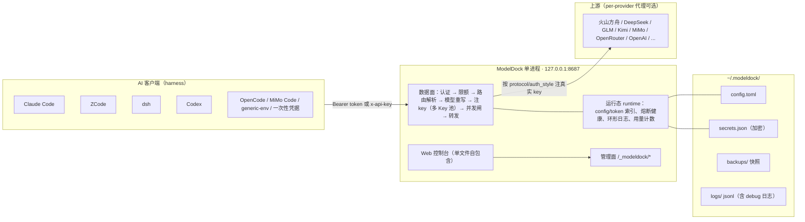
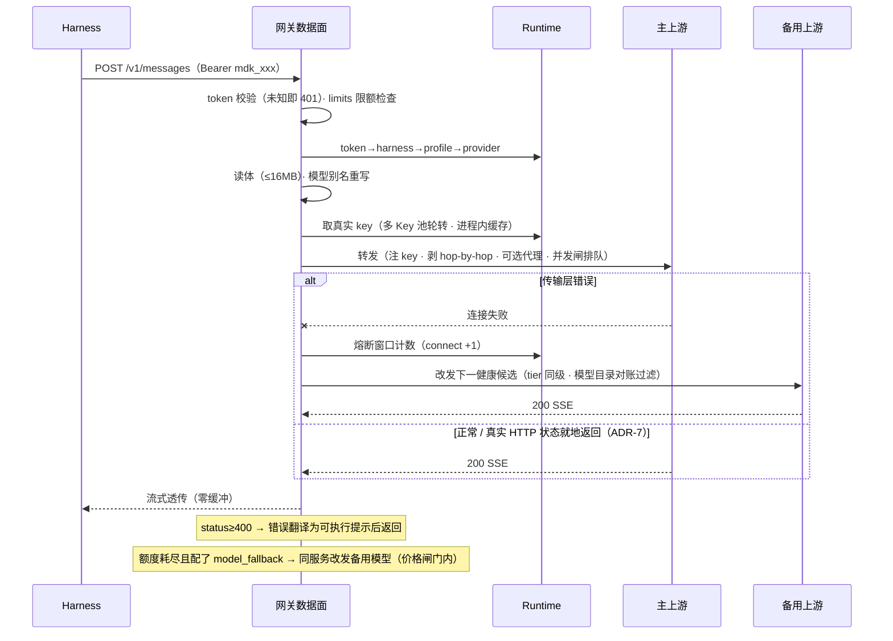
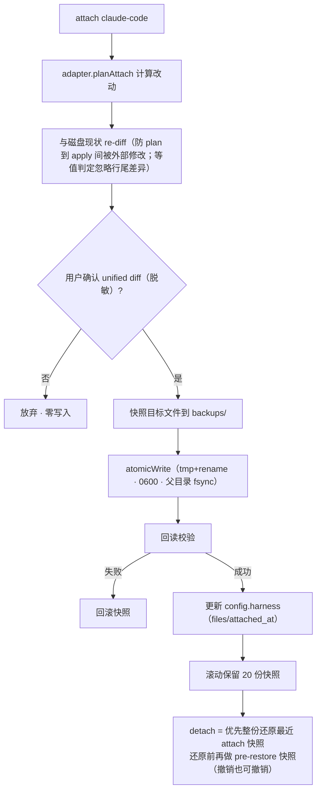
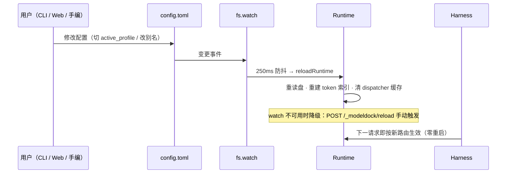

# ModelDock 概要设计说明书

| 文档属性 | 内容 |
|---|---|
| 当前版本 | **v1.2 · as-built 刷新** |
| 对齐实现 | develop 分支（2026-11-16；发布版本见 git tag 与 CHANGELOG，最新 v1.8.0） |
| 作者 | ObsidianTrine |
| 日期 | 2026-11-16 |

**版本历史**

| 版本 | 日期 | 说明 |
|---|---|---|
| v1.2 | 2026-11-16 | as-built 刷新（对齐 v1.8.0）：新增 ADR-10～13（多 Key 池/模型级容灾/限额熔断丝定位/协议不做转换）；网关数据面补多 Key 池、并发闸与排队、429 退避、限流余量留痕、自动备用链模型目录对账、模型级容灾与模型级熔断；管理面补 debug 日志、metrics、一次性凭据、usage/pricing 端点；新增 §5.10 用量与成本核算；适配器补 MiMo Desktop（推翻 v1.1「不接入」结论）、钉路由协议校验、视觉能力链；config schema 补 `keys`/`max_concurrency`/`tier`/`model_fallback`/`limits`/`auto_fallback`/`queue_wait_ms`/`log_retention_days`/`debug`/`[update]` 节；里程碑补 v1.2.2–v1.8.0；测试基线刷新（产品套件 156 文件 + 编排器套件 103 文件）；R9 更新为部分落实（bench 基线已建） |
| v1.1 | 2026-10-24 | as-built 刷新（对齐 develop）：请求体上限改为默认 16MB 且可经 `gateway.max_body_mb` 调整；修正 R1/T2/§6.2 的「overview 返回 key 明文」描述（现为 `hasKey` 布尔 + 显式 `reveal-key` 端点，带审计）；测试基线与里程碑表更新；其余章节经复核与实现一致 |
| v1.0 | 2026-10-11 | 初版（随公开仓库 v1.0.0 发布）：以实现为准（as-built）的概要设计——术语表、ADR 决策（网关为主/配置即 TOML/密钥分层/纯 JS 依赖/SEA 检测/failover 语义/别名透传/定时切换实时求值）、双槽位路由选路语义、子系统设计、接口设计、关键流程、威胁模型、非功能指标、测试映射（642 例 / 46 条命令 / 20 预设基线）、风险处置与规划项现状 |

**评审记录**（评审后填写）

| 评审人 | 日期 | 结论 | 意见摘要 |
|---|---|---|---|
| | | | |

## 目录

1. [引言](#1-引言)
2. [背景与目标](#2-背景与目标)
3. [总体架构](#3-总体架构)
4. [关键设计决策（ADR）](#4-关键设计决策adr)
5. [子系统设计](#5-子系统设计)
6. [接口设计](#6-接口设计)
7. [关键流程](#7-关键流程)
8. [数据与目录布局](#8-数据与目录布局)
9. [安全设计](#9-安全设计)
10. [非功能设计](#10-非功能设计)
11. [测试与验收](#11-测试与验收)
12. [里程碑与实施现状](#12-里程碑与实施现状)
13. [风险与开放问题（v1.0 处置结论）](#13-风险与开放问题v10-处置结论)
14. [附录：评审关注点](#14-附录评审关注点)

---

## 1. 引言

### 1.1 目的与读者

本文是 ModelDock 的概要设计说明书，用于技术评审与后续详细设计/维护的基准。读者为具备工程背景的评审人与贡献者。文中所有"已实现"描述均以当前 develop 源码为准并标注关键源码位置；未实现的能力一律显式标注「规划中」，避免设计与实现的口径漂移。

### 1.2 范围

**覆盖**：单机形态下的配置托管、API 网关、客户端接入（attach）、备份还原、导入、诊断、Web 控制台、用量与成本核算、跨平台打包（SEA）。
**不覆盖**（单机核心之外的子系统已独立详设并实施，细节见各自文档）：多机配置同步与云端控制面（[design-cloud-sync.md](./design-cloud-sync.md)——M1–M3c 已随 v1.0.0 发布，剩 M4 与 VPS 真机验收）、自动更新（[design-auto-update.md](./design-auto-update.md)——M1/M2 已发布并追加预取/断点续传/更新还原（v1.7.2/v1.8.0，超出详设范围），M3 暂缓待 VPS）。网关数据面仍仅监听 `127.0.0.1` 单用户；远程能力（LAN 手机控制台 `/m`、云端控制面）经上述两份详设承载。MCP 配置仅做只读盘点（CLI `mcp list` 与 doctor 安检的数据源），不做下发/统一管理（2026-10-29 产品决策）。

### 1.3 术语表

| 术语 | 定义 |
|---|---|
| harness | AI 编码客户端（Claude Code、ZCode、dsh、Codex、OpenCode、MiMo Code 等），经适配器接入 ModelDock |
| provider | 上游模型服务：`base_url` + 协议 + 认证方式 + key 引用（存于安全后端） |
| profile | 路由档案：provider + 默认模型 + 别名映射 + 可选 fallback 链 |
| alias | 模型别名映射（支持 `*` 通配），如 `claude-sonnet-* → deepseek-v4-flash` |
| attach / detach | 接管 / 还原某个 harness 的配置（先预览 diff、自动快照） |
| adapter | harness 适配器，三层体系：L1 内置 / L2 声明式 pack / L3 外部插件（规划中） |
| token | 网关为每个 harness 颁发的本地凭据（`mdk_` 前缀），替代真实上游 key |
| admin token | 管理面凭据（`mdkadm_` 前缀），记录在运行态文件 `gateway.json` |
| 一次性凭据（ephemeral harness） | 为自动化任务签发的限时、限额临时客户端凭据（明文只在签发响应出现一次），支持续期与吊销，到期自动回收；用量独立建账 |
| secret store | 上游 key 的安全存储后端（macOS Keychain / Windows DPAPI / Linux Secret Service / 加密或 0600 文件） |
| snapshot | 任何写盘前对目标文件的自动快照（manifest + sha256 校验） |
| active_profile | 全局默认路由；`route=default` 的 harness 跟随它 |
| 熔断（meltdown） | 60s 滑动窗口错误计数触发的临时摘除，避免持续打故障上游；另有模型级熔断（同一服务下单模型摘除） |
| 定时切换（schedule） | 按时段把流量优先走 / 避开指定服务的窗口配置；每次请求实时求值（ADR-9），生效日支持星期几与日类型（工作日 / 周末 / 法定节假日） |
| 多 Key 池 | 同一 provider 配多把上游 key，网关轮转均摊；单把被上游拒绝（401/403）时自动冷却换下一把 |
| 模型容灾（model fallback） | 同一服务内主力模型额度耗尽时改发备用模型重试（价格闸门内），替代把额度错误抛给客户端 |
| 任务等级（tier） | profile 上的任务档位标签；故障切换只在同等级候选间进行，防重活静默落档 |
| 数据面限额（limits） | per-harness 的 rpm（每分钟请求数）与 daily_tokens（日 token 花费）上限，超限 429；内存计数、定位是熔断丝不是账本（ADR-12） |
| 成本折算（pricing） | 转发日志 token 用量按模型单价折算美元；两级价源（内置 models.dev 牌价 + `pricing.json` 覆盖） |
| SEA | Node.js Single Executable Application，单文件可执行打包 |

### 1.4 参考资料

`AGENTS.md`（工程约定）、`docs/usage.md`（使用指南）、`docs/config-reference.md`（配置键参考，自动生成）、`docs/attach-env-vars.md`（各客户端 attach 触达键清单）、`CHANGELOG.md`（版本记录）。

---

## 2. 背景与目标

### 2.1 问题陈述

每个 AI 编码客户端各自维护 `base_url` + API Key：切换供应商要逐个改配置、部分还要重启；key 以明文散落在各处配置文件中；模型分层映射（sonnet/opus/haiku → 不同上游模型）要在每个客户端里重复配置。多 agent 自动化编排（Dockmaster）出现后，追加两类诉求：无人值守长任务的供给韧性（限流/额度/故障不能打断船队）与「烧了多少、能不能再烧」的实时可计量。

### 2.2 设计目标与非目标

**目标**

1. **一次接入、零成本切换**：harness 指向网关后，供应商/模型切换只在 ModelDock 侧完成并即时生效，harness 配置零改动。
2. **key 集中保管**：真实上游 key 只存于 ModelDock 安全后端，harness 配置中只出现本地 token。
3. **非侵入**：未 `attach` 前对现有 harness 零写入；所有写入先 diff 预览、自动快照、可还原。
4. **开箱即用**：内置预设库 + 模型目录自动获取 + 首启向导，安装到跑通 ≤5 分钟。
5. **可诊断**：`test` / `doctor` / `status` / `logs` 回答"通不通、慢不慢、哪里坏了"；debug 日志模式按需留痕。
6. **可分发**：跨平台单文件可执行（SEA），无 Node 环境依赖。
7. **可计量**（v1.6.0 起新增，超出 v1.0 目标集）：用量、估算成本、限额、一次性凭据台账全程可见（§5.10）。

**非目标**

- 远程访问、多用户、多机高可用（本机单用户工具，设计如此）。
- prompt 内容审计、代理缓存（日志不落请求体）。
- 上游协议全量模拟：按 anthropic / openai / responses 三协议端点直连透传；**协议互相转换已定为不做**（ADR-13），以钉路由前的协议兼容校验替代。
- 云同步与多机能力（Phase 2 另行详设，**已实施**，见 §1.2 范围注记）。

### 2.3 设计依据：本机现状盘点

| harness | 配置位置 | 协议 | 现状 |
|---|---|---|---|
| Claude Code | `~/.claude/settings.json` | anthropic | 经 cc-switch 代理 → 火山 Coding Plan；`DEFAULT_*_MODEL` env 做模型分层映射 |
| ZCode | `~/.zcode/v2/config.json` | anthropic | bigmodel/zai 多 provider 注册表 |
| dsh | `~/.dsh/settings.yaml` + `.credentials.yaml` | anthropic-messages / openai-completions | providers 带 `apiKeyEnv` 间接层 |
| Codex | 未安装 | openai/responses | 列入适配目标 |
| cc-switch | `~/.cc-switch/cc-switch.db` | — | 现任切换器，含火山/DeepSeek/小米 MiMo 档案 |

关键结论（设计输入）：① 本地代理模式已被 cc-switch 验证可行；② 各上游均提供 Anthropic 兼容端点，协议同质化高，透传式网关成立；③ 模型分层映射是重度真实需求，须为一等能力（别名系统）；④ 本机存在 clash 代理，部分国外上游需 per-provider 代理配置。

---

## 3. 总体架构

### 3.1 架构图



### 3.2 模块划分

| 模块（`src/`） | 职责 |
|---|---|
| `cli.ts` | 入口三路分发：`--sea-gateway` 起守护；SEA 无参双击起 GUI；其余走 commander（勿破坏） |
| `cli/` | CLI 命令（63 处 `.command` 注册 · 14 顶层组，§6.1） |
| `config/` | config.toml 读写（`store.ts`）、类型定义（`types.ts`）、key 安全后端（`secrets.ts`） |
| `gateway/` | HTTP 网关：数据面+管理面（`server.ts`/`main.ts`）、转发与重写（`relay.ts`）、运行态与健康（`state.ts` + `state/`）、并发闸与排队（`concurrency.ts`）、成本（`pricing.ts`）、用量聚合（`usage.ts`）、上游代理（`proxy.ts`）、Web 控制台（`ui.ts` + `ui/`，单文件内联 HTML/JS） |
| `adapters/` | 适配器契约（`types.ts`）、L1 内置 9 个、L2 pack 引擎（`packs.ts`）、provider-json 工厂（`provider-json.ts`）、落盘引擎（`engine.ts`）、桌面应用探测（`presence.ts`） |
| `backup/` | 快照、sha256 校验还原、滚动保留（含跨进程半成品占位防护） |
| `import/` | 存量配置只读扫描与收编：cc-switch（含 v3 Codex/Gemini 行）/ Claude Code / Codex / dsh / ZCode（新旧两代）/ OpenCode / MiMo Code / WorkBuddy / claude-code-router / Crush / Gemini CLI + one-api/new-api 渠道拉取（管理 API）；逐源故障隔离 |
| `mcp/` | MCP 配置只读盘点（CLI `mcp list` 与 doctor 安检的数据源；控制台卡片已下架，见 v1.5.2） |
| `presets/` | 内置 provider 预设库（含模型元数据与多协议端点；另有 `presets.json` 用户扩展） |
| `providers/` | 模型目录拉取（`fetch.ts`）、已知模型元数据表（`known.ts`）、dsh catalog（`dshcatalog.ts`） |
| `sync/` + `cloud/` | 多机配置同步（syncdoc 数据模型、同步代理、WebDAV/localdir 目标、文本资产白名单）与云端控制面（独立进程，详设见 design-cloud-sync.md） |
| `update/` | 自更新：检查 → 下载（镜像回退链 + 断点续传 + 预取 staging）→ SHA256 校验 → 替换 → 重启网关；更新还原（对换式回退上一版，零下载）；Web 控制台/托盘入口（详设见 design-auto-update.md） |
| `install/` + `cliinstall.ts` | 客户端自动安装元数据与执行（含托管 Node bootstrap、EBADENGINE 钉版健康检查） |
| `autostart.ts` / `ops.ts` + `ops/` | 开机自启服务文件生成（三平台：LaunchAgent / systemd / Windows 注册表 Run 键，v1.5.0 起替代 VBS）与重置/卸载运维 |
| `tray.ts` | 原生托盘程序（macOS 菜单栏 / Windows 系统托盘；轻量模式/仅托盘模式/更新弹窗，随 SEA 发布） |
| `util/i18n.ts` | 双语文案：`t(中文, English)`，语言链 `--lang` > `MODELRDOCK_LANG` > config.toml > zh |
| `gateway/lan.ts` + `cookies.ts` | LAN 手机控制台（第二监听器 `/m` + 二维码 + PWA）与会话 cookie |
| `gateway/daytype.ts` + `holidays.ts` | 定时切换生效日判定（holiday-cn 缓存日历：工作日/周末/法定节假日） |
| `util/` | 路径（`paths.ts`）、原子写（`fsx.ts`，含 agent 写入门禁）、diff/脱敏、JSONPath、glob |

### 3.3 运行形态

| 形态 | 入口 | 说明 |
|---|---|---|
| 开发 | `npm run dev -- <cmd>` | tsx 直跑源码 |
| 分发 | Releases 安装包 / 源码构建（`bin.modeldock → dist/cli.js`） | commander CLI |
| SEA 单文件 | 可执行文件名以 `modeldock` 开头 | 双击 → 后台 spawn `--sea-gateway` → 打开浏览器控制台；带参则等价 CLI |

SEA 检测以 `process.execPath` 文件名判断（ADR-6）。守护进程单实例：读 `gateway.json`，pid 存活且 `/_modeldock/health` 可达则拒绝二次启动。

### 3.4 技术选型与约束

- **TypeScript（ESM，NodeNext）+ Node ≥22**；运行依赖仅 6 个纯 JS 包：`commander`、`undici`（v8，含 ProxyAgent 流式转发）、`smol-toml`、`yaml`（Document API 保注释）、`@inquirer/prompts`、`qrcode-generator`（手机入网二维码）。
- **硬约束：全部纯 JS、无 native addon**——SEA 单文件打包的前提（ADR-5）。
- 密钥后端调用平台原生子进程（macOS `security` CLI / Windows PowerShell DPAPI / Linux `secret-tool`）；SQLite 读取（cc-switch）优先内置 `node:sqlite`。

---

## 4. 关键设计决策（ADR）

| # | 决策 | 备选方案 | 理由 |
|---|---|---|---|
| ADR-1 | **网关为主、配置写入为辅** | 纯写入器（cc-switch 模式） | 见下表对比：切换零成本、key 零暴露、可叠加别名/日志/failover。写入器保留为 bootstrap 与 `attach --mode file` 降级路径 |
| ADR-2 | **配置即 TOML 文本**（`config.toml` 用户可直编 + fs.watch 热加载） | JSON / SQLite | 可 diff、可手编、可纳入 dotfiles；SQLite 不透明且违背"配置即文本" |
| ADR-3 | **密钥分层安全后端 + 绝不回退明文** | 统一明文 0600 / 强制 OS keychain | 跨平台可用性与安全强度平衡；解不开宁可控失败也不落明文（§9.3） |
| ADR-4 | **单进程同时承载数据面与管理面** | 数据面/管理面分离进程 | 本地单用户工具，运维面最小化；管理面有独立鉴权边界（§9.2） |
| ADR-5 | **纯 JS 依赖、禁 native addon** | 使用 native 加速包 | SEA 单文件打包前提，工程约束优先 |
| ADR-6 | **SEA 检测走 `process.execPath` 文件名** | `import.meta.url` / sea-config env | postject 注入下 `import.meta.url` 失效；esbuild CJS 输出下为空 |
| ADR-7 | **failover 只切传输层错误**（连接拒绝/重置/超时等），真实 HTTP 状态（含 429/5xx）就地返回；例外：`gateway.failover_status_codes` 显式列出的状态码（上游未产出内容）在仍有剩余候选时切换 | 对 5xx/429 也切换 | 避免同一请求对多上游重复计费；429/5xx 可能是账号/模型配置问题，换服务大概率同样失败 |
| ADR-8 | **别名未命中透传原始模型名** | 未命中报错 | 上游新模型零配置即可用；`default_model` 仅在请求完全缺 model 字段时兜底 |
| ADR-9 | **定时切换每次请求实时求值**（选路时现算命中窗口，无后台定时器 / 无切换指针） | 后台定时器到点改写 active_profile / 维护运行态切换指针 | 无定时误差与重启补切问题；配置修改经热加载即时生效；并发选路无共享状态；窗口目标不可用时每次请求自然降级 |
| ADR-10 | **多 Key 池轮转：同一服务多把 key，401/403 冷却单把换下一把重试；转发恒走池**（v1.7.0） | 单 key 固定注入 | 单把失效不再断整条链路；多账号均摊上游限额 |
| ADR-11 | **模型级容灾仅额度类错误触发（402 / 429 带额度特征）+ 价格闸门（主力/备用单价差双向 ≤5%，写入口校验）+ 未映射的模型永不触发**（v1.7.3） | 任意错误换模型重试 | 额度不会分钟级恢复但同服务备用模型可继续供给；价格闸防「便宜模型换贵模型」误伤账单；未映射保护防质量敏感任务（审查/规划）被静默降级 |
| ADR-12 | **数据面限额（`limits`）是内存熔断丝不是账本**：计数在网关内存、重启清零；计费事实在 usage 日志 | 持久化计数 | 定位是 runaway 防护（超限即拒），不是计费账本；对账以日志/usage 聚合为准 |
| ADR-13 | **协议不做转换**：钉路由 / attach 前校验客户端协议与服务端点兼容性，不匹配直接拒绝并给修复路径（补端点或改钉其他服务）（v1.7.2） | anthropic ↔ openai 翻译层（原 M3 规划） | 国内上游普遍提供 Anthropic 兼容端点（bigmodel 预设已按官方文档补端点）；翻译层需维护两套协议语义映射且易错，校验+拒绝以零翻译成本换取「钉成功但永远打不到」事故的根治 |

**ADR-1 对比明细**

| | A. 本地网关（主） | B. 配置写入器（辅） |
|---|---|---|
| 原理 | harness 指向 `127.0.0.1:8687`，网关转发并注入真实 key | CLI 把 url/key 直接写进 harness 原生配置 |
| 切换成本 | 0（改路由即热生效） | 重写文件，部分 harness 需重启 |
| key 暴露面 | 只在 ModelDock | 散落各配置文件 |
| 依赖 | 需常驻守护进程 | 无 |
| 附加能力 | 别名重写 / 用量日志 / failover | 无 |

---

## 5. 子系统设计

### 5.1 网关数据面

**请求生命周期**（`src/gateway/server.ts` / `relay.ts`）：

1. 监听 `127.0.0.1:8687`；`EADDRINUSE` 时端口 +1 重试最多 10 次，实际端口回写 `gateway.json` 并提示（attach 以实际端口写入；`--port` 非法值启动前先验）。
2. URL 分流：`/_modeldock/*` → 管理面；无 token 的 `GET /` → 302 控制台；`/favicon.ico` → 204；免鉴权数据面自检 `GET /v1/health`（与管理面健康端点同口径，v1.5.0）；**其余所有路径不设白名单**，认证后整体透传上游。
3. 认证（双轨）：`x-modeldock-admin` 头（CLI 用，可附 `x-modeldock-profile` 覆盖路由）→ 管理面；否则取 `Authorization: Bearer` 或 `x-api-key` → token→harness 索引（持久 harness + 一次性凭据）；未知 token 401。
4. 数据面限额（v1.6.0，ADR-12）：harness 配 `limits`（rpm / daily_tokens）时超限 429 并明说；计数内存态。
5. 路由解析：profile 覆盖 → harness 钉死的 `route`（非 `default` 时）→ `active_profile`；任一层缺失返回 503 + 可执行修复提示。
6. 读请求体上限默认 16MB（`gateway.max_body_mb` 可调；超出 413，报错附调整指引；收完体再应答保证说明必达）。
7. **模型重写**：仅对 6 条路由路径生效（`/v1/messages`、`/v1/messages/count_tokens`、`/v1/chat/completions`、`/v1/completions`、`/v1/responses`、`/v1/embeddings`）；规则为精确 alias 优先于 `*` 通配，未命中透传，无 model 字段注入 `default_model`（ADR-8）；例外：Claude 内置模型名（`claude-*`）未命中别名时改写为 `default_model`（开箱即用；服务目录真实提供 claude-* 时透传不改写），discovery 别名（`anthropic.` 前缀 ID）转发前还原真实 ID；其余路径纯透传。**`GET /v1/models` 本地合成**（不透传上游）：返回当前选路目标服务的模型目录（显示名 + ID，Anthropic 形状为主、兼容 OpenAI 字段），跟随钉定路由与手动切换，支持 `?provider=<服务>` 过滤（v1.3.0）。
8. **出站构造**：按入站 path 推断客户端协议，取 `provider.endpoints[protocol]`（缺端点 400 可操作错误）；剥离 hop-by-hop / host / content-length / 入站凭据头；按 `auth_style` 注入真实 key（多 Key 池轮转，ADR-10；anthropic 补 `anthropic-version: 2023-06-01` 缺省值）。
9. **并发闸**（v1.7.0，`concurrency.ts`）：provider 可设 `max_concurrency`，超出排队等待（`gateway.queue_wait_ms` 默认 2000ms，超时按并发满载处理：跳下一候选或回 429）。
10. **上游代理**：`provider.proxy = direct | env | http://...`（undici ProxyAgent，兼容 clash），dispatcher 按 provider 缓存。
11. **转发**：按候选链逐个转发（候选链构成见下节；故障切换常开，不依赖任何开关）；传输层连接错误重试 1 次；上游 429 且给出 `retry-after` 时自动等一拍重试（v1.7.0）。
12. **响应**：过滤响应侧 hop-by-hop 与 content-length；status < 400 时 `pipeline` 流式透传（SSE 零缓冲；SSE 行缓冲封顶）；≥ 400 时读全文、经错误翻译后以 JSON 返回；客户端断开即中止上游转发（按 499 记日志，v1.5.0）；响应头带请求关联 ID（跨日志对账）。
13. **日志**：内存环形 500 条 + 按天 `gateway-*.jsonl` 与操作审计 `audit-*.jsonl`（按 `log_retention_days` 默认 30 天自动清理，v1.3.0）；不落请求体；上游响应带 `x-ratelimit-*` / `retry-after` 时可选记录限流余量（`/logs/query` 带出，v1.7.3）。

**超时与重试参数**

| 参数 | 默认 | 说明 |
|---|---|---|
| `gateway.port` | 8687 | 占用时 +1，最多 10 次 |
| `gateway.idle_timeout_ms` | 600000（10 min） | 流内空隙超时（undici bodyTimeout） |
| headersTimeout | 60 s | 上游响应头超时（已送达上游后超时不触发故障转移，防重复计费，v1.5.2） |
| keepAliveTimeout | 75 s | 连接保活 |
| `gateway.retries` | 1 | 仅传输层连接错误类（ECONNREFUSED / ECONNRESET / ENOTFOUND / ETIMEDOUT / EPIPE / UND_ERR_CONNECT_TIMEOUT） |
| 请求体上限 | 16 MB（`gateway.max_body_mb` 可调） | 超出 413；模型改写需完整缓冲请求体 |
| 热加载防抖 | 250 ms | fs.watch 触发后合并 |
| `gateway.queue_wait_ms` | 2000 | 并发闸满载时的排队等待上限 |

**自动路由候选链**（`gateway/state.ts` 的 `pickTarget` / `parseFallbackEntry`；恒启用——故障切换不依赖任何开关）

每次请求实时排出候选链，按序转发：

1. **主候选三级优先**：① `gateway.auto_route_provider` **人工钉定的主服务**（桌面/手机「当前」槽人工选择，人为修改优先于程序自动——含定时窗口；钉定持续到选回「自动」；钉定前校验协议兼容，ADR-13）→ ② 定时切换 prefer 窗口目标（可带 `服务ID:模型ID` 强制改写模型；**仅 `auto_failover` 开启时参与**——该开关语义为「程序自动选主」）→ ③ 默认路由主服务。高优先目标须通过可用性过滤（存在、`enabled !== false`、未熔断）才接管，否则顺延到下一级，不打死在坏服务上。
2. **fallback 链**：`gateway.route_next`（「下一个切换」槽人工钉定）存在时插到首位，其后为 `profile.fallback` 条目去重按 `priority` 降序、同 priority 按最近请求耗时升序（均无数据保持配置顺序）。
3. **自动备用链**（`gateway.auto_fallback`，缺省开）：手动 fallback 之外自动把已启用服务补进切换候选（按定时窗口/优先级/实测耗时排序，模型名原样透传）；**模型目录对账**（v1.7.3）：自动候选在其模型目录中查不到客户端请求的模型时跳过不重放（`model_mismatch` 留痕），显式配置的候选不受此限；链尾兜底、过滤后全空如实 503。
4. **链尾兜底**：钉定 / 窗口接管了主候选时，默认路由主服务排到整个候选链末尾（在用户显式 fallback 之后），保证高峰目标不可用时回落到默认服务而非直接报错。
5. **任务等级约束**（v1.6.0）：profile 带 `tier` 标签时，故障切换只在同等级候选间进行——高优先级服务的流量不会被切到低等级上游（`tier-validate` 端点做写入口校验）。
6. 全部候选不可用 → 503（`reason=down_all`；自动候选被模型目录过滤全剔除时如实 503 并留痕，不再误报 502）。

**「正在使用」的展示口径**（`gateway/state.ts` 的 `routeState`）：服务端唯一计算入口。所有展示面——服务卡 `inUse`、顶部「正在使用」行、手机页「使用中」徽标、客户端「跟随全局」行、本地 `/v1/models`——都消费同一份 `effective`（钉定 > 可用窗口 > 默认，含 `enabled`/熔断过滤，与请求候选链同源）。`default`（`active_profile`）是配置态，供接入/直连等场景，不冒充「正在使用」；烤模型客户端的 `displayRouteProvider` 只看 `enabled`、忽略熔断（避免探活抖动导致客户端模型列表反复重写）。窗口的**命中（hit）与接管（applied）分开**：被人工钉定压过、目标不可用、或自动选主关闭时 `applied=false`，控制台 pill 与手机页写明原因（`suppressedBy`）。窗口/钉定把主候选换到别的服务时，候选目标使用该服务自己的 profile（默认模型 + 别名），保证请求模型改写、`/v1/models` 与界面展示同源。

**故障切换与熔断**（`gateway/state.ts` 的 `recordOutcome` / `isMeltdown`，`relay.ts` 的 `forwardWithFailover`）

**故障切换常开**：主候选不可达时按候选链自动改发，不与 `auto_failover` 绑定（该开关只控制定时窗口是否参与选主）；候选链只有主服务时行为与直连等价。按候选链逐个转发；仅**传输层错误**（连接拒绝 / 重置 / 超时等，请求未送达、可安全重放）改发下一候选（ADR-7）。例外：`gateway.failover_status_codes` 显式列出的状态码（如 429/503，上游未产出内容）在仍有剩余候选时切换，切换前排空响应体释放连接；未列出的已送达状态码一律就地返回，避免同一请求对多上游重复计费。

60s 滑动窗口错误计数：

| 错误类别 | 窗口内阈值 | 熔断时长 |
|---|---|---|
| 传输层连接错误 | 3 | 60 s |
| 429 | 5 | 120 s |
| 5xx | 10 | 60 s |
| 额度耗尽（402 / 429 带 quota 语义响应体） | 3 | 15 min（额度不会分钟级恢复，避免反复撞耗尽的服务） |
| 4xx（其余） | 不计数（中性：模型/key 配置类错误换服务大概率同样失败） | — |

熔断中的 provider 不作候选；解除条件为连续 3 次成功，另有 60s 周期探活清扫器在冷却期满后主动探活恢复。候选全部连接失败 → 502（`reason=down_all`）。

**模型级熔断与模型级容灾**（v1.7.3，ADR-11）：

- **模型级熔断**：观测指标（`/_modeldock/metrics`）含 `model_meltdown` 清单——同一服务下哪个模型正在熔断、还剩多久恢复；429 退避重试不重复计数、改写注入失败不计「已吸收」（v1.8.0 口径对齐）。
- **模型级容灾**：同一服务商内主力模型额度耗尽时，自动改发同服务备用模型重试（`model_fallback = { "主力模型" = "备用模型" }`；CLI `model fallback` 或控制台「模型容灾」块写入）。触发条件：仅额度耗尽类错误（402，或 429 带额度特征）且该服务的备用服务链都走完；**价格闸门**：主力/备用单价差双向 ≤5%（写入口校验）；**未映射的模型永不触发**；手编防呆：「主力 = 备用」自映射条目不生效（不架空熔断快速失败）、备用链尾部不合成同模型候选空转（v1.8.0）。

**多 Key 池与失效冷却**（v1.7.0，ADR-10）：provider `keys[]` 多把 key 轮转均摊；某把被上游拒绝（401/403）时自动冷却换下一把重试；控制台修改 key 对池内位置正确生效（v1.6.0 修复）；密钥表并发写持锁保活防丢（v1.6.0）。

**定时切换**（`gateway/state.ts` 的 `hitScheduleWindows` / `activeScheduleWindow` / `activeAvoidTargets`）

- **求值模型**：`gateway.schedule.windows` 在每次选路时实时求值命中窗口（ADR-9），无定时器、无运行态——修改时段经热加载后下一请求立即生效。`start` 含、`end` 不含；`end < start` 视为跨午夜窗口，后半夜归属窗口起始日（星期几与日类型都按起始日判定）。
- **生效日**：窗口可配 `days`（星期几）与 `dayFilter`（日类型），同时配置取交集。日类型由 holiday-cn 缓存日历判定：`workday` = 周一至五与调休补班日（不含法定节假日）/ `weekend` / `holiday`；公告未覆盖的年份按星期几降级判定（宁可按普通周历走，不停用窗口）。
- **窗口模式**：`prefer`（缺省）= 时段内优先走 `target`（`服务ID:模型ID` 可强制改写模型）；`avoid` = 时段内从候选链剔除该服务（仅服务粒度，模型部分忽略）。
- **多窗口重叠消解**：多个 prefer 窗口同时命中时**按配置顺序取首个**，其余窗口不参与（即使首个目标不可用也不顺延到次一个 prefer 窗口，而是整个 schedule 层降级）；avoid 窗口彼此独立、命中即全部生效，且可与 prefer 叠加（prefer 目标恰被 avoid 时同样被剔除、顺延后续候选）。保存端点不检测重叠、无警告——顺序即语义。
- **降级与软约束**：prefer 目标不可用（下线 / 熔断）时该窗口不接管，按三级优先顺延（默认主服务）；主服务被人工钉定时窗口整体让位（钉定 > 窗口）；avoid 剔除后候选链为空时，从链外其余可用服务按 `priority` 降序补入；仍无可用则回退被避开的原链——宁可用被避开的服务也不断供。
- **保存校验**（`/_modeldock/auto-route/schedule`，整体替换 `{enabled, windows}`）：逐条校验 HH:mm 格式、起止不同、目标服务存在、`mode` / `dayFilter` 枚举；校验与引擎求值同源（v1.5.1）；清空窗口即删除 schedule 配置。

**上游错误翻译**（可执行提示）：401/403 → 提示 `provider set-key`（钥匙环故障时跳下一候选不打断备用链，v1.5.0）；404 + 模型名 → 提示 `model refresh` 或切 profile；400 + context 关键词 → 上下文超限建议；429 → 限流提示（中文额度提示可识别，v1.5.2）。JSON 原文注入 `modeldock: {hint, provider, model}` 字段后透出。

### 5.2 网关管理面与运行态

- **端点清单**见 §6.2（约 60 条）；鉴权模型见 §9.2。
- **热加载**：fs.watch 监听 `~/.modeldock/`，`config.toml` / `secrets.json` 变更经 250ms 防抖后重建运行态（重读盘、重建 token 索引、清 dispatcher 缓存；缓存失效收口——不再无谓作废密钥缓存，v1.6.0 性能批）；watch 不可用时降级为提示，可 `POST /_modeldock/reload` 手动触发。任何配置修改（CLI / Web 控制台 / 手编文件）都经此路径**零重启生效**。
- **运行态文件 `gateway.json`**（0600）：pid / port / admin_token / started_at；供单实例判定与 CLI 取 admin token；各路写方并入同一串行队列防并发覆盖（v1.5.2）。
- **开机自启（常驻，`gateway install/uninstall` + `POST /_modeldock/autostart`）**：注册为系统服务——macOS LaunchAgent（RunAtLoad + KeepAlive，崩溃自动拉起）、Linux systemd user unit（Restart=always）、Windows 注册表 Run 键（v1.5.0 起，静默自分离拉起，替代 v1.1 时代的 VBS）。daemon 命令按安装形态推导（SEA→自身 `--sea-gateway`；npm→`node <cli.js> --sea-gateway`；dev→tsx 直跑 cli.ts），argv 以 base64 注记随服务文件落盘，status 可检出 nvm 升级/二进制移动导致的路径失效（stale）。运行中安装只登记文件不 bootstrap（第二个实例会被单实例保护拒掉、KeepAlive 陷入重启循环），下次登录由服务接管；服务托管时 `gateway stop` 先 bootout 再停进程，避免与游离进程清扫互相拉锯；整机 `uninstall` 连服务文件一并移除。
- **debug 日志模式**（v1.7.1）：默认关；`gateway start --debug` / `MODELRDOCK_DEBUG=1` / config `[gateway] debug = true`（热加载即效，后台 daemon 也可开）任一为真即生效。落 `logs/debug-<date>.jsonl`：管理面每请求访问明细（方法/路径/状态码/耗时）+ 子进程调用（版本探测、密钥加解密）成败与耗时；管理面 4xx/5xx 无论开关都在事件日志留痕；诊断日志不含任何 key 明文；doctor 显示开关状态。
- **可观测端点**（v1.5.0 / v1.7.0 / v1.7.3）：`/_modeldock/metrics`（admin 门内）：按服务分位延迟、事件循环延迟、错误率滑动窗口（近 5 分钟 / 1 小时，限流/5xx/连接失败/额度拒绝分桶）、`model_fallback` 改发计数（`fallback_count`/`absorbed_count`）、`model_meltdown` 清单；`/_modeldock/model-availability` 上游模型可用性 + 周期探测；`/_modeldock/usage` / `usage-live` / `harness-usage` 见 §5.10。
- **一次性凭据**（v1.7.0 / v1.7.3）：`POST /_modeldock/harness/provision` 签发（限时 ≤24h、限额，token 明文只在签发响应出现一次）/ `harness/revoke` 吊销（不影响持久配置）/ `harness/renew` 续期（只延不缩、上限与签发一致 24h、已过期拒绝复活 410、token 不换发不回显）；用量独立建账（§5.10）。
- **写盘一致性**：管理面修改统一走「读盘 → 改 → 原子写 → 热加载」；无实际变化的保存跳过重写（逐字节一致即跳过，v1.3.0）；数据面每请求路径不写任何配置文件，唯一磁盘写是日志追加且失败静默不挡转发。

### 5.3 Web 控制台（`gateway/ui.ts` + `ui/`）

单文件自包含（HTML + 内联 JS，正规最小化 v1.5.1，无构建链、无外部资源），由 `GET /_modeldock/ui` 直接输出；桌面与手机页均带 Content-Security-Policy（v1.4.0/v1.5.1）。三步式引导：

1. **添加服务**：预设 chips 快选、三协议端点勾选（anthropic / openai / responses）、key 粘贴录入（支持多 Key 追加）、"拉取模型"预览（失败回退厂商已知模型表）、逐模型编辑上下文/最大输出/视觉能力、「清空模型」两段式确认（v1.7.1）、「模型容灾」编辑块（价格闸门校验，v1.7.3）；行渲染上限 200 行 +「显示全部」（v1.6.0）。
2. **我的服务**：搜索/排序/过滤、"应用"全局切换（提示哪些客户端将跟随）、延迟 ping、端到端流式测速、编辑浮层、删除；路由双槽位（「当前」=主服务自动·A/人工钉定、「下一个切换」=备用自动·B/人工钉定）+「程序自动选主」开关；钉路由前协议兼容校验（ADR-13）。两个「自动」选项都写明程序会选谁——A 取 `ignoreManual` 链（忽略两处钉定），B 取 `ignoreRouteNext` 链（只清本槽钉定、保留主服务钉定/窗口/链尾兜底）；候选链只有主服务时 B 显示「自动 · 无备用服务」。顶部健康条 5s 轮询（SWR：先回旧数据后台追新）；状态行今日用量徽标（请求数/tokens/估算成本，悬停明细，v1.6.0）。
3. **接入 AI 客户端**：客户端安装（自动命令或指引，见 §9.1 威胁 T7；本机无 Node 也能装——托管运行时 + 大陆镜像）、一键接入（先 `/attach/plan` 预览 diff，确认后 apply，自动快照可还原；钉定协议校验）、断开并还原。

附加：**一键迁移卡片**——扫描本机 cc-switch / Claude Code / Codex / dsh / ZCode（新旧两代）/ OpenCode / MiMo Code / WorkBuddy / claude-code-router / Crush / Gemini CLI 存量配置（含 key）一键导入，key 搬入安全存储、原软件不动，"暂不导入"以 localStorage 签名记住；**请求日志面板**（v1.7.2）：筛选页签（错误/控制台操作/全部/成功请求，默认错误）、错误行显示改发链摘要与修复建议（原始报错收进悬浮）、每行复制按钮 +「复制本页」、成功请求页最近 200 条；**定时切换面板**双模式时段时间输入（滚动面板 + 宽容键入联动高亮，首开预填 DeepSeek 低谷默认时段，删光仅放占位行）；**同步状态行**、**更新检查入口**（徽标 + 弹层 + 预取秒装）、**「独立直连」救援通道入口**（琥珀警示）；`config export/import` 加密配置包（.msync）桌面与手机页均可；顶栏 logo/品牌名直达 GitHub 主页；宽屏六成宽居中布局（v1.2.3）；暗色主题。

v1.0.0 已包含：**LAN 手机控制台**（第二监听器 `/m` 页，扫码带令牌接入 + PWA 常驻主屏，路由控件与桌面同口径；`/m/api/*` 端点，`mdklan_` 令牌持久化，cookie 名内嵌端口防双实例互踢）。

### 5.4 配置与密钥存储

**config.toml schema**（`config/types.ts`，`version=1`，高于当前版本拒绝加载；62+ 键的权威清单见自动生成的 docs/config-reference.md）：

| Section | 字段 | 说明 |
|---|---|---|
| 顶层 | `version` / `active_profile` | 版本迁移入口（迁移写盘前自动快照，v1.5.0）；默认路由 |
| `providers.<id>` | `base_url`（必填）、`protocol`（anthropic/openai/responses）、`auth_style`（bearer/x-api-key）、`key_ref`、`keys?`（多 Key 池，v1.7.0）、`proxy?`、`enabled?`（默认 true）、`priority?`（默认 0）、`tier?`（任务等级标签，v1.6.0）、`max_concurrency?`（并发闸，v1.7.0）、`model_fallback?`（模型级容灾映射，v1.7.3）、`endpoints?`（每协议 base_url）、`models?` | 上游凭据与模型目录 |
| `providers.<id>.models.<modelId>` | `display_name?` / `context_window?` / `max_output?` / `capabilities?`（视觉三态：显式值最高、上游声明 > 内置表）/ `source`（preset/fetched/manual） | 模型元数据 |
| `profiles.<name>` | `provider`、`default_model?`、`aliases?`（支持 `*` 通配）、`fallback?`（string[]）、`tier?`（任务等级，v1.6.0） | 路由档案 |
| `harness.<id>` | `mode`（gateway=网关接入 / direct=独立直连，均已实现；file 仍为 schema 预留枚举）、`route?`（default=跟随 active_profile）、`token?`、`attached_at?`、`files?`、`client_profiles?`（客户端自身 profile 范围）、`gateway_base?`（接入时写入的网关地址，detach 精确匹配）、`direct_base?`（直连实际写入地址）、`limits?`（rpm/daily_tokens 数据面限额，v1.6.0） | 接入状态 |
| `adapter_packs.<id>` | `format`（json/toml/yaml）、`config_file`、`detect?`、`upsert`（路径表达式 → 值模板，变量 `{token}{port}{base_url}{base_url_openai}`） | L2 声明式接入 |
| `gateway` | `port?` / `idle_timeout_ms?` / `headers_timeout_ms?` / `retries?` / `max_body_mb?`（默认 16）/ `auto_failover?`（程序自动选主开关，默认 false）/ `auto_route_provider?` / `route_next?` / `auto_fallback?`（自动备用链，缺省开）/ `failover_status_codes?` / `queue_wait_ms?`（默认 2000，v1.7.0）/ `schedule?`（windows/enabled，窗口带 dayFilter）/ `log_retention_days?`（默认 30，0=不清，v1.3.0）/ `debug?`（debug 日志开关，v1.7.1） | 网关行为 |
| `update` | `mirror?`（下载镜像前缀，SHA256SUMS 永走官方）、`prefetch?`（预取开关，缺省开，v1.7.2） | 自更新 |
| `security` | `store?`（file/keychain） | 密钥后端显式覆盖 |
| `backup` | `keep?` | 每 harness 快照滚动保留数（默认 20，非法或 <1 钳到 1） |

**密钥存储**（`config/secrets.ts`）：`secrets.json` 扁平表，`key_ref` 支持 `keychain:` / `secret-service:` / `file:` / `env:` / 明文（不推荐）。后端选择与降级链见 §9.3；解密结果进程内缓存（避免每请求 spawn 子进程；常驻轮询的 token 解析挪进节流/退避守卫，v1.7.3）；存量明文在启动/加载时自动迁移到安全后端；跨机密文识别并给指引（v1.4.0）；解不开一律置空并告警，**绝不回退明文**；写入持锁 + 重读比对封竞态（v1.6.0）；钥匙环子进程统一 10s 超时强杀。

### 5.5 Harness 适配器体系

**契约**：adapter 只负责"计算改动"（`plan*`），落盘统一走 `engine.applyChanges`（`adapters/engine.ts:30`）：与磁盘现状 re-diff（防 plan→apply 间被外部修改；等值判定忽略行尾差异，v1.6.0）→ 用户确认 → 快照 → 原子写（tmp+rename，0600，Unix 补父目录 fsync，v1.6.0）→ 回读校验（失败回滚）→ 滚动清理快照。接口签名见 §6.3。

**三层扩展**：

| 层级 | 机制 | 适用 | 状态 |
|---|---|---|---|
| L1 内置 | 编译进 CLI | 下表 9 个 | 已实现 |
| L2 声明式 pack | `config.toml` 写 `[adapter_packs.*]`，引擎统一执行「检测 → upsert（JSONPath/YAML setIn，保缩进注释）→ 校验 → 原子写」 | 大多数"改 baseURL/key 字段"的 harness，零代码接入 | 已实现（无反向规则，还原靠快照） |
| L3 外部插件 | `~/.modeldock/adapters/*.mjs` 导出契约对象，运行时加载 | 多文件/复杂凭据库 harness | **规划中（M2）** |

**L1 支持矩阵**（9 个）：

| harness id | 配置文件 | attach 写入 | detach 还原 |
|---|---|---|---|
| claude-code | `~/.claude/settings.json` | env 写 `ANTHROPIC_BASE_URL`（网关）+ `ANTHROPIC_AUTH_TOKEN`（token），清残留 `ANTHROPIC_API_KEY`；`--takeover-models` 把 `ANTHROPIC_MODEL`/`DEFAULT_*_MODEL` 迁入 profile aliases 并从文件删除；网关模式默认关遥测与非必要旁路请求；旧版客户端按档位铺四层模型槽位（modelPicker 按版本门控，<2.1.243 回退 env 钉定，v1.6.0） | 删除注入变量 / attach 快照整还原 |
| zcode | `~/.zcode/v2/config.json` | 只新增/维护 `builtin:modeldock` provider 条目，**绝不动既有条目**；模型规则按能力声明写视觉位 | 仅当该条目仍指向 127.0.0.1 时删除 |
| dsh | `~/.dsh/settings.yaml` + `.credentials.yaml` | `llm-pi-ai.providers.modeldock` 条目（含模型列表，由 ModelDock 元数据 + dsh 内置 catalog 合并补全并回写；无明确默认不猜，v1.8.0）+ token refs | 删条目 + token |
| codex | `~/.codex/config.toml` | `model_providers.modeldock`（Bearer 内联，`wire_api="responses"`）；网关模式 `/model` 可见可选网关目录模型、切云服务后回调自动重烤、`codex -p` 按 profile 一键切路由、直连形态守卫（v1.7.3/v1.8.0 四处缺陷收口） | 删条目 + 清理旧版 shell rc 哨兵段 |
| opencode | `~/.config/opencode/opencode.json` | `provider.modeldock`（OpenAI 兼容 `/v1`），JSON 工厂复用；开启模型清单声明（上下文/视觉在客户端侧可见） | 删条目 |
| mimo-code | `~/.config/mimocode/mimocode.jsonc`（或 `.json`，Windows 在 `%LOCALAPPDATA%\mimocode\`，`MIMOCODE_HOME` 覆盖） | 同上 + 按官方样例写入 `models` 声明与 `only_configured_models`；JSONC 注释宽容解析（重写丢注释有提示） | 删条目 |
| mimo-desktop | 与 MiMoCode CLI 共用 `~/.config/mimocode/mimocode.jsonc`（桌面端为 Electron 客户端，内嵌 mimocode 引擎） | 完全复用 provider-json 工厂，仅「已安装」判定换成桌面应用本体（v1.5.x 前后推翻 v1.1「不接入」结论） | 删条目 |
| workbuddy | `~/.workbuddy-ai/models.json`（env `WORKBUDDY_CONFIG_DIR`/`CODEBUDDY_CONFIG_DIR` 覆盖；`~/.workbuddy` 旧目录兜底，多候选探测） | 按当前路由模型目录写入条目数组（UI 同款格式，`url` 为完整 `/v1/chat/completions` 端点 + 本地 token）；用户自有条目与同 id 条目不覆盖，对象格式同步维护 `availableModels`；顶层数组缩进稳定不膨胀；补图片能力位 | 移除指向本网关的条目（其余不动） |
| generic-env | 不写文件 | `modeldock env` 输出 `ANTHROPIC_*` / `OPENAI_*` 环境变量（按实际运行实例端口），兜底任何读环境变量的 harness | 手动移除 |

**协议兼容校验**（v1.7.2，ADR-13）：控制台钉路由、CLI `harness route`、指定服务的 attach 都在写盘前检查客户端协议与服务端点匹配，不匹配拒绝并给两条修复路径（给服务补对应协议端点，或改钉其他支持该协议的服务）；多协议自适应客户端（ZCode、dsh）不受限。

**视觉能力链统一**（v1.7.0/v1.7.1）：上游能力三态采集；显式值最高（取消勾选保存不被内置表回填）；config > upstream > 内置表短路；表外变体（日期/档位后缀）按前缀兜底；o1-mini/o3-mini 修正为纯文本；目录拉取不采视觉。

> **评估后不接入**：Trae（自定义模型存 SQLite ItemTable 且经账号侧云同步，与「diff 预览 → 原子写文本」引擎模型冲突无法安全落笔）。手动方式：Trae 设置 → 模型 → 添加自定义模型，填网关 `http://127.0.0.1:<port>/v1` + harness token。（MiMo Desktop 已于 v1.5.x 接入，见上表。）

**独立直连模式（救援通道，已随 v1.0.0 发布）**：`harness direct <id> [profile]` 把上游 `base_url` + **真实 Key** 直接写进客户端配置（走同一套 diff 确认 + 快照 + 原子写），网关不在也照常可用——与网关模式互补的降级路径。`harness route / direct / gateway` 支持运行期改路由与直连⇄网关双向切换（客户端配置零改动由网关模式保证；直连切换则重写客户端配置文件）；`harness restore <harness> [snapshotId]` 承接快照还原（原顶层 `restore` 并入本组）。直连模式下 Claude Code 的模型配置按目标服务目录全量重写（含 1M 上下文标注），切换直连目标不残留旧模型名；直连断开后残留引用收回（v1.8.0）。

### 5.6 备份与还原（快照）

- **触发**：任何对 harness 配置文件的写盘前（`applyChanges`），及 detach/restore 前（对当前状态再做 `pre-restore` 快照，保证"撤销也可撤销"）；config.toml 版本迁移写盘前（v1.5.0）。
- **布局**：`~/.modeldock/backups/<harness>/<YYYYMMDDTHHMMSS>-<操作>-<rand4>/`，含 `manifest.json`（id、harness、operation、timestamp、tool_version、active_profile、文件清单 `{path, stored_as, sha256, mode}`）与 `files/<i>.blob`（保留原权限位）；半成品目录以占位标记防跨进程误删（占位宽限 10 分钟）。
- **还原**：逐文件 sha256 校验，不一致即中止；`detach` 优先整份还原**最近一次** attach 快照（= 本次接入前的状态：只回滚本次接入写入的内容，不回滚用户在此期间对同一文件做的外部改动），无快照才走 `planDetach` 反向清理；还原后热加载。
- **保留**：每 harness 滚动保留 N 份（`backup.keep`，默认 20，非法或 <1 钳到 1，快照是还原底线不允许"一个不留"）。

### 5.7 存量配置导入

来源：`cc-switch`（读 `cc-switch.db` providers 表，优先内置 `node:sqlite` 只读，回退外部 `sqlite3 -json`；跳过 127.0.0.1 占位）、`claude`（settings.json env）、`dsh`（settings.yaml + credentials refs 解 key）、`zcode`（v2/config.json，新旧两代合并扫描）、`codex`、`opencode`、`mimo-code`、`workbuddy`、`claude-code-router`、`crush`、`gemini-cli`、one-api/new-api 渠道拉取（管理 API；批量导入撞名自动错开，v1.4.0）。行为**对原文件只读**；按归一化地址去重保留"使用中"项；key 批量并发写入 secret store；建 provider（附已知模型元数据）+ 可选同名 profile；`is_current` 项设为 `active_profile`；逐源故障隔离（单源异常不拖垮整次盘点，v1.8.0）。

### 5.8 预设库与模型目录

- **预设库**：随包内置 provider 预设（火山方舟 Coding/Agent Plan、DeepSeek 双协议、智谱 bigmodel/z.ai（2026-11-08 补回 Anthropic 兼容端点）、Kimi 国内外、小米 MiMo、阿里云百炼、SiliconFlow、OpenAI、Anthropic、OpenRouter、Groq、DashScope、Gemini 兼容等；数量以 `modeldock preset list` 输出为准），字段含 `base_url` / `protocol` / `auth_style` / `docs_url` / `needs_proxy` / `endpoints`（多协议端点）/ 内置模型表。`provider add` 模糊搜索选择，用户只需粘贴 key。**用户自定义扩展**：`~/.modeldock/presets.json` 同名 `id` 覆盖内置预设、新 `id` 追加（启动合并；格式错误可操作报错阻断启动）。远程更新 **规划中（M2）**。
- **模型目录三源合成**：内置预设 + 已知元数据表（约 70 条常见模型 + 视觉能力前缀识别）+ models.dev 社区元数据（`model catalog refresh`，补未知模型的上下文/输出）+ 上游 `GET /v1/models` 自动拉取（多候选端点探测：对 base_url 逐层剥 `/v1`、`/v1beta`、`/anthropic`、`/openai`、`/compatible-mode` 尾段组合 `/v1/models`、`/models`，支持代理；全部失败抛可执行提示，并按 base_url host 回退预设库已知模型）。新拉取模型标 `source=fetched` 且不覆盖已有条目；未知元数据给保守默认并显式标记，doctor 提示"上下文不够用"隐患；拉取不采视觉（v1.7.0）。attach dsh 时反向用 dsh 内置 catalog 补全回写。

### 5.9 诊断

- `test`（经网关对上游发一次最小流式请求，回答"通不通、慢不慢"）。
- `doctor`（配置/网关/上游可达/各 harness 指向逐项体检，每项带稳定 id；**并行执行**互不依赖检查（v1.6.0）；`--deep` 真实请求深检——网关在线经 `/_modeldock/test` 全链验证、不在线直连探认证并核对模型名（v1.7.0）；`--fix` 分级修复——安全项自动、敏感项确认、决策项只报告，**执行后自动复核**打印已解决/仍存在/新出现（v1.8.0 沿革 2026-11），存在 bad 项退出码 1（`--json` 同）；检查面含：日志体积与磁盘余量、config.toml 解析错误带路径、FAKE_HOME 误配、沙箱自启残留、钥匙环故障与未配密钥区分、跨机密文引用、网关版本漂移（升级忘重启）、端口占用进程点名、debug 开关状态；合计行 + `summary` 随 `--json` 输出）。
- `status`（总览表）、`logs`（按天 JSONL，只读当天+昨天）。
- `mcp list`（MCP 配置只读盘点；doctor 安检同源）。

### 5.10 用量与成本核算（v1.6.0–v1.7.3，超出 v1.0 设计范围新增）

- **用量聚合**：`GET /_modeldock/usage`（管理面鉴权）按日期区间与客户端/服务/模型过滤，汇总请求数、token 明细（含可计费口径 `billable_tokens`：剔除缓存读等不计费部分，`billable_partial` 标记旧日志混入）、估算成本（`cost` + `unpriced_models` 列名提醒）、小时桶（`bucket=hour` → `hours[]`）、按模型分桶（`tokens_by_model`）、分模型时延（`latency_by_model`：平均/p50/p95）；`usage-live` 实时口径；`harness-usage` 按客户端聚合。
- **成本折算**（`gateway/pricing.ts`）：token 按模型单价折算美元，两级价源——内置 models.dev 官方牌价（八千余模型随目录刷新）+ `~/.modeldock/pricing.json` 覆盖（键 = 模型名或 `服务商/模型`，单位美元每百万 token）；查不到单价按 $0 计并列名提醒，**绝不猜价**；转发热路径查价不重复读盘。
- **任务等级（tier）**：profile 打档位标签，failover 只在同级间切换；`tier-validate` 写入口校验。
- **数据面限额（limits）**：per-harness rpm + 日 token 上限，超限 429 并明说；内存计数、重启清零（ADR-12）。
- **一次性凭据**：`harness/provision` 签发（限时 ≤24h、限额）`/revoke` 吊销 `/renew` 续期（只延不缩）；`harness-usage` 独立台账——每编排任务各烧多少不混服务总账。
- **编排侧消费**：`POST /_modeldock/pricing-lookup` 批量查价（管理面鉴权）；`.agents` 编排器的燃油账（`reconcile`/`stats --cost`/`sail --max-cost-usd`）经上述端点取数（编排器命令族在 `.agents/`，不在产品 CLI 范围）。

---

## 6. 接口设计

### 6.1 CLI 命令面（63 处 `.command` 注册 · 14 顶层组 · 2026-11-16 源码统计）

| 分组 | 命令 | 用途 |
|---|---|---|
| 初始化 | `init [--yes]` | 首启向导：检测 → 收编 → 预设 → 起网关 → attach |
| | `import --from all\|cc-switch\|claude\|dsh\|zcode\|... [--yes] [--no-with-profiles]` | 只读收编存量配置 |
| | `config edit` | `$EDITOR` 直编 config.toml，保存校验 |
| | `config export` / `config import <file>` | 导出/导入加密配置包（.msync，AES-256-GCM 含 key 明文；跨机手动迁移，机器态不动） |
| 上游/模型 | `provider add [presetId] [--name/--base-url/--protocol/--auth/--key/--key-env/--no-fetch/--yes]` | 添加上游（默认自动拉模型，可建同名 profile） |
| | `provider list` / `provider rm <id>` / `provider set-key <id> [--add]` | 列出（脱敏）/ 删除（连带 key 与引用 profile）/ 换 key（`--add` 追加进多 Key 池）热生效 |
| | `model list [pid]` / `model refresh <pid>` / `model set <pid> <model> [--ctx/--max-out/--display/--cap]` | 模型目录查看 / 拉取 / 编辑 |
| | `model fallback <pid> <主力模型> <备用模型>` | 模型级容灾写入口（价格闸门校验，v1.7.3） |
| | `model catalog refresh` | models.dev 社区元数据补全（未知模型的上下文/输出） |
| 路由 | `profile add [name] --provider/--model/--aliases/--tier` / `profile use <name>` / `profile list` / `profile rm` | 建路由 / 切默认（热生效）/ 查 / 删 |
| 接入 | `attach <harness> [--mode gateway\|file] [--profile] [--set-default] [--takeover-models] [--port] [--yes]` | diff 预览 → 快照 → 写入（`--port` 显式指定实例端口，v1.2.2） |
| | `detach <harness> [--yes]` / `token <harness>` | 断开还原 / 显 token |
| | `harness route <id> [profile]` / `harness direct <id> [profile]` / `harness gateway <id>` / `harness restore <harness> [snapshotId] [--list]` | 运行期管理：改路由（协议校验）/ 切独立直连（救援通道）/ 切回网关 / 快照还原 |
| | `env` | 输出 generic-env 环境变量（自动建接管；按实际运行实例端口） |
| 网关 | `gateway start [--port] [--daemon] [--debug]` / `stop` / `rotate-token` / `status` / `log [-n] [-f] [--harness]` | 生命周期 / 令牌轮换（旧令牌与 cookie 立即失效）/ 状态 / 请求日志 |
| | `gateway install` / `gateway uninstall` | **开机自启（常驻）**：注册/移除系统服务（macOS LaunchAgent KeepAlive / Linux systemd user unit / Windows 注册表 Run 键），登录自动拉起、崩溃自动重启；stop 遇服务托管先 bootout 防拉锯 |
| | `ui` | 打开 Web 控制台（自动带 token） |
| 诊断 | `test [profile]` / `doctor [--deep/--fix/--json]` / `status` | 端到端探测 / 体检（深检+修复+复核）/ 总览 |
| | `mcp list` | MCP 配置只读盘点 |
| 维护 | `adapter list` | 三层适配器与检测状态 |
| | `sync setup/status/pause/enroll/resume` | 多机配置同步（WebDAV / 本地同步盘 / 云端控制面入网；详设 design-cloud-sync.md） |
| | `update [--check/--yes/--token/--clean/--restore]` | 自更新：检查 → 下载（镜像回退链 + 断点续传 + 预取）→ SHA256 → 替换 → 重启网关；`--restore` 一键回退上一版（v1.8.0） |
| | `presets update` | **规划中（M2）**，当前随版本发布 |
| | `usage` | 指引命令：统计本体已上线（Web 控制台状态行 + `GET /_modeldock/usage` 聚合查询） |
| | `reset` | 还原全部 harness → 停网关 → 清 config+secrets（保留快照与日志） |
| | `uninstall` | 还原全部 → 停网关 → 删整个 `~/.modeldock` |

> 编排器（Dockmaster）命令族（`sail` / `schedule` / `reconcile` / `stats` 等）在 `.agents/` 侧，属本仓库开发基建，不在产品 CLI 范围。

### 6.2 管理 HTTP API（`/_modeldock/*`）

数据面为"其余所有路径认证后整体透传"（无白名单）；另有免 token 的 `GET /` → 302 控制台、`GET /favicon.ico` → 204、免鉴权数据面自检 `GET /v1/health`；数据面 `GET /v1/models` 本地合成（§5.1）。管理面端点清单（2026-11-16 源码盘点，约 60 条）：

| 类别 | 端点 | 说明 |
|---|---|---|
| 基础（只读免鉴权） | `health` / `status` / `config` / `overview` / `logs?n=` / `logs/query` / `ui` / `import/detect` | 概要 / 配置视图 / 控制台总览（只含 `hasKey` 布尔）/ 环形与查询日志（带级别、根因归类、建议字段、改发链、ratelimit 余量）/ 控制台页面（`?token=` 换 HttpOnly cookie 后 302）/ 存量扫描 |
| 云端会话 | `auth/relogin` | 云端登录过期重登 |
| 服务管理（修改类） | `service` / `service/update` / `service/delete` / `service/fetch-models` / `service/model-fallback` / `service/reveal-key` | 增删改 / 预览拉模型（不落盘）/ 模型容灾映射（价格闸门）/ key 明文按需取（admin 凭据 + Host 白名单 + 审计） |
| 路由（修改类） | `auto-route` / `auto-route/schedule` / `use` / `profile` / `key` / `tier-validate` / `switch` | 双槽位钉定与自动选主开关 / 定时切换 / 切 active_profile / 建 profile / 存 key / tier 校验 |
| 接入（修改类） | `attach/plan` / `attach/apply` / `detach` / `install` / `harness/route` / `harness/mode` / `harness/env` | 接入方案预览 / 执行 / 断开还原 / 客户端自动安装 / 运行期路由与模式 |
| 一次性凭据（修改类） | `harness/provision` / `harness/renew` / `harness/revoke` | 签发（明文一次性回显）/ 续期（只延不缩，过期 410）/ 吊销 |
| 用量与成本 | `usage` / `usage-live` / `harness-usage` / `pricing-lookup` / `metrics`（admin 门内） | 聚合查询（§5.10）/ 实时口径 / 凭据台账 / 批量查价 / 指标（分位延迟、事件循环、错误率窗口、model_fallback、model_meltdown） |
| 目录与预设 | `presets` / `model-catalog` / `model-availability` / `schedule/holidays-cn` | 预设目录（按需拉取）/ 模型目录 / 上游模型可用性 + 周期探测 / 节假日日历 |
| 运维（修改类） | `reload` / `test` / `reset` / `uninstall` / `autostart` / `admin/rotate` / `admin/update/status·check·apply` | 手动热重载 / 连通探测 / 配置重置 / 整机卸载 / 自启开关 / 令牌轮换 / 自更新三端点 |
| 托盘 | `tray-lite` / `tray-state` | 托盘轻量菜单数据源 |
| 多机同步 | `sync/discover` / `sync/import` / `sync/offer` / `sync/offer-approve` / `sync/remote-status` / `sync/request-remote` | 同步发现 / 导入 / 配置包提议与批准 / 远端状态 |
| LAN | 第二监听器 `/m` + `/m/api/*` | 手机控制台（`mdklan_` 令牌 + PWA manifest） |
| 云端控制面 | 独立进程（`src/cloud/server.ts`，`/v1/login·pair·doc·heartbeat·devices`） | 不占网关端口 |

### 6.3 适配器契约（`adapters/types.ts`）

```ts
interface HarnessAdapter {
  id: string
  label: string
  install?: ClientInstall            // 客户端安装元数据（Web 控制台「安装并接入」）
  detect(): Promise<DetectResult>    // { installed, configFiles, current?, note? }
  planAttach(opts: AttachOptions, cfg: Config): Promise<PlanResult>
  planDetach(cfg: Config): Promise<PlanResult>
  status(cfg: Config, gatewayPort: number): Promise<AdapterStatus>
}

// FileChange: { path, before(null=新建), after, note? }
// PlanResult: { changes, notes,
//   profileUpdates?    // --takeover-models 迁入的别名/默认模型
//   providerModelMeta? // attach 中从外部 catalog 补全并回写的模型元数据
// }
```

---

## 7. 关键流程

### 7.1 请求转发与故障切换

> 候选链构成（人工钉定 > 定时窗口 > 默认路由 / fallback 排序 / 自动备用链模型目录对账 / 链尾兜底 / tier 约束）与定时切换语义见 §5.1；下图展示转发与传输层错误切换分支（故障切换常开，候选链只有主服务时等价直连）。



### 7.2 attach 生命周期（非侵入 + 可还原）



### 7.3 配置热加载（切换零重启）



---

## 8. 数据与目录布局

```
~/.modeldock/                 # 全部路径经 src/util/paths.ts，支持 MODELRDOCK_FAKE_HOME 重定向（测试）
├── config.toml               # 全部声明式配置（用户可直编，0600 原子写，写前快照）
├── secrets.json              # key 存储（平台后端加密或 0600）
├── gateway.json              # 运行态：pid / port / admin_token / started_at（0600）
├── presets.json              # 用户自定义预设扩展（同名 id 覆盖内置）
├── pricing.json              # 模型单价覆盖（美元每百万 token；样例见 docs/examples/pricing.json）
├── backups/                  # <harness>/<时间戳-操作-随机>/manifest.json + files/*.blob
├── logs/                     # gateway-YYYY-MM-DD.jsonl · audit-YYYY-MM-DD.jsonl · debug-YYYY-MM-DD.jsonl
├── updates/staging/          # 更新预取下载暂存（断点续传）
└── adapters/                 # L3 外部插件目录（规划中 M2）
```

写盘纪律：一律 `atomicWrite()`（tmp + rename，显式权限位；Unix 补父目录 fsync）；测试/agent 上下文对真实 home 的写入被门禁拒收（§9.1 T9）；测试经 `MODELRDOCK_FAKE_HOME` 隔离并在 `finally` 还原。

---

## 9. 安全设计

### 9.1 威胁模型

| # | 资产 | 威胁 | 对策 |
|---|---|---|---|
| T1 | 上游 API key | 泄露到 harness 配置 / 仓库 | key 只存 ModelDock 安全后端；harness 配置只见本地 token；`list`/`show` 与 diff 展示一律脱敏 |
| T2 | 上游 API key | 本机其他进程/用户读取 | 平台安全后端（Keychain/DPAPI/Secret Service/机器绑定 AES）；明文仅 0600 末位降级；`overview` 只返回 `hasKey` 布尔，key 明文经显式 `POST /service/reveal-key`（需 admin 凭据 + Host 白名单）按需取且记审计（v1.0 曾随总览批量下发，已收紧） |
| T3 | 网关转发通道 | 未授权进程经网关调用上游 | per-harness token（24 字节随机）+ 一次性凭据（限时限额）；未知 token 401；仅监听 127.0.0.1 |
| T4 | 配置 | 浏览器 drive-by / DNS rebinding 篡改 | 修改类端点要求浏览器同源（Host=127.0.0.1 且 Origin 同源或 `Sec-Fetch-Site: same-origin`）或 admin token；管理面响应不带 CORS 头 |
| T5 | 用户数据 | 日志泄露 prompt | 日志只记元数据（方法/路径/状态/耗时/provider/model），不落请求体 |
| T6 | 配置与快照 | 误操作/篡改后不可恢复 | 原子写 + 写前快照 + sha256 校验还原 + 操作审计日志 |
| T7 | 本机执行 | `/install` 端点被诱导执行命令 | 命令为 adapter 内编译期常量（无拼接注入面）+ 修改类鉴权门槛；进程内 spawn shell 的架构取舍见 R2 |
| T8 | 历史 key | 存量明文残留 | 启动/加载时自动迁移到安全后端；解不开置空，绝不回退明文 |
| T9 | 生产配置 | 测试 / agent 进程写穿真实 `~/.modeldock`（2026-10-30 事故防线，v1.5.2） | 写入门禁：测试/agent 上下文进程（`VITEST`、`MODELRDOCK_TEST=1`、`ZCODE_*`/`CLAUDECODE` 等 agent env 标记）对真实 home 的 `atomicWrite`/`withFileLock` 一律拒写并给可操作报错——只看写入目标落点；自家入口进程置受信写者标记；有意写真实 home 的场景显式设 `MODELRDOCK_ALLOW_REAL_HOME_WRITE=1` 豁免 |
| T10 | 同步包 | 软链根目录绕过白名单排除规则漏打包密钥（v1.8.0） | 同步打包拒绝符号链接根目录；白名单外文件不入包 |

补充加固（v1.4–v1.8）：桌面/手机页 CSP 基线；管理面缓存键改 HMAC、日志格式串参数化、低危正则回溯面收敛（v1.8.0 静态扫描清零批）；管理面数值参数类型护栏（布尔/字符串数字拒收 400，v1.8.0）；控制台文档链接仅允许 http(s)（防 `javascript:` 注入）；配对码密码学安全随机。

### 9.2 认证与授权矩阵

| 主体 | 凭据 | 权限 |
|---|---|---|
| harness | per-harness token（`Bearer` / `x-api-key`） | 数据面转发 |
| 一次性凭据 | 签发的限时限额 token | 数据面转发（到期自动回收；续期只延不缩） |
| CLI | `x-modeldock-admin`（取自 `gateway.json`，0600） | 管理面全部（含指定 profile 做探测） |
| 浏览器（本机） | `?token=` 换 `mdk_admin` HttpOnly+SameSite=Lax cookie（7 天，Path=/_modeldock） | 修改类端点（或满足同源条件即可） |
| 匿名本机请求 | 无 | 只读端点（health/status/config/overview/logs/ui/import/detect）——依据"本机边界即可信边界 + 无 CORS 头阻断跨站读取"，取舍见 R1 |

### 9.3 密钥存储矩阵

| 平台 | 首选后端 | `key_ref` scheme | 降级链 |
|---|---|---|---|
| macOS | 系统 Keychain（`security` CLI，service=modeldock） | `keychain:` | — |
| Windows | 文件内 DPAPI 密文（当前账号绑定；PowerShell 批量，失败回退逐条） | `enc:dpapi:` | 解不开置空，不回退明文 |
| Linux | Secret Service（`secret-tool`） | `secret-service:` | 无钥匙环 → machine-id 派生密钥 AES-256-GCM（`enc:mach:`）→ 0600 明文 + 一次性警告 |

`security.store` 可显式覆盖；解密结果进程内缓存；批量写入并发整表加密后原子写（持锁保活防陈锁抢入丢 key）。

### 9.4 审计与日志

操作审计（attach/detach/服务增删/切换/取 key 明文等）与请求日志分流：内存环形 500 条 + 按天 JSONL 落盘（默认保留 30 天自动清理）；审计日志记录操作者与对象；请求日志仅元数据（T5），v1.7.2 起附级别/根因归类/建议/改发链摘要字段。

---

## 10. 非功能设计

> §10 目标值为设计目标；转发热路径已有本机基准（`scripts/bench-relay.mjs` + `docs/bench-baseline.md`，2026-10-31 首基线——仅同一机器 before/after 对比用，**不作 CI 门禁**，见 R9）。

| 维度 | 目标 | 依据/手段 |
|---|---|---|
| 转发开销 | P50 < 5ms（不含上游处理） | token 索引、别名重写、key 均为内存操作；热路径查价不读盘 |
| 流式 | SSE 零缓冲透传，首字节即转发 | undici body → res 直接 `pipeline`，无 SSE 解析层（行缓冲封顶） |
| 冷启动 | 网关可服务 < 2s；SEA 双击到控制台可访问 < 5s（含 spawn） | 无重初始化；启动后台迁移密钥不阻塞；overview 预热 + SWR |
| 常驻内存 | < 100MB | 环形日志 500 条有界；无请求体持久缓存 |
| 可靠性 | 单实例崩溃后可直接重启；配置写全部原子 + 快照 | `gateway.json` 单实例判定；tmp+rename；崩溃痕迹自动落盘（v1.5.0） |
| 上游瞬断 | 传输层错误重试 1 次；自动切换候选链 | §5.1 熔断/切换/并发闸排队/429 退避 |
| 兼容性 | Node ≥22；macOS（Intel/AS）/ Linux（x64/ARM64）/ Windows x64 | 五平台 SEA，GitHub Actions 构建 |
| 可维护性 | 改完 `src/**` 必须测试全绿；新增 harness 不改核心代码 | §11 测试域分层；适配器契约 + L2 pack |
| 性能回归 | 保存/切路由/doctor 等高频路径不劣化 | 两轮性能批修（缓存失效收口、并行化、惰性加载、SWR）；bench 基线 before/after |

---

## 11. 测试与验收

### 11.1 测试策略与覆盖（vitest，`fakeHome()` 隔离；双 config 均 `isolate: false`——同 worker 共享模块注册表，跨文件 mock 是雷区）

> 用例数随迭代漂移快，以 CI 与 `npm test` 输出为准。文件基线（2026-11-16 计数）：**产品套件 156 文件（`npm test`）+ 编排器套件 103 文件（`npm run test:workflow`）**；v1.1 基线为 851 例 / 69 文件。测试按改动域分层跑（L0 文档 → L1 按域 → L2 finish 门禁 `scripts/test-gate.mjs` 域路由 → L3 双套件全量），口径见 AGENTS.md「测试指南」。

| 域 | 套件（`test/`） | 覆盖 |
|---|---|---|
| 网关 | `gateway` / `gatewaycmd` / `hotpath` / `attach-port` / `modelmeta` / 并发与排队 / 容灾与熔断 | 数据面认证/别名重写/SSE 透传/协议路由/错误翻译/本地 `/v1/models`；多 Key 池、并发闸、模型级容灾（价格闸门/未映射保护）、自动备用链模型目录对账、tier 约束；管理面防跨站与端点；定时切换 pickTarget / 熔断（含 quota 类）/ 端到端 failover |
| Web 控制台 | `webui-static`（L0 静态契约）/ `webui-dom`（L2 happy-dom DOM 行为）/ `ui-html` / `ui-edit-backfill` / `console-cache` / `dedup-smoke` / UI 门禁 `ui-lint` | i18n 双语对/弹层 msg 槽位/惰性 label/端点漂移审计；首屏渲染契约、语言切换重渲染、弹层校验错误写槽位；HTML 结构配对与脚本编译冒烟；组件令牌规约门禁 |
| 适配与安装 | `adapters` / `install` / `cliinstall` / `noderuntime` | 各 harness attach/detach（takeover、catalog 回写、既有条目保留）、applyChanges 引擎、客户端自动安装与托管 Node bootstrap |
| 配置与备份 | `store` / `backup` / `presets` / `util` / `perf-fixes` / `fsx-memo` | config 往返与原子写（含结构错误前置拦截）、secrets 各后端与 0600（按平台分支）、快照/sha256/保留数、预设库、别名 glob/JSONPath/diff 脱敏/L2 pack、请求体上限换算、PATH memo、agent 写入门禁 |
| 用量与成本 | usage 聚合 / pricing / 一次性凭据 | bucket/过滤/可计费口径/时延分位、价目覆盖、provision/renew/revoke、台账 |
| 运维 | `autostart` / `reset` / `reset-cli` / `uninstall` | 三平台自启服务文件生成、重置与卸载（子进程端到端 + 选项注册） |
| 同步与云 | `syncagent` / `syncdoc` / `syncexport` / `syncpull` / `synctarget` / `cloudconsole` / `cloudserver` | .msync 配置包、WebDAV/localdir 目标与轮换、同步代理收敛、软链拒绝、云端控制面 |
| LAN / 更新 / 定时 / i18n | `lan` / `lansync` / `update` / `update-cli` / `update-notes` / `update-web` / `daytype` / `i18n` | 手机控制台与扫码、自更新链路（含预取/还原）与发布说明、生效日类型、双语文案 |
| 编排（开发基建，非产品代码） | `orchestrator/*`（103 文件） | `.agents` 多 agent 编排：planner/policy/gates/queue/reconcile 等 |

### 11.2 验收标准

1. 从安装到 Claude Code 经网关跑通 ≤5 分钟、≤6 条命令。
2. 新增/切换 provider 均一条命令，且零改动 harness 配置。
3. harness 配置文件中无真实上游 key（只有本地 token）。
4. 未 attach 前对现有 harness 零写入；`import` 全程只读。
5. 每次写有快照；detach/restore 后与快照 sha256 一致。
6. `test` 能明确回答"通不通、慢不慢"。
7. （v1.6.0 追加）usage 聚合能回答"烧了多少、能不能再烧"；一次性凭据到期自动回收、用量可按任务对账。

---

## 12. 里程碑与实施现状

| 版本 | 日期 | 内容 |
|---|---|---|
| v1.0.0 | 2026-10-11 | 首个公开发布版本：单机闭环（网关 + 预设 + 适配器体系 + 快照 + 导入 + 诊断 + Web 控制台）、五平台 SEA 单文件与自动发布、密钥安全存储（Keychain / DPAPI / Secret Service / machine-id AES）、网关开机自启（三平台服务）、客户端「安装并接入」闭环（含托管 Node bootstrap）、定时切换与自动路由（双槽位）、多机同步 M1–M3c、自更新 M1/M2、LAN 手机控制台与 PWA、独立直连救援通道、托盘、双语 i18n |
| v1.1.x – v1.2.1 | 2026-10-13 ~ 10-21 | 「配置包」统一搬家入口、dev 沙箱隔离治理、「正在使用」状态条与路由信息如实化、一键导入卡治理、doctor `--fix`/`--json`、托盘版本常驻、两轮性能批修 |
| v1.2.2 – v1.3.0 | 2026-10-25 ~ 10-26 | attach `--port` 显式实例端口、挂死上游快速切换、托盘轻量模式（切服务/模型/接入全在托盘）、`/v1/models?provider=` 过滤、日志保留期自动清理、首屏提速 |
| v1.4.0 – v1.4.3 | 2026-10-27 | 仅托盘模式、Windows 更新链集中修复（向导化/跨位版本比较）、批量导入防覆盖、CSP 基线、CRLF 等值判定、同步双机互写防护 |
| v1.5.0 – v1.5.2 | 2026-10-28 ~ 10-29 | 可观测性补全（metrics/崩溃痕迹/`/v1/health`/请求关联 ID）、Windows 注册表自启（替代 VBS）、doctor 三新检、config-reference 自动生成（62 键）、控制台脚本最小化 -27%、agent 写入门禁（写穿事故防线）、MCP 只读盘点（控制台卡片后下架）、版本迁移前快照 |
| v1.6.0 | 2026-11-03 | 成本核算上线（usage 聚合 + cost 折算 + pricing.json 覆盖）、任务等级 tier 与数据面限额（rpm/日 token）、doctor 新一轮检查、claude-code 接入打磨（遥测关闭/档位槽位/modelPicker 门控）、保存与切换提速批 |
| v1.7.0 – v1.7.3 | 2026-11-07 ~ 11-12 | 多 Key 池、服务并发上限与排队、doctor `--deep` 与修复后复核、一次性凭据（签发/吊销/续期/台账）、上游健康观测与模型可用性端点、debug 日志模式、视觉能力链统一、钉路由协议校验、更新预取 + 断点续传、请求日志改发链留痕与筛选、模型级容灾 + 模型级熔断、自动备用链模型目录对账、Codex 接入增强、bigmodel 补 Anthropic 端点 |
| v1.8.0 | 2026-11-15 | 更新还原（`update --restore` 对换式回退 + Windows 首次有旧版保留）、静态安全加固批（告警清零）、管理面参数类型护栏、Codex 接入四处缺陷收口、模型容灾计数口径对齐、同步软链拒绝、导入逐源故障隔离、手编 config 结构错误前置拦截 |

**超出原设计规划已交付**（as-built 修正，v1.1 清单 + v1.2 增补）：请求级 failover + 熔断（原列 M3）、opencode / mimo-code / **mimo-desktop（v1.1 曾评估不接入，后经实测与 CLI 共用配置文件实现）** / workbuddy 适配器、Web 控制台安装-接入-断开闭环、Linux machine-id 加密后端、额度耗尽熔断、Claude 内置模型名网关兜底改写、网关本地 `/v1/models`、模型选择器策划（网关/直连双模式）、多机配置同步 M1–M3c + 文本资产白名单、自更新 M1/M2 + **预取/断点续传/更新还原**、LAN 手机控制台与 PWA、独立直连救援通道、`harness` 运行期管理组、托盘（轻量/仅托盘模式）、双语 i18n、客户端安装托管 Node bootstrap（含钉版健康门禁）、`config export/import` 加密配置包、`presets.json` 用户自定义预设扩展、models.dev 元数据补全、**用量统计与成本核算（v1.1 曾定调「不做」，v1.6.0 反转上线）**、任务等级与数据面限额、一次性凭据体系、多 Key 池、并发闸与排队、模型级容灾与模型级熔断、自动备用链模型目录对账、上游健康观测与 metrics、debug 日志模式、doctor `--deep`/复核/版本漂移、视觉能力链统一、钉路由协议校验（ADR-13）、MCP 只读盘点、agent 写入门禁、日志保留期清理、Windows 注册表自启。

**规划中**

- M2 剩余（2026-10-11 逐项代码复核；其中 doctor 检出 watch 失效（R5）已于 2026-10-20 随 doctor `--fix`/`--json` 改造交付）：L3 外部插件、presets 远程更新（`presets update` 仍为占位）、管理面「严格模式」（R1）、固定端口失败即退出选项（R4）、压测门禁（bench 基线已建，`docs/bench-baseline.md`，门禁未接）、`backup --all`；usage 统计已上线（见超出清单）。
- ~~网关侧 `/v1/models` 合成~~：**已交付**（2026-10-11，数据面本地合成，见 §5.1）。
- M3：~~anthropic ↔ openai 协议互相转换~~ **已定为不做**（ADR-13，校验拒绝替代）；项目级 profile 覆盖（未做）。
- 云同步（详设 [design-cloud-sync.md](./design-cloud-sync.md)）：M1–M3c 已随 v1.0.0 发布；剩 M4 按需项（恢复码/吊销设备/口令缓存开关）与 VPS 真机验收（VPS 未购）。
- 自动更新（详设 [design-auto-update.md](./design-auto-update.md)）：M1/M2 已随 v1.0.0 发布并追加预取/断点续传/更新还原（v1.7.2/v1.8.0）；M3（更新源迁自建）暂缓待 VPS，届时与云同步基础设施合流。

---

## 13. 风险与开放问题（v1.0 处置结论）

| # | 风险/问题 | 现状 | v1.0 处置 |
|---|---|---|---|
| R1 | 管理面只读端点完全免鉴权 | 依据"本机边界 + 无 CORS 头"取舍；本机任意非浏览器进程可无凭据读取配置元数据（key 明文已不随只读端点下发：overview 只含 `hasKey` 布尔，明文走需凭据且记审计的 `POST /service/reveal-key`） | **接受**（本机单用户边界）；「严格模式」（GET 也要求 admin token）仍为 M2 候选 |
| R2 | `/install` 在网关进程内 spawn shell | 命令为编译期常量，无注入面；但管理面鉴权一旦被绕过即等同本机代码执行 | **接受**；收敛为 CLI 侧执行列为 M2 候选 |
| R3 | `backup.keep` 配置项已定义未接线 | v1.0.0 已统一由配置驱动，非法/<1 钳到 1 | **已修复**（含回归测试） |
| R4 | 端口漂移：占用时自动 +1，已 attach 的 harness 若指向旧端口会失效 | 以实际端口提示缓解，attach 用实际端口；`attach --port` 可显式钉定（v1.2.2）；跨重启漂移仍是边界场景 | **接受**；"固定端口失败即退出"选项仍为 M2 候选 |
| R5 | fs.watch 降级后热加载静默失效 | 降级为提示 + 手动 reload 端点；daemon stdout 被丢弃、启动期告警用户看不见，doctor 体检以 fs.watch 探测检出（2026-10-20 已实现） | **缓解**（CLI 体检可检出；daemon 运行中的静默失效仍无实时告警） |
| R6 | SEA 平台矩阵：Linux ARM64 / Windows 仅 CI 构建验证 | 无真机回归清单 | **接受**；发布前以 CI 全绿 + darwin/linux-x64 真机冒烟为准，清单随发布逐步补充 |
| R7 | Windows DPAPI 经 PowerShell 批处理，spawn 开销与健壮性 | 失败回退逐条；解密结果有缓存；子进程统一 10s 超时强杀 | **接受**；观察长尾延迟 |
| R8 | 无并发编辑锁：CLI 与 Web 同时改配置为"最后写者胜" | 原子写 + 热加载兜底；密钥表写入已持锁保活（v1.6.0）；gateway.json 写方串行队列（v1.5.2） | **接受**（单用户工具）；乐观锁列为远期候选 |
| R9 | 无性能回归门禁（§10 为目标值） | **部分缓解**：`scripts/bench-relay.mjs` 转发热路径基准 + `docs/bench-baseline.md` 基线（2026-10-31 首基线），仅同机 before/after 参考、明确不作 CI 门禁 | 接受；压测门禁仍为 M2 候选 |
| R10 | 数据面限额（limits）内存计数重启清零 | 计数定位是 runaway 熔断丝不是账本（ADR-12）；计费事实在 usage 日志 | **接受**（设计如此） |

---

## 14. 附录：评审关注点

1. **架构边界**：网关为主 / 写入为辅的取舍（ADR-1）是否成立？数据面与管理面同进程（ADR-4）是否接受？
2. **安全取舍**：R1（只读免鉴权）、R2（进程内 spawn shell）是否接受？是否需要严格模式？一次性凭据的限时/限额边界是否够用？
3. **可靠性语义**：failover 只切传输层错误 + 显式状态码白名单（ADR-7）、熔断参数（3/5/10 阈值、60s/120s）、模型级容灾触发条件（额度类 + 价格闸门 ≤5% + 未映射保护，ADR-11）是否合理？
4. **接口稳定性**：`/_modeldock/*` 端点命名（现约 60 条）、per-harness token + 一次性凭据模型、config.toml schema 是否可冻结为 v1 接口承诺？
5. **扩展性**：L2 pack 表达力（单文件 upsert、无反向规则）是否够用？L3 优先级是否提前？
6. **非功能**：§10 目标值是否认可，bench 基线是否升级为回归门禁？
