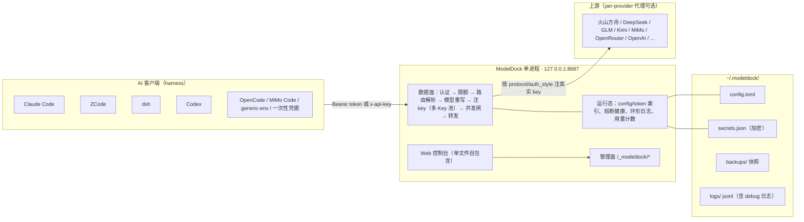
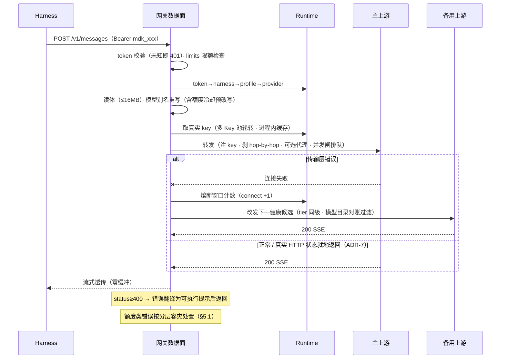
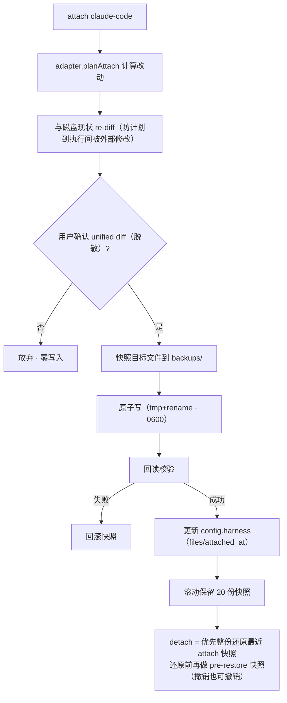
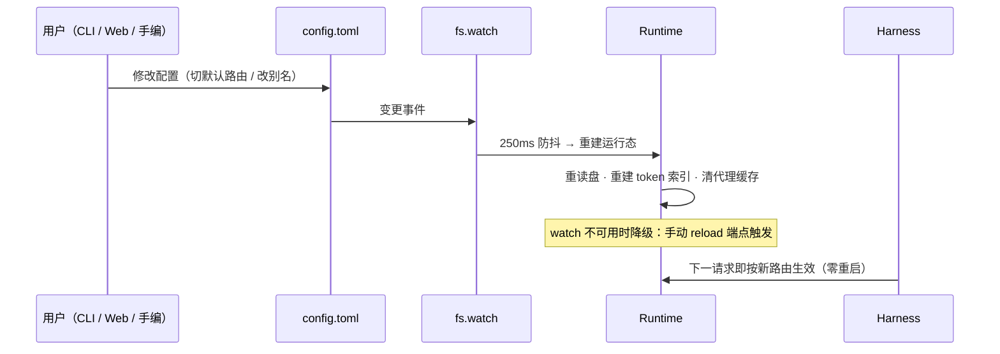

# ModelDock 高层设计说明书

| 文档属性 | 内容 |
|---|---|
| 当前版本 | **v2.1** |
| 状态 | 设计基准 |
| 作者 | ObsidianTrine |
| 日期 | 2026-11-16 |

**版本历史**

| 版本 | 日期 | 说明 |
|---|---|---|
| v2.1 | 2026-11-16 | 按设计先行原则重写：全文以设计口径陈述系统能力，剥离对实现的对账式表述、源码定位与版本号注记；语言精简 |
| v2.0 | 2026-11-16 | 按 HLD 规范重构章节结构（剥离实施史与测试映射，修正三处口径矛盾） |
| v1.0 – v1.2 | 2026-10-11 ~ 11-16 | 初版及两次随实现对账的修订（as-built 口径），已被 v2.x 设计口径取代 |

**评审记录**（评审后填写）

| 评审人 | 日期 | 结论 | 意见摘要 |
|---|---|---|---|
| | | | |

## 目录

1. [引言](#1-引言)
2. [总体描述](#2-总体描述)
3. [总体架构](#3-总体架构)
4. [关键设计决策（ADR）](#4-关键设计决策adr)
5. [子系统设计](#5-子系统设计)
6. [接口设计](#6-接口设计)
7. [关键流程](#7-关键流程)
8. [数据与目录布局](#8-数据与目录布局)
9. [安全设计](#9-安全设计)
10. [非功能设计](#10-非功能设计)
11. [验收标准](#11-验收标准)
12. [规划与开放问题](#12-规划与开放问题)
13. [附录：评审关注点](#13-附录评审关注点)

---

## 1. 引言

### 1.1 目的与读者

本文定义 ModelDock 的边界、架构、子系统与接口设计，是详细设计与实现的基准。读者为工程评审人与贡献者。

本文为设计先行文档：所述能力为系统的承诺交付面。尚未设计定案的能力显式标注「规划中」（§12.1）；实现演进史与修复记录见 CHANGELOG，运维操作细节见 docs/ops/。

### 1.2 范围

**覆盖**：单机形态下的配置托管、API 网关、客户端接入（attach）、备份还原、存量导入、诊断、Web 控制台、用量与成本核算、跨平台分发（SEA）。

**不覆盖**（由独立详设承载）：多机配置同步与云端控制面（[design-cloud-sync.md](./design-cloud-sync.md)）、自动更新（[design-auto-update.md](./design-auto-update.md)）。网关数据面仅监听本机回环地址、面向单用户；远程能力（LAN 手机控制台、云端控制面）经上述两份详设承载。MCP 配置仅做只读盘点，不做下发与统一管理（产品决策）。

### 1.3 术语表

| 术语 | 定义 |
|---|---|
| harness | AI 编码客户端（Claude Code、ZCode、dsh、Codex、OpenCode、MiMo Code 等），经适配器接入 ModelDock |
| provider | 上游模型服务：`base_url` + 协议 + 认证方式 + key 引用 |
| profile | 路由档案：provider + 默认模型 + 别名映射 + 可选 fallback 链 + 任务等级 |
| alias | 模型别名映射（支持 `*` 通配），如 `claude-sonnet-* → deepseek-v4-flash` |
| attach / detach | 接管 / 还原某个 harness 的配置（先预览 diff、自动快照） |
| adapter | harness 适配器，三层体系：L1 内置 / L2 声明式 pack / L3 外部插件（规划中） |
| token | 网关为每个 harness 颁发的本地凭据（`mdk_` 前缀），替代真实上游 key |
| admin token | 管理面凭据（`mdkadm_` 前缀），记录在运行态文件 `gateway.json` |
| 一次性凭据 | 为自动化任务签发的限时、限额临时凭据（明文只在签发响应出现一次），支持续期与吊销，到期自动回收，用量独立建账 |
| secret store | 上游 key 的安全存储后端（macOS Keychain / Windows DPAPI / Linux Secret Service / 加密或 0600 文件） |
| snapshot | 任何写盘前对目标文件的自动快照（manifest + sha256 校验） |
| active_profile | 全局默认路由；`route=default` 的 harness 跟随它 |
| 熔断 | 60s 滑动窗口错误计数触发的临时摘除；另有模型级熔断（同一服务下单模型摘除） |
| 定时切换 | 按时段把流量优先走 / 避开指定服务的窗口配置；每次请求实时求值（ADR-9），生效日支持星期几与日类型（工作日 / 周末 / 法定节假日） |
| 多 Key 池 | 同一 provider 配多把上游 key，网关轮转均摊；单把被上游拒绝（401/403）时自动冷却换下一把 |
| 模型容灾 | 同一服务内主力模型额度耗尽时改发备用模型重试（价格闸门内），替代把额度错误抛给客户端 |
| 任务等级（tier） | profile 的任务档位标签；故障切换只在同等级候选间进行 |
| 数据面限额（limits） | per-harness 的 rpm 与日 token 上限，超限 429；内存计数，定位是熔断丝不是账本（ADR-12） |
| 成本折算 | 转发日志 token 用量按模型单价折算美元；两级价源（内置牌价 + `pricing.json` 覆盖） |
| SEA | Node.js Single Executable Application，单文件可执行打包 |

### 1.4 参考资料

`AGENTS.md`（工程约定与测试策略）、`docs/guide/usage.md`（使用指南）、`docs/reference/config-reference.md`（配置键参考，自动生成）、`docs/ops/attach-env-vars.md`（各客户端 attach 触达键清单）、`CHANGELOG.md`（版本记录）。

---

## 2. 总体描述

### 2.1 问题陈述

每个 AI 编码客户端各自维护 `base_url` + API Key：切换供应商要逐个改配置、部分还要重启；key 以明文散落在各处配置文件中；模型分层映射要在每个客户端里重复配置。多 agent 自动化编排出现后，追加两类诉求：无人值守长任务的供给韧性（限流/额度/故障不能打断任务群）与「烧了多少、还能烧多少」的实时可计量。

设计输入（编写时的本机现状）：各客户端配置位置与协议各异（Claude Code 走 `settings.json` env，ZCode 走 provider 注册表，dsh 走 YAML + 凭据引用，Codex 走 TOML）；存在 cc-switch 这类纯写入式切换器；部分国外上游须经代理访问。关键结论：① 本地代理模式已被验证可行；② 各上游普遍提供 Anthropic 兼容端点，协议同质化高，透传式网关成立；③ 模型分层映射是一等需求（别名系统）；④ 上游代理须支持 per-provider 配置。

### 2.2 设计目标与非目标

**目标**

1. **一次接入、零成本切换**：harness 指向网关后，供应商/模型切换只在 ModelDock 侧完成并即时生效，harness 配置零改动。
2. **key 集中保管**：真实上游 key 只存于 ModelDock 安全后端，harness 配置中只出现本地 token。
3. **非侵入**：未 attach 前对现有 harness 零写入；所有写入先 diff 预览、自动快照、可还原。
4. **开箱即用**：内置预设库 + 模型目录自动获取 + 首启向导，安装到跑通 ≤5 分钟。
5. **可诊断**：`test` / `doctor` / `status` / `logs` 回答"通不通、慢不慢、哪里坏了"；debug 日志按需留痕。
6. **可分发**：跨平台单文件可执行，无 Node 环境依赖。
7. **可计量**：用量、估算成本、限额、一次性凭据台账全程可见。

**非目标**

- 远程访问、多用户、多机高可用（本机单用户工具，设计如此）。
- prompt 内容审计、代理缓存（日志不落请求体）。
- 上游协议互相转换（ADR-13），以钉路由前的协议兼容校验替代。
- 云同步与多机能力由独立详设承载（§1.2）。

### 2.3 运行与部署形态

| 形态 | 入口 | 说明 |
|---|---|---|
| 开发 | `npm run dev -- <cmd>` | 直跑源码 |
| 分发 | Releases 安装包 / 源码构建 | commander CLI |
| SEA 单文件 | 可执行文件名以 `modeldock` 开头 | 双击 → 后台拉起网关守护 → 打开浏览器控制台；带参则等价 CLI |

- **SEA 检测**以可执行文件名判断（ADR-6），不依赖运行时注入的模块信息。
- **单实例**：读 `gateway.json`，pid 存活且健康端点可达则拒绝二次启动。
- **开机自启（常驻）**：注册为系统服务——macOS LaunchAgent（崩溃自动拉起）、Linux systemd user unit（Restart=always）、Windows 注册表 Run 键（登录自启）。守护命令按安装形态推导。运行中安装只登记服务文件不 bootstrap（第二个实例会被单实例保护拒掉），下次登录由服务接管；服务托管时 `gateway stop` 先解除服务接管再停进程，避免与游离进程清扫互相拉锯。

### 2.4 技术约束与选型

- **TypeScript（ESM，NodeNext）+ Node ≥22**；运行依赖全部为纯 JS 包：commander、undici（流式转发与代理）、smol-toml、yaml（保注释的 Document API）、@inquirer/prompts、qrcode-generator。
- **硬约束：全部纯 JS、无 native addon**——SEA 单文件打包的前提（ADR-5）。
- 密钥后端调用平台原生子进程（macOS `security` CLI / Windows DPAPI / Linux `secret-tool`）；SQLite 只读读取优先用 Node 内置模块。

---

## 3. 总体架构

### 3.1 架构图



### 3.2 模块划分

| 模块 | 职责 |
|---|---|
| cli | 入口三路分发（网关守护 / SEA GUI / commander）与 CLI 命令面（§6.4） |
| config | 声明式配置存储、类型定义、密钥安全后端 |
| gateway | 网关数据面与管理面：认证、路由解析、模型重写、key 注入、并发闸、转发与故障切换、熔断健康、日志、Web 控制台、LAN 手机页、定时生效日判定、用量与成本聚合 |
| adapters | 适配器契约、L1 内置实现、L2 声明式 pack 引擎、统一落盘引擎 |
| backup | 写前快照与 sha256 校验还原、滚动保留 |
| import | 存量配置只读扫描与收编（逐源故障隔离） |
| mcp | MCP 配置只读盘点 |
| presets / providers | 内置预设库（含用户扩展）与模型目录三源合成 |
| sync / cloud | 多机配置同步与云端控制面（独立详设） |
| update | 自更新链路（独立详设） |
| install | 客户端自动安装与托管运行时引导 |
| autostart / ops | 开机自启服务文件生成（三平台）与重置/卸载 |
| tray | 原生托盘程序（macOS 菜单栏 / Windows 系统托盘） |
| util | 路径、原子写、写入门禁、diff/脱敏、JSONPath、glob、双语 i18n |

---

## 4. 关键设计决策（ADR）

| # | 决策 | 备选方案 | 理由 |
|---|---|---|---|
| ADR-1 | **网关为主、配置写入为辅** | 纯写入器（cc-switch 模式） | 见下表对比：切换零成本、key 零暴露、可叠加别名/日志/failover。写入器保留为 bootstrap 与显式 `--mode file` 路径（§5.4） |
| ADR-2 | **配置即 TOML 文本**（用户可直编 + fs.watch 热加载） | JSON / SQLite | 可 diff、可手编、可纳入 dotfiles；SQLite 不透明且违背"配置即文本" |
| ADR-3 | **密钥分层安全后端 + 绝不回退明文** | 统一明文 0600 / 强制 OS keychain | 跨平台可用性与安全强度平衡；解不开宁可控失败也不落明文（§9.3） |
| ADR-4 | **单进程同时承载数据面与管理面** | 数据面/管理面分离进程 | 本地单用户工具，运维面最小化；管理面有独立鉴权边界（§9.2） |
| ADR-5 | **纯 JS 依赖、禁 native addon** | 使用 native 加速包 | SEA 单文件打包前提，工程约束优先 |
| ADR-6 | **SEA 检测走可执行文件名** | 运行时注入信息 / 模块 URL | 打包注入下模块 URL 失效；CJS 输出下为空 |
| ADR-7 | **failover 只切传输层错误**（连接拒绝/重置/超时等，请求未送达、可安全重放），真实 HTTP 状态（含 429/5xx）就地返回；例外：① `failover_status_codes` 显式列出的状态码（上游未产出内容）在仍有剩余候选时切换；② 上游 404 且错误体明确点名请求模型不被支持（如 `UnsupportedModel`）时视同额度类，在候选链中段切下一存活候选（2026-11-20）——错误体不匹配或已到链尾仍原样回传 | 对 5xx/429 一律切换 | 避免同一请求对多上游重复计费；429/5xx 常是账号/模型配置问题，换服务大概率同样失败。额度类错误的完整处置分层见 §5.1「分层容灾」 |
| ADR-8 | **别名未命中透传原始模型名** | 未命中报错 | 上游新模型零配置即可用；`default_model` 仅在请求完全缺 model 字段时兜底 |
| ADR-9 | **定时切换每次请求实时求值**（选路时现算命中窗口，无后台定时器、无切换指针） | 后台定时器改写默认路由 / 维护切换指针 | 无定时误差与重启补切问题；配置修改经热加载即时生效；并发选路无共享状态；窗口目标不可用时每次请求自然降级 |
| ADR-10 | **多 Key 池轮转**：同一服务多把 key，401/403 冷却单把换下一把重试；转发恒走池 | 单 key 固定注入 | 单把失效不断整条链路；多账号均摊上游限额 |
| ADR-11 | **模型级容灾仅额度类错误触发 + 价格闸门 + 未映射保护**：触发条件为额度耗尽类错误（402 / 429 带额度特征）且备用服务链走完；主力/备用单价差双向 ≤5%（写入口校验）；未映射的模型永不触发 | 任意错误换模型重试 | 额度不会分钟级恢复但同服务备用模型可继续供给；价格闸防「便宜模型换贵模型」误伤账单；未映射保护防质量敏感任务被静默降级 |
| ADR-12 | **数据面限额是内存熔断丝不是账本**：计数在网关内存、重启清零；计费事实在用量日志 | 持久化计数 | 定位是 runaway 防护（超限即拒）；对账以日志/用量聚合为准 |
| ADR-13 | **协议不做转换**：钉路由 / attach 前校验客户端协议与服务端点兼容性，不匹配直接拒绝并给修复路径（补端点或改钉其他服务） | anthropic ↔ openai 翻译层 | 上游普遍提供 Anthropic 兼容端点；翻译层需维护两套协议语义映射且易错，校验+拒绝以零翻译成本根治「钉成功但永远打不到」 |

**ADR-1 对比明细**

| | A. 本地网关（主） | B. 配置写入器（辅） |
|---|---|---|
| 原理 | harness 指向本地网关，网关转发并注入真实 key | CLI 把 url/key 直接写进 harness 原生配置 |
| 切换成本 | 0（改路由即热生效） | 重写文件，部分 harness 需重启 |
| key 暴露面 | 只在 ModelDock | 散落各配置文件 |
| 依赖 | 需常驻守护进程 | 无 |
| 附加能力 | 别名重写 / 用量日志 / failover | 无 |

---

## 5. 子系统设计

### 5.1 网关数据面

**请求生命周期**：

1. 监听 `127.0.0.1:8687`；端口被占时 +1 重试最多 10 次，实际端口回写 `gateway.json` 并提示（attach 以实际端口写入）。
2. URL 分流：`/_modeldock/*` → 管理面；无 token 的 `GET /` → 302 控制台；`/favicon.ico` → 204；免鉴权数据面自检 `GET /v1/health`；**其余所有路径不设白名单**，认证后整体透传上游。
3. 认证（双轨）：`x-modeldock-admin` 头（CLI 用，可附 profile 覆盖路由）→ 管理面；否则取 `Authorization: Bearer` 或 `x-api-key` → token→harness 索引（持久 harness + 一次性凭据）；未知 token 401。
4. 数据面限额：harness 配 `limits`（rpm / daily_tokens）时超限 429 并明说；计数内存态（ADR-12）。
5. 路由解析：profile 覆盖 → harness 钉死的 `route`（非 `default` 时）→ `active_profile`；任一层缺失返回 503 + 可执行修复提示。
6. 读请求体上限默认 16MB（可调；超出 413，报错附调整指引；收完体再应答保证说明必达）。
7. **模型重写**：仅对 6 条路由路径生效（`/v1/messages`、`/v1/messages/count_tokens`、`/v1/chat/completions`、`/v1/completions`、`/v1/responses`、`/v1/embeddings`）；精确 alias 优先于 `*` 通配，未命中透传，无 model 字段注入 `default_model`（ADR-8）。例外：Claude 内置模型名（`claude-*`）未命中别名时改写为 `default_model`（服务目录真实提供 claude-* 时透传不改写）；discovery 别名（`anthropic.` 前缀 ID）转发前还原真实 ID。其余路径纯透传。
8. **本地模型目录**：`GET /v1/models` 由网关本地合成，不透传上游——返回当前选路目标服务的模型目录（显示名 + ID，Anthropic 形状为主、兼容 OpenAI 字段），跟随钉定路由与手动切换，支持 `?provider=` 过滤。理由：上游目录不等于用户筛选过的目录，上游也未必实现该接口。
9. **出站构造**：按入站 path 推断客户端协议，取 `provider.endpoints[protocol]`（缺端点 400 可操作错误）；剥离 hop-by-hop / host / content-length / 入站凭据头；按 `auth_style` 注入真实 key（多 Key 池轮转；anthropic 补 `anthropic-version` 缺省值）。
10. **并发闸**：provider 可设 `max_concurrency`，超出排队等待（上限可调，默认 2000ms；超时按并发满载处理：跳下一候选或回 429）。
11. **上游代理**：`provider.proxy = direct | env | http://...`，兼容 clash；代理客户端按 provider 缓存。
12. **转发**：按候选链逐个转发（候选链构成见下文；故障切换恒启用，不依赖任何开关）；传输层连接错误重试 1 次；上游 429 且给出 `retry-after` 时自动等一拍重试。
13. **响应**：status < 400 时流式透传（SSE 零缓冲、行缓冲封顶）；≥ 400 时读全文、经错误翻译后以 JSON 返回；客户端断开即中止上游转发（按 499 记日志）；响应头带请求关联 ID。
14. **日志**：内存环形 500 条 + 按天请求日志与审计日志（默认保留 30 天自动清理）；不落请求体；上游响应带限流头时记录限流余量。

**超时与重试参数**

| 参数 | 默认 | 说明 |
|---|---|---|
| `gateway.port` | 8687 | 占用时 +1，最多 10 次 |
| `gateway.idle_timeout_ms` | 600000 | 流内空隙超时 |
| 响应头超时 | 60 s | 已送达上游后超时不触发故障转移（防重复计费），仅白名单状态码才切换 |
| 连接保活 | 75 s | — |
| `gateway.retries` | 1 | 仅传输层连接错误类 |
| 请求体上限 | 16 MB（`gateway.max_body_mb` 可调） | 超出 413；模型改写需完整缓冲请求体 |
| 热加载防抖 | 250 ms | fs.watch 触发后合并 |
| `gateway.queue_wait_ms` | 2000 | 并发闸满载时的排队等待上限 |

**自动路由候选链**（恒启用，每次请求实时排出）

1. **主候选三级优先**：① 人工钉定的主服务（人为修改优先于程序自动——含定时窗口；钉定持续到选回「自动」；钉定前校验协议兼容）→ ② 定时切换 prefer 窗口目标（可带 `服务ID:模型ID` 强制改写模型；仅 `auto_failover` 开启时参与）→ ③ 默认路由主服务。高优先目标须通过可用性过滤（存在、已启用、未熔断）才接管，否则顺延到下一级。
2. **fallback 链**：「下一个切换」槽人工钉定的服务插到首位，其后为 profile fallback 条目去重按 `priority` 降序、同 priority 按最近请求耗时升序。
3. **自动备用链**（缺省开）：手动 fallback 之外自动把已启用服务补进候选（按定时窗口/优先级/实测耗时排序，模型名原样透传）；**模型目录对账**：自动候选在其模型目录中查不到请求模型时跳过不重放（`model_mismatch` 留痕），显式配置的候选不受此限。
4. **链尾兜底**：钉定 / 窗口接管了主候选时，默认路由主服务排到整个候选链末尾，保证高峰目标不可用时回落到默认服务。
5. **任务等级约束**：profile 带 `tier` 时，故障切换只在同等级候选间进行。
6. 全部候选不可用 → 按「全链失败分型」返回（见下）。

**全链失败分型**：所有候选均为**传输层连接失败**（含白名单授权切换后耗尽）→ **502**（`reason=down_all`）；所有候选被可用性过滤或模型目录对账**剔除**（非连接失败）→ **503**，按原因留痕。

**分层容灾**（额度类错误的处置顺序，与 ADR-7/ADR-11 配套）：

1. **服务级切换**：按候选链改发备用服务——429 仅当 `failover_status_codes` 显式包含时切换（已送达状态默认就地返回）；402 归入额度耗尽熔断计数；上游 404 且错误体命中模型缺失语义（如 `UnsupportedModel`）时视同额度类切下一存活候选（仅候选链中段，2026-11-20 carve-out，未产出内容无重复计费）。
2. **模型级容灾**：该服务的备用服务链都走完后，同服务内按 `model_fallback` 映射改发备用模型重试。约束见 ADR-11；手编「主力 = 备用」自映射不生效（不架空熔断快速失败），备用链尾部不合成同模型候选空转。
3. **预改写加速**：模型在额度冷却期（15 分钟）且已配映射时，转发前直接改写为备用模型，跳过注定失败的上游往返；未配映射且该模型在熔断期 → 快速失败并提示配置映射。
4. **服务级熔断**独立运行于上述各层（见下表），摘除的服务不作候选。

改发事实入观测指标：改发累计与网关直接改写（未触达原模型上游）计数、模型级熔断清单（§5.2 metrics）；429 退避重试不重复计数、改写注入失败不计「已吸收」。

**服务级熔断**（60s 滑动窗口错误计数）：

| 错误类别 | 窗口内阈值 | 熔断时长 |
|---|---|---|
| 传输层连接错误 | 3 | 60 s |
| 429 | 5 | 120 s |
| 5xx | 10 | 60 s |
| 额度耗尽（402 / 429 带额度语义响应体） | 3 | 15 min（额度不会分钟级恢复） |
| 4xx（其余） | 不计数（模型/key 配置类错误换服务大概率同样失败） | — |

熔断中的 provider 不作候选；解除条件为连续 3 次成功，另有周期探活清扫器在冷却期满后主动探活恢复。

**多 Key 池**（ADR-10）：provider 多把 key 轮转均摊；某把被上游拒绝（401/403）时自动冷却换下一把重试。

**「正在使用」的展示口径**：服务端唯一计算入口，所有展示面（服务卡、顶部状态行、手机页徽标、客户端「跟随全局」行、本地 `/v1/models`）消费同一份计算结果——钉定 > 可用窗口 > 默认，含启用/熔断过滤，与请求候选链同源。`default`（`active_profile`）是配置态，不冒充「正在使用」。烤模型客户端的展示路由只看启用态、忽略熔断（避免探活抖动导致客户端模型列表反复重写）。窗口的命中与接管分开：被钉定压过、目标不可用、或自动选主关闭时 `applied=false`，界面写明原因。窗口/钉定把主候选换到别的服务时，候选目标使用该服务自己的 profile（默认模型 + 别名），保证请求模型改写、`/v1/models` 与界面展示同源。

**定时切换**

- **求值模型**：窗口在每次选路时实时求值（ADR-9），无定时器、无运行态——修改时段经热加载后下一请求立即生效。`start` 含、`end` 不含；`end < start` 视为跨午夜窗口，后半夜归属窗口起始日。
- **生效日**：窗口可配 `days`（星期几）与 `dayFilter`（日类型），同时配置取交集。日类型由节假日日历缓存判定：`workday`（工作日与调休补班日）/ `weekend` / `holiday`；公告未覆盖的年份按星期几降级判定（不停用窗口）。
- **窗口模式**：`prefer`（缺省）= 时段内优先走 `target`；`avoid` = 时段内从候选链剔除该服务（仅服务粒度）。
- **多窗口重叠消解**：多个 prefer 窗口同时命中时按配置顺序取首个，其余窗口不参与（即使首个目标不可用也不顺延到次一个 prefer 窗口）；avoid 窗口彼此独立、命中即全部生效，且可与 prefer 叠加。保存端点不检测重叠——顺序即语义。
- **降级与软约束**：prefer 目标不可用时该窗口不接管，按三级优先顺延；主服务被人工钉定时窗口整体让位；avoid 剔除后候选链为空时，从链外其余可用服务按 priority 降序补入；仍无可用则回退被避开的原链——宁可用被避开的服务也不断供。
- **保存校验**（整体替换 `{enabled, windows}`）：逐条校验 HH:mm 格式、起止不同、目标服务存在、模式与日类型枚举；校验与引擎求值同源；清空窗口即删除配置。

**上游错误翻译**（可执行提示）：401/403 → 提示换 key（钥匙环故障时跳下一候选不打断备用链）；404 + 模型名 → 提示拉取目录或切 profile；400 + context 关键词 → 上下文超限建议；429 → 限流提示。上游原文注入 `modeldock: {hint, provider, model}` 字段后透出。

### 5.2 网关管理面与运行态

- **端点清单**见 §6.2；鉴权模型见 §9.2。
- **热加载**：fs.watch 监听数据目录，配置/密钥变更经 250ms 防抖后重建运行态（重读盘、重建 token 索引、清代理缓存）；watch 不可用时降级为提示，可手动触发 reload。任何配置修改（CLI / Web / 手编文件）都经此路径**零重启生效**。
- **运行态文件 `gateway.json`**（0600）：pid / port / admin_token / started_at；供单实例判定与 CLI 取 admin token；各路写方并入同一串行队列防并发覆盖。
- **debug 日志模式**：默认关；旗标、环境变量、config 开关三者任一为真即生效（config 开关热加载即效）。落独立 debug 日志：管理面每请求访问明细 + 子进程调用成败与耗时；管理面 4xx/5xx 无论开关都在事件日志留痕；不含任何 key 明文。
- **可观测端点**：metrics（admin 门内）——按服务分位延迟、事件循环延迟、错误率滑动窗口（近 5 分钟 / 1 小时，限流/5xx/连接失败/额度拒绝分桶）、容灾改发计数、模型级熔断清单；模型可用性端点 + 周期探测；用量端点见 §5.10。
- **一次性凭据**：签发 / 续期 / 吊销与台账契约见 §5.10，端点见 §6.2。
- **写盘一致性**：管理面修改统一走「读盘 → 改 → 原子写 → 热加载」；无实际变化的保存跳过重写；数据面每请求路径不写任何配置文件，唯一磁盘写是日志追加且失败静默不挡转发。

### 5.3 Web 控制台

单文件自包含（HTML + 内联 JS，无构建链、无外部资源），免鉴权页面 + 令牌换会话 cookie；桌面与手机页均带 CSP。三步式引导，每步的核心契约：

1. **添加服务**：预设快选、三协议端点勾选、key 录入（支持多 Key 池）、拉取模型预览（失败回退厂商已知模型表）、逐模型元数据编辑（上下文/最大输出/视觉能力）、模型容灾映射编辑（价格闸门校验）。
2. **我的服务**：服务列表管理、延迟探测、端到端流式测速；路由双槽位（「当前」「下一个切换」）+「程序自动选主」开关，语义与请求候选链同源（§5.1）；钉路由前协议兼容校验（ADR-13）。
3. **接入 AI 客户端**：客户端安装（自动命令或指引，威胁 T7；本机无 Node 也可装——托管运行时）、一键接入（先预览 diff，确认后 apply，自动快照可还原）、断开并还原。

附加组件：一键迁移卡片（扫描本机各客户端存量配置含 key 一键导入，原软件不动）；请求日志面板（筛选页签、错误行显示改发链摘要与修复建议）；定时切换面板；同步状态行；更新检查入口；「独立直连」救援通道入口；加密配置包导出导入；暗色主题。UI 交互细节见 `docs/guide/usage.md`。

**LAN 手机控制台**：第二监听器 `/m` 页，扫码带令牌接入 + PWA 常驻主屏，路由控件与桌面同口径；令牌持久化，cookie 名内嵌端口防双实例互踢。

### 5.4 配置与密钥存储

**config.toml schema**（版本号承载迁移入口，高于当前版本拒绝加载；全部键的权威清单见 docs/reference/config-reference.md）：

| Section | 字段 | 说明 |
|---|---|---|
| 顶层 | `version` / `active_profile` | 版本迁移入口（迁移写盘前自动快照）；默认路由 |
| `providers.<id>` | `base_url`（必填）、`protocol`（anthropic/openai/responses）、`auth_style`（bearer/x-api-key）、`key_ref`、`keys?`（多 Key 池）、`proxy?`、`enabled?`（默认 true）、`priority?`、`tier?`、`max_concurrency?`、`model_fallback?`、`endpoints?`（每协议 base_url）、`models?` | 上游凭据与模型目录 |
| `providers.<id>.models.<modelId>` | `display_name?` / `context_window?` / `max_output?` / `capabilities?`（视觉三态）/ `source` | 模型元数据 |
| `profiles.<name>` | `provider`、`default_model?`、`aliases?`（支持 `*` 通配）、`fallback?`、`tier?` | 路由档案 |
| `harness.<id>` | `mode`（gateway=网关接入 / direct=独立直连；file=配置写入器语义，CLI 显式接受、内置适配器均按网关模式产出）、`route?`（default=跟随 active_profile）、`token?`、`attached_at?`、`files?`、`client_profiles?`、`gateway_base?`（detach 精确匹配用）、`direct_base?`、`limits?` | 接入状态 |
| `adapter_packs.<id>` | `format`（json/toml/yaml）、`config_file`、`detect?`、`upsert`（路径表达式 → 值模板，变量 `{token}{port}{base_url}{base_url_openai}`） | L2 声明式接入 |
| `gateway` | `port?` / `idle_timeout_ms?` / `headers_timeout_ms?` / `retries?` / `max_body_mb?` / `auto_failover?`（程序自动选主开关，默认 false）/ `auto_route_provider?` / `route_next?` / `auto_fallback?`（自动备用链，缺省开）/ `failover_status_codes?` / `queue_wait_ms?` / `schedule?` / `log_retention_days?`（默认 30）/ `debug?` | 网关行为 |
| `update` | `mirror?`（下载镜像前缀，校验和永走官方）、`prefetch?`（预取开关，缺省开） | 自更新 |
| `security` | `store?`（file/keychain） | 密钥后端显式覆盖 |
| `backup` | `keep?` | 每 harness 快照滚动保留数（默认 20，非法或 <1 钳到 1） |

**密钥存储**：`secrets.json` 扁平表，`key_ref` 支持 `keychain:` / `secret-service:` / `file:` / `env:` / 明文（不推荐）。后端选择与降级链见 §9.3；解密结果进程内缓存；存量明文在加载时自动迁移到安全后端；解不开一律置空并告警，**绝不回退明文**；写入持锁防并发丢 key；钥匙环子进程统一超时强杀。

### 5.5 Harness 适配器体系

**契约**：adapter 只负责"计算改动"，落盘统一由落盘引擎执行：与磁盘现状 re-diff（防计划到执行间被外部修改；等值判定忽略行尾差异）→ 用户确认 → 快照 → 原子写（tmp+rename，0600）→ 回读校验（失败回滚）→ 滚动清理快照。接口签名见 §6.3。

**三层扩展**：

| 层级 | 机制 | 适用 | 状态 |
|---|---|---|---|
| L1 内置 | 编译进 CLI | 下表 9 个 | 已设计并实现 |
| L2 声明式 pack | `config.toml` 写 `[adapter_packs.*]`，引擎统一执行「检测 → upsert（JSONPath/YAML setIn，保缩进注释）→ 校验 → 原子写」 | 大多数"改 baseURL/key 字段"的 harness，零代码接入 | 已设计并实现（无反向规则，还原靠快照） |
| L3 外部插件 | 数据目录下 `adapters/*.mjs` 导出契约对象，运行时加载 | 多文件/复杂凭据库 harness | **规划中** |

**L1 支持矩阵**（9 个）：

| harness id | 配置文件 | attach 写入 | detach 还原 |
|---|---|---|---|
| claude-code | `~/.claude/settings.json` | env 写网关地址 + 本地 token，清残留旧凭据变量；`--takeover-models` 把模型钉定变量迁入 profile aliases 并从文件删除；网关模式默认关遥测与非必要旁路请求；模型选择按客户端版本门控（旧版回退 env 钉定） | 删除注入变量 / attach 快照整还原 |
| zcode | `~/.zcode/v2/config.json` | 只新增/维护 `builtin:modeldock` provider 条目，**绝不动既有条目**；模型规则按能力声明写视觉位 | 仅当该条目仍指向本网关时删除 |
| dsh | `~/.dsh/settings.yaml` + `.credentials.yaml` | provider 条目（含模型列表，由 ModelDock 元数据 + dsh 内置 catalog 合并补全并回写）+ token 引用 | 删条目 + token |
| codex | `~/.codex/config.toml` | model provider 条目（Bearer 内联，responses 协议）；网关模式 `/model` 可见可选网关目录模型、切云服务后回调自动重烤接入配置、直连形态守卫防误接管 | 删条目 + 清理旧版 shell rc 哨兵段 |
| opencode | `~/.config/opencode/opencode.json` | provider 条目（OpenAI 兼容 `/v1`），JSON 工厂复用；开启模型清单声明 | 删条目 |
| mimo-code | `~/.config/mimocode/mimocode.jsonc`（或 `.json`，Windows 在 `%LOCALAPPDATA%\mimocode\`，env 可覆盖） | 按官方样例写入模型声明与「仅列已配置模型」开关；JSONC 注释宽容解析（重写丢注释有提示） | 删条目 |
| mimo-desktop | 与 MiMoCode CLI 共用同一份 jsonc 配置（桌面端内嵌 mimocode 引擎） | 复用同一工厂，仅「已安装」判定换成桌面应用本体 | 删条目 |
| workbuddy | `~/.workbuddy-ai/models.json`（env 可覆盖；旧目录兜底，多候选探测） | 按当前路由模型目录写入条目数组（url 为完整端点 + 本地 token）；用户自有条目与同 id 条目不覆盖；顶层数组缩进稳定 | 移除指向本网关的条目（其余不动） |
| generic-env | 不写文件 | `modeldock env` 输出 `ANTHROPIC_*` / `OPENAI_*` 环境变量，兜底任何读环境变量的 harness | 手动移除 |

**协议兼容校验**（ADR-13）：控制台钉路由、CLI 改路由、指定服务的 attach 都在写盘前检查客户端协议与服务端点匹配，不匹配拒绝并给修复路径；多协议自适应客户端（ZCode、dsh）不受限。

**视觉能力链**：模型视觉能力三态采集，解析优先级 config 显式值 > 上游声明 > 内置表；表外变体（日期/档位后缀）按前缀兜底；目录拉取不采视觉。

> **评估后不接入**：Trae（自定义模型存 SQLite 且经账号侧云同步，与「diff 预览 → 原子写文本」引擎模型冲突无法安全落笔）。手动方式：客户端设置添加自定义模型，填网关地址 + harness token。

**独立直连模式（救援通道）**：`harness direct` 把上游 `base_url` + **真实 Key** 直接写进客户端配置（走同一套 diff 确认 + 快照 + 原子写），网关不在也照常可用。`harness route / direct / gateway` 支持运行期改路由与直连⇄网关双向切换（客户端配置零改动由网关模式保证；直连切换则重写客户端配置文件）；`harness restore` 承接快照还原。直连模式下 Claude Code 的模型配置按目标服务目录全量重写，切换直连目标不残留旧模型名。

### 5.6 备份与还原（快照）

- **触发**：任何对 harness 配置文件的写盘前，及 detach/restore 前（对当前状态再做 pre-restore 快照，保证"撤销也可撤销"）；config.toml 版本迁移写盘前。
- **布局**：`~/.modeldock/backups/<harness>/<时间戳-操作-随机>/`，含 `manifest.json`（id、harness、操作、时间戳、工具版本、active_profile、文件清单含 sha256 与权限位）与文件 blob（保留原权限）；半成品目录以占位标记防跨进程误删。
- **还原**：逐文件 sha256 校验，不一致即中止；detach 优先整份还原**最近一次** attach 快照（只回滚本次接入写入的内容，不回滚用户在此期间对同一文件做的外部改动），无快照才走反向清理；还原后热加载。
- **保留**：每 harness 滚动保留 N 份（`backup.keep`，默认 20，非法或 <1 钳到 1——快照是还原底线，不允许"一个不留"）。

### 5.7 存量配置导入

来源：cc-switch（SQLite 只读）、Claude Code、dsh、ZCode（新旧两代合并扫描）、Codex、OpenCode、MiMo Code、WorkBuddy、claude-code-router、Crush、Gemini CLI、one-api/new-api 渠道拉取（管理 API；批量导入撞名自动错开）。行为**对原文件只读**；按归一化地址去重保留"使用中"项；key 批量写入 secret store；建 provider（附已知模型元数据）+ 可选同名 profile；「使用中」项设为默认路由；逐源故障隔离（单源异常不拖垮整次盘点）。

### 5.8 预设库与模型目录

- **预设库**：随包内置 provider 预设（火山方舟、DeepSeek 双协议、智谱 bigmodel/z.ai、Kimi 国内外、小米 MiMo、阿里云百炼、SiliconFlow、OpenAI、Anthropic、OpenRouter、Groq、DashScope、Gemini 兼容等），字段含 `base_url` / `protocol` / `auth_style` / `docs_url` / `needs_proxy` / 多协议端点 / 内置模型表。`provider add` 模糊搜索选择，用户只需粘贴 key。**用户自定义扩展**：`~/.modeldock/presets.json` 同名 `id` 覆盖内置预设、新 `id` 追加（启动合并；格式错误可操作报错阻断启动）。远程更新**规划中**。
- **模型目录三源合成**：内置预设 + 已知元数据表（常见模型上下文/输出参数 + 视觉能力前缀识别）+ models.dev 社区元数据（补未知模型）+ 上游模型列表自动拉取（多候选端点探测，支持代理；全部失败抛可执行提示，并按 host 回退预设库已知模型）。新拉取模型标 `source=fetched` 且不覆盖已有条目；未知元数据给保守默认并显式标记，doctor 提示"上下文不够用"隐患。attach dsh 时反向用 dsh 内置 catalog 补全回写。

### 5.9 诊断

- `test`：经网关对上游发一次最小流式请求，回答"通不通、慢不慢"。
- `doctor`：配置/网关/上游可达/各 harness 指向/密钥库/版本漂移/磁盘逐项体检，每项带稳定 id；`--deep` 发真实请求深检（认证与模型名核对）；`--fix` 分级修复（安全项自动、敏感项确认、决策项只报告），执行后自动复核；存在 bad 项退出码 1（`--json` 同，含 summary）；互不依赖的检查并行执行。
- `status`（总览表）、`logs`（按天 JSONL）、`mcp list`（MCP 只读盘点）。

### 5.10 用量与成本核算

- **用量聚合**：管理面用量端点按日期区间与客户端/服务/模型过滤，汇总请求数、token 明细（可计费口径：剔除缓存读等不计费部分；标记旧日志混入）、估算成本（未定价模型列名提醒）、小时桶、按模型分桶、分模型时延分位；实时口径端点；按客户端聚合端点兼作一次性凭据台账。
- **成本折算**：token 按模型单价折算美元，两级价源——内置牌价（随目录刷新）+ `~/.modeldock/pricing.json` 覆盖（键 = 模型名或 `服务商/模型`，单位美元每百万 token）；查不到单价按 $0 计并列名提醒，**绝不猜价**；转发热路径查价不重复读盘。
- **任务等级与限额的计量视角**：tier 约束 failover 范围（§5.1）；limits 为数据面熔断丝（ADR-12）——本节提供两者的账面口径（按客户端/任务聚合）。
- **一次性凭据**：签发（限时 ≤24h、限额，token 明文只在签发响应出现一次）/ 吊销（不影响持久配置）/ 续期（只延不缩、上限与签发一致、已过期拒绝复活、token 不换发不回显）；用量独立建账，每个自动化任务各烧多少不混服务总账。

---

## 6. 接口设计

### 6.1 数据面 URL 契约

| 路径 | 行为 |
|---|---|
| `GET /`（无 token） | 302 → 控制台 |
| `GET /favicon.ico` | 204 |
| `GET /v1/health` | 数据面自检（免鉴权，与管理面健康端点同口径） |
| `GET /v1/models` | 本地合成模型目录（§5.1；支持 `?provider=` 过滤） |
| `/_modeldock/*` | 管理面（§6.2） |
| 其余所有路径 | 认证后整体透传上游（无白名单） |

### 6.2 管理 HTTP API（`/_modeldock/*`）

鉴权模型见 §9.2（修改类端点要求浏览器同源或 admin token；只读端点本机免鉴权）。端点按功能域分组：

| 类别 | 端点 | 说明 |
|---|---|---|
| 基础（只读免鉴权） | `health` / `status` / `config` / `overview` / `logs` / `logs/query` / `ui` / `import/detect` | 概要 / 配置视图 / 控制台总览（只含 `hasKey` 布尔）/ 环形与查询日志 / 控制台页面（token 换 cookie）/ 存量扫描 |
| 云端会话 | `auth/relogin` | 云端登录过期重登 |
| 服务管理（修改类） | `service` / `service/update` / `service/delete` / `service/fetch-models` / `service/model-fallback` / `service/reveal-key` | 增删改 / 预览拉模型（不落盘）/ 模型容灾映射（价格闸门）/ key 明文按需取（admin 凭据 + Host 白名单 + 审计） |
| 路由（修改类） | `auto-route` / `auto-route/schedule` / `use` / `profile` / `key` / `tier-validate` / `switch` | 双槽位钉定与自动选主开关 / 定时切换 / 切默认路由 / 建 profile / 存 key / tier 校验 |
| 接入（修改类） | `attach/plan` / `attach/apply` / `detach` / `install` / `harness/route` / `harness/mode` / `harness/env` | 接入方案预览 / 执行 / 断开还原 / 客户端自动安装 / 运行期路由与模式 |
| 一次性凭据（修改类） | `harness/provision` / `harness/renew` / `harness/revoke` | 签发（明文一次性回显）/ 续期（只延不缩，过期 410）/ 吊销 |
| 用量与成本 | `usage` / `usage-live` / `harness-usage` / `pricing-lookup` / `metrics`（admin 门内） | 聚合查询（§5.10）/ 实时口径 / 凭据台账 / 批量查价 / 指标（§5.2） |
| 目录与预设 | `presets` / `model-catalog` / `model-availability` / `schedule/holidays-cn` | 预设目录 / 模型目录 / 上游模型可用性 / 节假日日历 |
| 运维（修改类） | `reload` / `test` / `reset` / `uninstall` / `autostart` / `admin/rotate` / `admin/update/*` | 手动热重载 / 连通探测 / 配置重置 / 整机卸载 / 自启开关 / 令牌轮换 / 自更新 |
| 托盘 | `tray-lite` / `tray-state` | 托盘菜单数据源 |
| 多机同步 | `sync/*` | 同步发现 / 导入 / 配置包提议与批准 / 远端状态 |
| LAN | 第二监听器 `/m` + `/m/api/*` | 手机控制台（§5.3） |
| 云端控制面 | 独立进程（`/v1/login·pair·doc·heartbeat·devices`） | 不占网关端口 |

### 6.3 适配器契约

```ts
interface HarnessAdapter {
  id: string
  label: string
  install?: ClientInstall            // 客户端安装元数据（Web 控制台「安装并接入」）
  detect(): Promise<DetectResult>    // { installed, configFiles, current?, note? }
  planAttach(opts: AttachOptions, cfg: Config): Promise<PlanResult>
  planDetach(cfg: Config): Promise<PlanResult>
  status(cfg: Config, gatewayPort: number): Promise<AdapterStatus>
}

// FileChange: { path, before(null=新建), after, note? }
// PlanResult: { changes, notes,
//   profileUpdates?    // --takeover-models 迁入的别名/默认模型
//   providerModelMeta? // attach 中从外部 catalog 补全并回写的模型元数据
// }
```

### 6.4 CLI 命令面（分组概览）

| 组 | 命令 | 职责 |
|---|---|---|
| 初始化 | `init` / `import` / `config edit·export·import` | 首启向导、存量收编、直编与加密配置包迁移 |
| 上游与模型 | `provider add·list·rm·set-key` / `model list·refresh·set·fallback·catalog` | 服务与 key（多 Key 池）管理、模型目录与容灾映射 |
| 路由 | `profile add·use·list·rm` | 路由档案与默认路由（热生效） |
| 接入 | `attach` / `detach` / `token` / `harness route·direct·gateway·restore` / `env` | 接入与还原、运行期路由与直连⇄网关切换、环境变量兜底 |
| 网关 | `gateway start·stop·install·uninstall·rotate-token·status·log` / `ui` | 生命周期、开机自启、令牌轮换、请求日志、控制台 |
| 诊断 | `test` / `doctor` / `status` / `mcp list` | 端到端探测、体检、总览、MCP 盘点 |
| 维护 | `adapter list` / `sync setup·status·pause·enroll·resume·assets` / `update`（含 `--restore`）/ `reset` / `uninstall` / `presets update`（占位）/ `usage`（指引） | 适配器、多机同步（assets 管文本资产白名单）、自更新与还原、重置卸载 |

命令选项级细节见 `docs/guide/usage.md`，全命令速查见 `docs/reference/commands.md`。编排器（Dockmaster）命令族属开发基建，不在产品 CLI 范围。

---

## 7. 关键流程

### 7.1 请求转发与故障切换

> 候选链构成、全链失败分型与分层容灾语义见 §5.1；下图展示转发与传输层错误切换分支（故障切换恒启用，候选链只有主服务时等价直连）。



### 7.2 attach 生命周期（非侵入 + 可还原）



### 7.3 配置热加载（切换零重启）



---

## 8. 数据与目录布局

```
~/.modeldock/                 # 全部路径经统一路径模块解析，支持环境变量重定向（测试隔离）
├── config.toml               # 全部声明式配置（用户可直编，0600 原子写，写前快照）
├── secrets.json              # key 存储（平台后端加密或 0600）
├── gateway.json              # 运行态：pid / port / admin_token / started_at（0600）
├── presets.json              # 用户自定义预设扩展（同名 id 覆盖内置）
├── pricing.json              # 模型单价覆盖（美元每百万 token）
├── backups/                  # <harness>/<时间戳-操作-随机>/manifest.json + files/*.blob
├── logs/                     # 请求日志 · 审计日志 · debug 日志（按天 JSONL）
├── updates/staging/          # 更新预取下载暂存（断点续传）
└── adapters/                 # L3 外部插件目录（规划中）
```

写盘纪律：一律原子写（tmp + rename，显式权限位，Unix 补父目录 fsync）；测试/agent 上下文对真实数据目录的写入被门禁拒收（§9.1 T9）。

---

## 9. 安全设计

### 9.1 威胁模型

| # | 资产 | 威胁 | 对策 |
|---|---|---|---|
| T1 | 上游 API key | 泄露到 harness 配置 / 仓库 | key 只存 ModelDock 安全后端；harness 配置只见本地 token；展示一律脱敏 |
| T2 | 上游 API key | 本机其他进程/用户读取 | 平台安全后端（Keychain/DPAPI/Secret Service/机器绑定 AES）；明文仅 0600 末位降级；总览只返回 `hasKey` 布尔，key 明文经显式端点按需取（需 admin 凭据 + Host 白名单）且记审计 |
| T3 | 网关转发通道 | 未授权进程经网关调用上游 | per-harness token（24 字节随机）+ 一次性凭据（限时限额）；未知 token 401；仅监听回环地址 |
| T4 | 配置 | 浏览器 drive-by / DNS rebinding 篡改 | 修改类端点要求浏览器同源或 admin token；管理面响应不带 CORS 头 |
| T5 | 用户数据 | 日志泄露 prompt | 日志只记元数据（方法/路径/状态/耗时/provider/model），不落请求体 |
| T6 | 配置与快照 | 误操作/篡改后不可恢复 | 原子写 + 写前快照 + sha256 校验还原 + 操作审计日志 |
| T7 | 本机执行 | 安装端点被诱导执行命令 | 命令为适配器内编译期常量（无拼接注入面）+ 修改类鉴权门槛；进程内 spawn 的取舍见 R2 |
| T8 | 历史 key | 存量明文残留 | 加载时自动迁移到安全后端；解不开置空，绝不回退明文 |
| T9 | 生产配置 | 测试 / agent 进程写穿真实数据目录 | 写入门禁：测试/agent 上下文进程（env 标记识别）对真实数据目录的原子写/文件锁一律拒写并给可操作报错——只看写入目标落点；自家入口进程置受信写者标记；豁免机制见 AGENTS.md |
| T10 | 同步包 | 软链根目录绕过白名单排除规则漏打包密钥 | 同步打包拒绝符号链接根目录；白名单外文件不入包 |

纵深防御补充：控制台桌面/手机页 CSP 基线；管理面缓存键 HMAC、日志格式串参数化、正则回溯面收敛（静态扫描告警清零）；管理面数值参数类型护栏（非数字参数拒收 400）；控制台文档链接仅允许 http(s)；配对码密码学安全随机。

### 9.2 认证与授权矩阵

| 主体 | 凭据 | 权限 |
|---|---|---|
| harness | per-harness token（Bearer / x-api-key） | 数据面转发 |
| 一次性凭据 | 签发的限时限额 token | 数据面转发（到期自动回收；续期只延不缩） |
| CLI | admin token（取自 `gateway.json`，0600） | 管理面全部（含指定 profile 做探测） |
| 浏览器（本机） | token 换 HttpOnly+SameSite=Lax 会话 cookie | 修改类端点（或满足同源条件即可） |
| 匿名本机请求 | 无 | 只读端点——依据"本机边界即可信边界 + 无 CORS 头阻断跨站读取"，取舍见 R1 |

### 9.3 密钥存储矩阵

| 平台 | 首选后端 | `key_ref` scheme | 降级链 |
|---|---|---|---|
| macOS | 系统 Keychain | `keychain:` | — |
| Windows | 文件内 DPAPI 密文（当前账号绑定；批量处理，失败回退逐条） | `enc:dpapi:` | 解不开置空，不回退明文 |
| Linux | Secret Service | `secret-service:` | 无钥匙环 → machine-id 派生密钥 AES-256-GCM → 0600 明文 + 一次性警告 |

`security.store` 可显式覆盖；解密结果进程内缓存；批量写入并发整表加密后原子写。

### 9.4 审计与日志

操作审计（attach/detach/服务增删/切换/取 key 明文等）与请求日志分流：内存环形 500 条 + 按天 JSONL 落盘（默认保留 30 天自动清理）；审计日志记录操作者与对象；请求日志仅元数据（T5），附级别/根因归类/建议/改发链摘要字段。

---

## 10. 非功能设计

> 目标值为设计目标；转发热路径有本机基准（bench 基线，见 docs/ops/bench-baseline.md——仅同一机器前后对比用，不作 CI 门禁，见 R9）。

| 维度 | 目标 | 手段 |
|---|---|---|
| 转发开销 | P50 < 5ms（不含上游处理） | token 索引、别名重写、key 均为内存操作；热路径查价不读盘 |
| 流式 | SSE 零缓冲透传，首字节即转发 | 响应体直通管道，无 SSE 解析层（行缓冲封顶） |
| 冷启动 | 网关可服务 < 2s；SEA 双击到控制台可访问 < 5s（含进程拉起） | 无重初始化；启动后台迁移密钥不阻塞；总览预热 + SWR |
| 常驻内存 | < 100MB | 环形日志 500 条有界；无请求体持久缓存 |
| 可靠性 | 单实例崩溃后可直接重启；配置写全部原子 + 快照 | `gateway.json` 单实例判定；tmp+rename；崩溃痕迹自动落盘 |
| 上游瞬断 | 传输层错误重试 1 次；自动切换候选链 | §5.1 分层容灾 / 熔断 / 并发闸排队 / 429 退避 |
| 兼容性 | Node ≥22；macOS（Intel/AS）/ Linux（x64/ARM64）/ Windows x64 | 五平台 SEA，GitHub Actions 构建 |
| 可维护性 | 改完源码测试全绿；新增 harness 不改核心代码 | 测试域分层（AGENTS.md）；适配器契约 + L2 pack |
| 高频路径 | 保存/切路由/体检等高频路径不劣化 | bench 基线前后对比守护 |

---

## 11. 验收标准

1. 从安装到 Claude Code 经网关跑通 ≤5 分钟、≤6 条命令。
2. 新增/切换 provider 均一条命令，且零改动 harness 配置。
3. harness 配置文件中无真实上游 key（只有本地 token）。
4. 未 attach 前对现有 harness 零写入；`import` 全程只读。
5. 每次写有快照；detach/restore 后与快照 sha256 一致。
6. `test` 能明确回答"通不通、慢不慢"。
7. 用量聚合能回答"烧了多少、还能烧多少"；一次性凭据到期自动回收、用量可按任务对账。

---

## 12. 规划与开放问题

### 12.1 规划中（未落项）

- **M2 剩余**：L3 外部插件、预设库远程更新（`presets update` 占位）、管理面「严格模式」（R1）、固定端口失败即退出选项（R4）、压测门禁（bench 基线已建，门禁未接）、`backup --all`。
- **M3**：项目级 profile 覆盖；协议互相转换已定为不做（ADR-13）。
- **云同步**（详设 design-cloud-sync.md）：剩余按需项（恢复码/吊销设备/口令缓存开关）与云端真机验收（待 VPS 就绪）。
- **自动更新**（详设 design-auto-update.md）：更新源迁自建暂缓待 VPS，届时与云同步基础设施合流。

### 12.2 风险与开放问题

| # | 风险/问题 | 现状 | 处置 |
|---|---|---|---|
| R1 | 管理面只读端点完全免鉴权 | 依据"本机边界 + 无 CORS 头"取舍；本机任意非浏览器进程可无凭据读取配置元数据（key 明文不随只读端点下发） | **接受**（本机单用户边界）；「严格模式」为 M2 候选 |
| R2 | 安装端点在网关进程内 spawn shell | 命令为编译期常量，无注入面；但管理面鉴权一旦被绕过即等同本机代码执行 | **接受**；收敛为 CLI 侧执行列为 M2 候选 |
| R3 | 快照保留数配置项定义未接线 | 已统一由配置驱动 | **已修复** |
| R4 | 端口漂移：占用时自动 +1，已 attach 的 harness 若指向旧端口会失效 | 以实际端口提示缓解；attach 可显式钉定端口；跨重启漂移仍是边界场景 | **接受**；"固定端口失败即退出"选项为 M2 候选 |
| R5 | fs.watch 降级后热加载静默失效 | 降级为提示 + 手动 reload 端点；体检以 fs.watch 探测检出 | **缓解**（体检可检出；daemon 运行中的静默失效仍无实时告警） |
| R6 | SEA 平台矩阵：Linux ARM64 / Windows 仅 CI 构建验证 | 无真机回归清单 | **接受**；发布前以 CI 全绿 + 真机冒烟为准 |
| R7 | Windows DPAPI 经 PowerShell 批处理，spawn 开销与健壮性 | 失败回退逐条；解密结果有缓存；子进程统一超时强杀 | **接受**；观察长尾延迟 |
| R8 | 无并发编辑锁：CLI 与 Web 同时改配置为"最后写者胜" | 原子写 + 热加载兜底；密钥表写入持锁；运行态文件写方串行队列 | **接受**（单用户工具）；乐观锁列为远期候选 |
| R9 | 无性能回归门禁（§10 为目标值） | 热路径基准脚本 + 基线文档，仅同机前后对比、不作 CI 门禁 | **部分缓解**；压测门禁为 M2 候选 |
| R10 | 数据面限额内存计数重启清零 | 计数定位是 runaway 熔断丝不是账本（ADR-12）；计费事实在用量日志 | **接受**（设计如此） |

---

## 13. 附录：评审关注点

1. **架构边界**：网关为主 / 写入为辅的取舍（ADR-1）是否成立？数据面与管理面同进程（ADR-4）是否接受？
2. **安全取舍**：R1（只读免鉴权）、R2（进程内 spawn shell）是否接受？是否需要严格模式？一次性凭据的限时/限额边界是否够用？
3. **可靠性语义**：failover 只切传输层错误 + 显式状态码白名单（ADR-7）、熔断参数（3/5/10 阈值、60s/120s）、分层容灾决策树（§5.1）与模型级容灾触发条件（ADR-11）是否合理？
4. **接口稳定性**：`/_modeldock/*` 端点命名、per-harness token + 一次性凭据模型、config.toml schema 是否可冻结为 v1 接口承诺？
5. **扩展性**：L2 pack 表达力（单文件 upsert、无反向规则）是否够用？L3 优先级是否提前？
6. **非功能**：§10 目标值是否认可，bench 基线是否升级为回归门禁？
