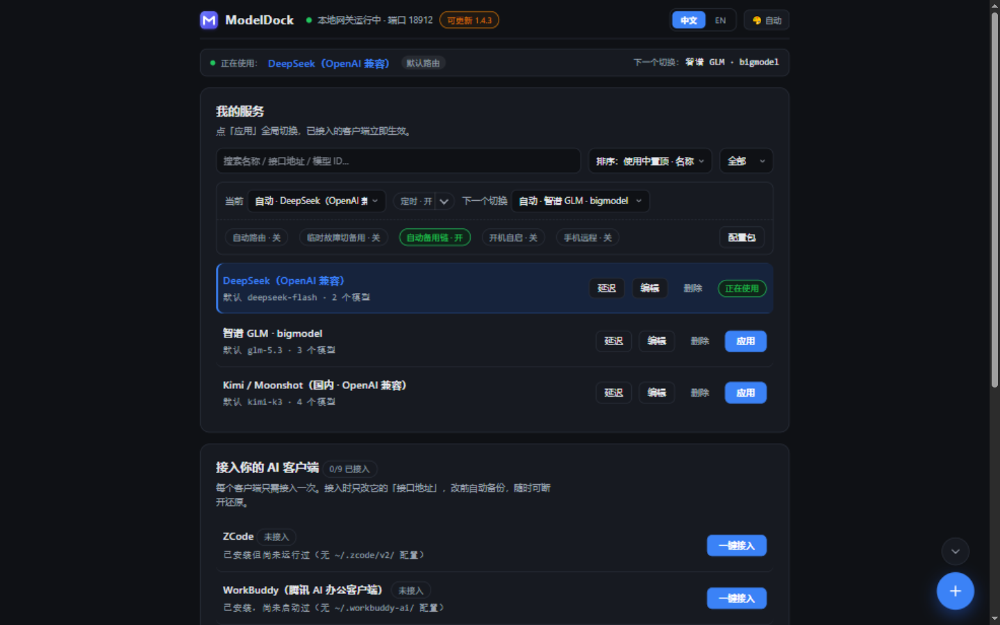

# ModelDock

**English** ｜ [简体中文](../../README.md)
<!-- i18n-slot: append new-language links on the line above (e.g. ｜ [日本語](../ja/README.md)); convention: .agents/conventions/docs-writing.md -->

[](https://github.com/ObsidianTrine/model_dock/actions/workflows/test.yml)
[](https://github.com/ObsidianTrine/model_dock/releases)
[](../../LICENSE)


**A local model configuration hub + API gateway**: keep every AI client's (Claude Code, ZCode, dsh, Codex, OpenCode, MiMo, WorkBuddy…) `base_url` + API key in one place. Point each client at the local gateway once — switching providers or model mappings then happens entirely on the ModelDock side, takes effect immediately, with zero client config changes.

## The problem it solves

- Every client keeps its own address and key: switching providers means editing each config and restarting each tool;
- Real upstream keys are scattered across client config files — hard to audit, easy to leak;
- When the primary service is rate-limited, down, or out of quota, traffic has nowhere to fall back.

ModelDock funnels everything through a gateway that listens on this machine only: **keys kept centrally, switches take effect immediately, upstream failures fail over automatically** — and until you explicitly attach, your existing configs are read-only and always revertible.



## How it works

```
AI clients (Claude Code / ZCode / dsh / Codex / ...)
   │  base_url → http://127.0.0.1:8687 + a local token
   ▼
ModelDock gateway (listens on 127.0.0.1 only)
   │  pick route → rewrite model aliases → inject real key
   ▼
Upstream APIs (Volcano Ark / DeepSeek / GLM / Kimi / OpenAI / ...)
```

## Core capabilities

| Area | What you get |
|------|--------------|
| **Switch in one place** | `modeldock profile use <name>` or one click in the console — every attached client switches instantly, zero config changes |
| **Failover & scheduled routing** | Primary unreachable / rate-limited / out of quota → traffic auto-fails over to other enabled services; change services by time of day (statutory holidays recognized automatically); pin a per-client service / model, or go "direct" past the gateway |
| **Key security** | Upstream keys live only in the local secure backend (macOS Keychain / Windows DPAPI / Linux Secret Service, with machine-bound-encryption fallback when no keyring exists); client configs contain only a local token; existing plaintext keys migrate automatically |
| **Non-invasive & revertible** | Before `attach`, your existing configs are read-only; every write to a client config is auto-snapshotted, `detach` / `restore` revert in one command |
| **Always-on** | `gateway install` registers auto-start with crash restart; a permanent macOS menu bar / Windows tray entry keeps the gateway running when the console window closes; "Lightweight mode" collapses everything to the tray |
| **Web & phone console** | Switching routes, scheduled switching, key replacement and onboarding new clients all have a GUI; on the same LAN, scan a QR code to open the compact phone console (off by default, one-click enable) |
| **Portability & multi-machine sync** | Export / import passphrase-encrypted config packages, or a 10-minute one-time share link; `modeldock sync setup` targets a WebDAV drive or a local sync folder — changes across your computers converge both ways, conflicts never lose data |
| **Upgrades & extensibility** | `modeldock update` downloads → verifies → replaces → restarts the gateway in one command; built-in adapters (Claude Code / ZCode / dsh / Codex / OpenCode / MiMo / WorkBuddy / generic env) plus declarative adapter packs for zero-code onboarding; existing configs import from cc-switch, claude-code-router, one-api / new-api and more |

## Quick start

### 1. Install

Download the package for your platform from [Releases](https://github.com/ObsidianTrine/model_dock/releases):

| Platform | Download | Notes |
|------|------|------|
| Windows | `modeldock-<version>-win32-x64-setup.exe` | Setup wizard: optional install path, PATH and shortcuts written automatically; portable `.zip` in the same release |
| macOS 13.0+ | `modeldock-<version>-darwin-x64.dmg` (Intel) / `-arm64.dmg` (Apple Silicon) | Drag into Applications; the `modeldock` CLI installs itself |
| Linux / CLI | `modeldock-<version>-linux-x64.tar.gz` / `-arm64.tar.gz` | Extract to a PATH directory, no Node.js needed |

```bash
# Linux / command-line install example
tar xzf modeldock-<version>-<platform>.tar.gz
chmod +x modeldock
sudo mv modeldock /usr/local/bin/     # or any other directory on your PATH
```

> SHA256 checksums for every artifact ship as `SHA256SUMS` on the Release. SmartScreen / Gatekeeper first-run allowance, uninstall and other details: [Usage guide · Installation & build](usage.md#2-installation--build).

### 2. First steps

**Fastest path** — a one-command wizard: it detects local clients and existing provider configs (10+ sources incl. cc-switch / Claude Code / Codex / claude-code-router), imports keys with your confirmation, sets the default route, starts the gateway in the background, and attaches clients one by one:

```bash
modeldock init
```

**Manual equivalent**:

```bash
modeldock provider add              # ① pick from the preset library (Volcano Ark / DeepSeek / GLM / Kimi / MiMo / OpenAI…), paste your key
modeldock profile use auto-<id>     # ② set the default route (add auto-creates auto-<id>; see modeldock profile list)
modeldock gateway start --daemon    # ③ start the local gateway in the background (127.0.0.1:8687)
modeldock attach claude-code        # ④ take over Claude Code (shows the diff first; writes after confirmation with an automatic snapshot)
```

After attaching, run `modeldock test` once for an end-to-end connectivity check (key / models / streaming / latency).

> Web console: with the gateway running, run `modeldock ui` (or open `http://127.0.0.1:8687` in a browser) — everything above has a GUI, and the top bar toggles Chinese / English anytime.

### Build from source (Node.js ≥22)

```bash
git clone https://github.com/ObsidianTrine/model_dock.git
cd model_dock && npm ci && npm run build
node dist/cli.js init     # first-run wizard; for development use `npm run dev -- <command>` to run the source directly
```

## Daily use

```bash
modeldock status                # overview: gateway / active profile / attach status per client
modeldock test                  # end-to-end connectivity self-test (key / models / streaming / latency)
modeldock doctor                # per-client health check; --fix applies fixes (sensitive ones confirm), --json for machines
modeldock gateway log -f        # gateway request logs (prompts are never logged)
modeldock profile use <name>    # switch provider — instant in gateway mode, zero client changes
modeldock gateway install       # auto-start on boot (resident): launches on login, restarts on crash
modeldock update                # one-command upgrade: download → verify → replace → auto-restart gateway (--check to look only)
modeldock model refresh <id>    # fetch the upstream model list automatically
modeldock config export         # move to a new computer: export a passphrase-encrypted package (services/routes/presets/schedules, keys included)
modeldock config import <file>  # import on the new computer: preview what will be replaced → confirm → auto-backup then apply
modeldock sync setup            # multi-machine auto-sync: target = WebDAV drive / local sync folder, changes converge both ways
modeldock detach <harness>      # restore the pre-attach original config
modeldock reset                 # reset config (snapshots kept, re-init later); --deep also clears logs, sync state and caches
modeldock uninstall             # uninstall the program (config & keys kept); --purge wipes everything including config
```

> Bilingual UI: CLI output and errors are Chinese by default; `modeldock --lang en` (anywhere in the command) switches to English. You can also set `MODELRDOCK_LANG=en`, or write `language = "en"` in config.toml to persist; the Web console toggles in the top bar anytime, and server-side messages such as errors follow along.

## Documentation

| Document | Contents |
|------|------|
| **[Usage guide](usage.md)** | Core concepts, installation details, full daily-operation walkthrough |
| [Config reference](config-reference.md) | Every `config.toml` key: type, default and description (generated from code, always in sync) |
| [New computer & multi-machine sync](multi-machine-sync.md) | Complete steps & troubleshooting for sync-folder onboarding |
| [Cloud deployment](deploy-cloud.md) | Self-hosted cloud sync hub runbook, manage all devices from one phone page |
| [Design doc](../design.md) (Chinese) | Architecture, ADRs, threat model |
| [AI pipeline guide](../ai-pipeline-guide.md) (Chinese) | End-to-end use of the autonomous pipeline: from a one-line intent to a release proposal — task in, merge out |
| [CI bots](../ci-bots.md) (Chinese) | GitHub Actions layered PR review & Dependabot: setup and usage (maintainers) |
| [AI review system](../ai-review-system.md) (Chinese) | Design & ops of layered code review: what each layer catches, how to keep improving |
| [Changelog](CHANGELOG.md) | User-visible changes in every release |
| 中文文档 | [简体中文版 README](../../README.md)（唯一事实来源） |

## Security

The gateway listens on `127.0.0.1` only and is not remotely accessible (by design); upstream keys live only in the local secure backend, and only local tokens appear in client configs; request logs record metadata only, never prompts. Full threat model and security design: [design doc §9](../design.md#9-安全设计) (Chinese). Found a security vulnerability? Please report it privately via the [security policy](SECURITY.md).

## Contributing

The repo ships with a built-in **Dockmaster** autonomous orchestration deck: contributors can hand off a task with one line (`/dockmaster have an agent do X`) — the dockmaster breaks it down, runs it headlessly, enforces test gates and merges the result. See the [Dockmaster manual](../../.agents/workflows/orchestrator.md).

Issues are welcome for bug reports and feature requests. Before submitting a PR, please read the [contributing guide](CONTRIBUTING.md) and [AGENTS.md](../../AGENTS.md) (engineering conventions and hard constraints, maintained in Chinese), and make sure `npm test` passes.

## Maintainer

[@ObsidianTrine](https://github.com/ObsidianTrine)

## License

[MIT](../../LICENSE) © ObsidianTrine
